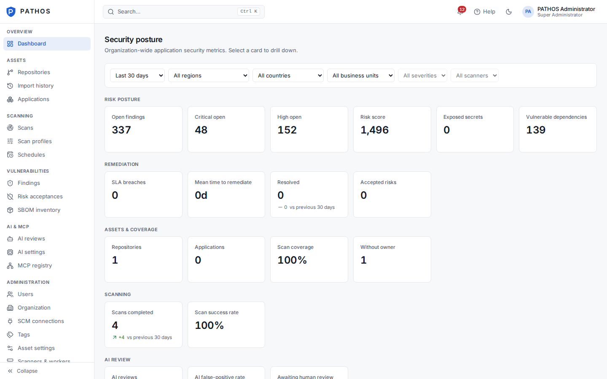
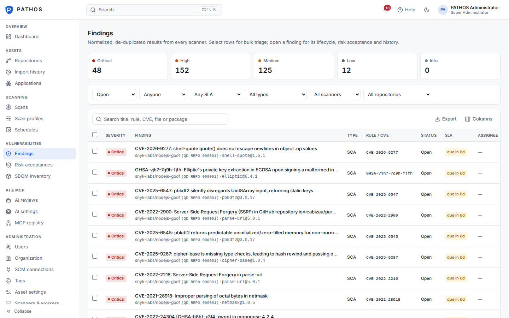

# PATHOS — open-source Application Security Posture Management (ASPM)

[](https://github.com/quditmind/pathos/releases/latest) [](https://github.com/quditmind/pathos/actions/workflows/ci.yml) [](LICENSE) [](docs/OPERATIONS.md#installing-a-release-signed-images)

**PATHOS is a self-hosted, open-source ASPM platform.** It runs SAST, SCA, secret scanning, IaC, container, DAST, mobile, binary and AI/LLM security checks in isolated workers, de-duplicates the findings, scores risk with EPSS, CISA KEV and reachability, and carries every application through a nine-phase security lifecycle: inventory, discovery, threat modelling, testing, remediation and continuous monitoring. It installs with Docker Compose, works fully air-gapped, and keeps AI optional, including local models through Ollama.

<p align="center">
  
  
</p>

> **Status: 3.0.2 (stable).** 3.0 adds the nine-phase application security lifecycle. The new modules are behind feature flags, off by default; an administrator turns them on under Administration › Feature flags. The platform phases P1–P8, the ten ASPM phases, the 1.1 gap closure and the 2.0–2.2 work are implemented and tested, all 100 [register](docs/aspm/PATHOS_FEATURE_GAP_ANALYSIS.md) capabilities included.

## Features

### Application security lifecycle (new in 3.0)

| Phase | What PATHOS does | Guide |
|---|---|---|
| Connect and inventory | Connectors hub for every integration with health checks; one onboarding flow that connects, registers, classifies and inventories an application | [Connectors](docs/user-guide/connectors.md), [Application onboarding](docs/user-guide/application-onboarding.md) |
| Discover | CodeGraph: services, API endpoints, data stores and data flows extracted from the code into a queryable graph | [CodeGraph](docs/user-guide/codegraph.md) |
| Threat model | STRIDE threats and attack paths generated from the CodeGraph, with mitigations linked to findings | [Threat models](docs/user-guide/threat-models.md) |
| Test | Scan profiles by kind of check (Quick, Standard, Comprehensive) across the worker images | [Security scanning](docs/user-guide/security-scanning.md) |
| Reverse engineer | Static analysis of your own builds (functions, imports, strings, sections), only for signed, attested or authorised artifacts | [Reverse engineering](docs/user-guide/reverse-engineering.md) |
| AI intelligence | Model per task, cross-phase correlation, AI threat suggestions and an evidence record for every AI decision; people approve | [AI security intelligence](docs/user-guide/ai-security-intelligence.md) |
| Remediate | Remediation workspace with owners, due dates and verification, plus security gates for IDE, pull request, CI, release and deploy | [Remediation](docs/user-guide/remediation.md) |
| Monitor | Continuous monitoring feed and architecture drift: new commits, dependency changes and new CVEs trigger re-assessment | [Monitoring](docs/user-guide/monitoring.md) |

### Scanning and findings

- **25 scan types**, from SAST, SCA and secrets to IaC, containers, API security, DAST, mobile (Android and iOS), fuzzing, licences, malware, binaries, AI/LLM and supply chain, with a live [coverage view](docs/user-guide/scan-coverage.md).
- **100 catalogued scanner integrations, 83 of them run in PATHOS worker images**: a core image plus ten opt-in family images (SAST, IaC, SCA, DAST, mobile, binary, AI, fuzzing, CodeGraph discovery, reverse engineering). Attack tools run only on targets authorised for intrusive testing. See the [scanner catalog](docs/SCANNER_CATALOG.md).
- **232 import formats from 207 tools**, SARIF included, de-duplicated with native results ([import history](docs/user-guide/import-history.md)).
- **Proof, not just findings**: function-level reachability with call paths, AI-proposed fixes verified by re-scanning (and optional sandboxed tests) before a pull request, opt-in live secret validation, and Kubernetes and registry runtime context.

### Risk, governance and teams

- Contextual 0–100 risk scores with EPSS, CISA KEV and OSV; attack paths, blast radius and posture by application, team or region.
- **Human Eye** manual review with evidence and independent approval; SLAs, risk acceptance, security policies and compliance views (OWASP Top 10, ASVS, PCI DSS, ISO 27001, SOC 2).
- SBOM export, VEX statements per application release, licence policy and malicious-package detection.
- Keycloak sign-in with TOTP, SAML or OIDC single sign-on, scoped RBAC, an audit log and optional multi-tenancy enforced by PostgreSQL row-level security ([multi-tenancy](docs/MULTI_TENANCY.md)).

### Developer workflow and integrations

- The `pathos` CLI, CI templates (GitHub Actions, GitLab CI, Azure Pipelines, Jenkins, pre-commit), [VS Code](docs/user-guide/ide-integration-vscode.md) and [JetBrains](docs/user-guide/ide-integration-jetbrains.md) plugins, pull request checks and secret push protection.
- GitHub, GitLab, Bitbucket Cloud and Azure DevOps; REST API, webhooks (Slack, Microsoft Teams), Jira, ServiceNow and an MCP server for AI assistants.
- AI review and the AI Security Analyst with Anthropic, OpenAI, xAI or a local model (Ollama). AI never decides on its own.

### Operations

- One host requirement: Docker Engine with Compose. Backup, restore and upgrade scripts, OpenTelemetry, S3-compatible artifact storage, rate limiting and security self-tests.
- Fully **air-gapped** installs with offline vulnerability data ([AIRGAP](docs/AIRGAP.md)).
- Every release image is signed with Sigstore cosign (keyless) and ships an SBOM and SLSA provenance. Published [benchmarks](docs/BENCHMARKS.md) and [performance measurements](docs/PERFORMANCE.md).

See [docs/DEVELOPMENT_ROADMAP.md](docs/DEVELOPMENT_ROADMAP.md) and [docs/aspm/PATHOS_IMPLEMENTATION_ROADMAP.md](docs/aspm/PATHOS_IMPLEMENTATION_ROADMAP.md) for the milestone reports.

## Installation

```bash
git clone https://github.com/quditmind/pathos.git && cd pathos
./deploy/scripts/install.sh    # generates .env with secrets and prints the admin login
docker compose up -d --wait
```

Then open https://localhost. Details: [docs/INSTALLATION.md](docs/INSTALLATION.md). This builds the images locally; to install a tested, cosign-signed release from GHCR instead, see [Installing a release](docs/OPERATIONS.md#installing-a-release-signed-images).

The only host requirement is Docker Engine with the Compose plugin. For production, see [docs/OPERATIONS.md](docs/OPERATIONS.md) (`docker-compose.prod.yml`).

## Development

```bash
make test               # Go and frontend unit tests (in containers)
make test-integration   # Go integration tests against a throwaway PostgreSQL
make smoke              # end-to-end API checks against the running stack
make e2e                # Playwright browser tests against the running stack
make security           # gosec, govulncheck, npm audit, Trivy, ZAP baseline
make load-test          # k6 load test (see docs/OPERATIONS.md)
```

CI (`.github/workflows/ci.yml`) runs all of the above on every pull request. It starts with fast checks (gofmt, vet, race-enabled unit and integration tests, gosec, govulncheck, the frontend build and npm audit), then does a fresh install of the full Compose stack, followed by the smoke test, the browser tests, Trivy on the built images and a ZAP baseline. Dependabot proposes weekly dependency updates.

## Documentation

**Using PATHOS** (also in the in-app Help Center):

| Document | Contents |
|---|---|
| [User guide](docs/user-guide/introduction.md) | Every module, step by step: repositories, scanning, findings, Human Eye, posture, AI, policies, integrations |
| [API reference](docs/api-reference/index.md) | Authentication, errors, pagination, and every REST endpoint with its permission |

**Application security lifecycle (3.0):**

| Document | Contents |
|---|---|
| [Connectors](docs/user-guide/connectors.md) | Every integration in one place, with health checks and troubleshooting |
| [Application onboarding](docs/user-guide/application-onboarding.md) | Connect, register, classify and inventory an application in one flow |
| [CodeGraph](docs/user-guide/codegraph.md) | Discovery of services, endpoints and data flows |
| [Threat models](docs/user-guide/threat-models.md) | STRIDE threats and attack paths from the CodeGraph |
| [Reverse engineering](docs/user-guide/reverse-engineering.md) | Static analysis of your own builds |
| [AI security intelligence](docs/user-guide/ai-security-intelligence.md) | AI evidence log, model per task, correlation, threat suggestions |
| [Remediation](docs/user-guide/remediation.md) | Remediation workspace and security gates |
| [Monitoring](docs/user-guide/monitoring.md) | Continuous monitoring feed and architecture drift |
| [Feature flags](docs/user-guide/administration.md#feature-flags) | Turning the 3.0 modules on per organization |

**Installing and operating:**

| Document | Contents |
|---|---|
| [INSTALLATION](docs/INSTALLATION.md) | Install, what runs, configure, verify |
| [OPERATIONS](docs/OPERATIONS.md) | Production deployment, releases, backup/restore/upgrade, scaling, monitoring, configuration reference, rate limits, object storage, malware scanning, AI options, self-tests |
| [AIRGAP](docs/AIRGAP.md) | Air-gapped installation with offline vulnerability data |
| [SECURITY](docs/SECURITY.md) | Implemented security controls, key rotation |
| [RBAC_MATRIX](docs/RBAC_MATRIX.md) | Roles, scopes, permission matrix |

**Design and engineering:**

| Document | Contents |
|---|---|
| [ARCHITECTURE](docs/ARCHITECTURE.md) | System design, isolation model, deployment, decisions, sizing, extension points |
| [DATABASE](docs/DATABASE.md) | Schema and migrations |
| [SCANNING_MODULE](docs/SCANNING_MODULE.md) | Scan executions, schedules and comparison: design notes |
| [REPOSITORY_ONBOARDING](docs/REPOSITORY_ONBOARDING.md) | Repository onboarding: design notes |
| [HUMAN_REVIEW](docs/HUMAN_REVIEW.md) | Human Eye: design notes |
| [SCANNER_CATALOG](docs/SCANNER_CATALOG.md) | Implemented scanners, licensing review, scan types, adding tools with manifests |
| [BENCHMARKS](docs/BENCHMARKS.md) | Detection quality on suites with known answers: method, results, limitations, how to reproduce |
| [DEPENDENCIES](docs/DEPENDENCIES.md) | Dependencies, versions and licenses |
| [OpenAPI](backend/api/openapi.yaml) | OpenAPI 3.1 description |

**Roadmaps and history:**

| Document | Contents |
|---|---|
| [ASPM roadmap](docs/aspm/PATHOS_IMPLEMENTATION_ROADMAP.md) | ASPM phases 1–10 and their completion reports |
| [ASPM register](docs/aspm/PATHOS_FEATURE_GAP_ANALYSIS.md) | The 100 target capabilities and their status |
| [DEVELOPMENT_ROADMAP](docs/DEVELOPMENT_ROADMAP.md) | Original platform build (phases P1–P8) and milestone reports |
| [CHANGELOG](CHANGELOG.md) | Changes per release |

## Contributing and security

Contributions are welcome: see [CONTRIBUTING.md](CONTRIBUTING.md) and the [Code of Conduct](CODE_OF_CONDUCT.md). Please report vulnerabilities privately, as described in [SECURITY.md](SECURITY.md).

## License

PATHOS is licensed under the [Apache License 2.0](LICENSE). Third-party scanners and images keep their own licenses; see [DEPENDENCIES](docs/DEPENDENCIES.md) and [SCANNER_CATALOG](docs/SCANNER_CATALOG.md).
