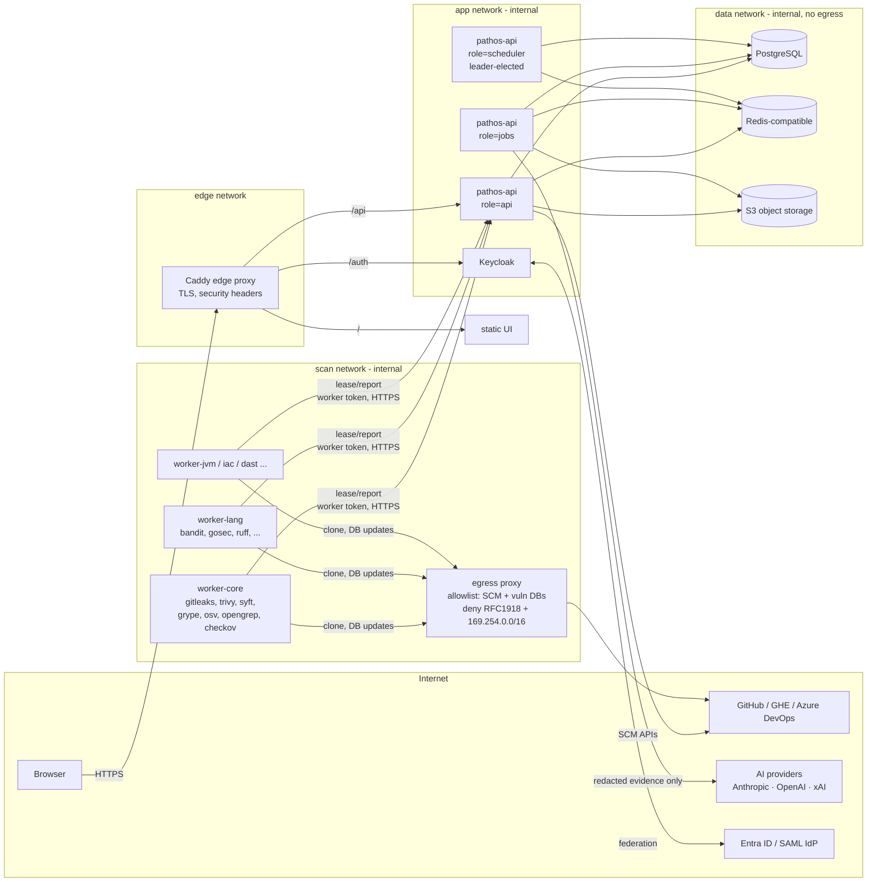

# PATHOS Architecture

Status: **Phase 6 implemented** for the vulnerability lifecycle (DB-enforced history, SLAs, risk acceptance, SBOM inventory). **Phase 5 implemented** for §6 (AI review, interactive MCP mode). **Phase 4 implemented** for §5 (scanner isolation: worker pools, lease API, egress proxy; raw reports are stored in PostgreSQL until object storage lands in Phase 8). **Phase 1 implemented** for §1 (api/jobs roles; scheduler is Phase 7), §3 (layout), §4 (authentication and authorization), §7 (deployment, minus SeaweedFS, workers and egress, which come in Phase 4), §8 (UI shell) and the envelope encryption in §9. Everything else is still design.

## 1. Architectural style

PATHOS is a **modular monolith** (Go) with **separately deployed scanner workers**:

| Responsibility | Runtime unit | Scales by |
|---|---|---|
| Web UI | `frontend` (static build served by edge proxy) | CDN/proxy replicas |
| REST API, auth, RBAC, scheduling, AI review, notifications | `pathos-api` (Go) | Horizontal replicas (stateless; sessions in Redis) |
| Background jobs (AI review, notifications, ingestion) | `pathos-api --role=jobs` (same binary) | Replicas, independent from API |
| Scanner execution | `pathos-worker` inside per-family worker images | Replicas per worker family |
| Identity | Keycloak | Keycloak clustering (later) |
| Relational data | PostgreSQL | Vertical; read replicas later |
| Queue, sessions, locks, rate limits | Redis-compatible store | Vertical |
| Raw reports, SBOMs | S3-compatible object storage | Storage backend |

The same Go binary runs in `api`, `jobs` or `scheduler` role (`--role`). This gives independent scaling without a microservice mesh. Modules talk through Go interfaces inside the binary. Only the **worker boundary** is a network boundary, because it is a **trust boundary**.

## 2. System diagram



Key properties:

- Workers **never** connect to PostgreSQL, Redis, S3 or Keycloak, and never receive platform secrets. They speak a narrow internal API (`/internal/worker/v1/*`: lease job, heartbeat, upload results, report status), authenticated with a per-worker credential scoped to those calls only.
- Workers have no route to `app`/`data` networks except the API's internal listener, and no direct internet access. Outbound traffic goes through the egress proxy. The proxy allowlists SCM hosts and vulnerability-DB mirrors, and denies private ranges and cloud metadata (`169.254.169.254`, `fd00:ec2::254`).
- PostgreSQL, Redis, S3 and worker ports are never published to the host.

## 3. Proposed repository layout

```
PATHOS/
├── docker-compose.yml            # `docker compose up -d` entry point (pinned images)
├── docker-compose.prod.yml       # production overrides (resources, replicas, no dev tools)
├── .env.example
├── Makefile                      # dev shortcuts (all targets run in containers)
├── backend/                      # Go module
│   ├── cmd/
│   │   ├── pathos/               # api | jobs | scheduler roles
│   │   ├── pathos-worker/        # worker agent, embedded in worker images
│   │   └── pathosctl/            # migrate, bootstrap, key rotation, backup helpers
│   ├── internal/
│   │   ├── platform/             # config, logging (slog), db (pgx), redis, objstore, crypto, otel, httpx
│   │   ├── auth/                 # OIDC (BFF), sessions, CSRF
│   │   ├── authz/                # roles, permissions, scope resolution, policy checks
│   │   ├── identity/             # users, teams, provisioning
│   │   ├── org/                  # organizations, regions, countries, business units
│   │   ├── audit/
│   │   ├── repos/  scm/{github,azuredevops}/  tags/
│   │   ├── scanners/             # catalog + Adapter interface + adapters/<tool>/
│   │   ├── profiles/  scans/  jobs/  scheduler/
│   │   ├── findings/  sbom/  sla/
│   │   ├── ai/                   # Provider interface, providers/{anthropic,openai,xai}, review pipeline, redaction
│   │   ├── mcp/                  # MCP server registry + PATHOS MCP server
│   │   ├── notify/               # SMTP, templates, delivery history
│   │   └── dashboard/  search/
│   ├── migrations/               # versioned SQL migrations
│   ├── queries/                  # sqlc query files
│   └── api/openapi.yaml          # source of truth for REST API
├── frontend/                     # Vite + React + TS + Tailwind + shadcn/ui
│   └── src/{app,components/ui,components/layout,features/*,lib,api}
├── workers/                      # Dockerfile per worker family + tool version manifest
├── deploy/
│   ├── caddy/Caddyfile
│   ├── keycloak/pathos-realm.json
│   ├── egress/                   # egress proxy allowlist
│   └── scripts/{install,backup,restore,upgrade}.sh
└── docs/
```

## 4. Authentication and authorization design

- **Backend-for-frontend (BFF) OIDC.** `pathos-api` runs the Authorization Code + PKCE flow against Keycloak. The browser receives only an opaque `HttpOnly; Secure; SameSite=Lax` session cookie. Access and refresh tokens stay server-side in Redis, so no tokens are ever exposed to JavaScript. State-changing requests require a CSRF token (synchronizer token bound to the session).
- **Keycloak** handles local login, MFA, password policy, Entra ID (OIDC) and generic SAML federation. A `pathos` realm is imported on first start. The initial administrator is created from `.env` with a forced password change.
- **Authorization lives in PATHOS, not Keycloak.** Scoped role assignments (`user × role × scope`, where scope ∈ organization / region / business unit / repository) are stored in PostgreSQL. Keycloak groups can be mapped to PATHOS role assignments for automatic provisioning. Every handler declares a required permission. List queries are filtered by the caller's resolved scopes in SQL, not post-filtered. The frontend hides menus as a courtesy only.
- Users are provisioned just-in-time on first login, and also through the admin UI and Keycloak admin API. Deactivation revokes PATHOS sessions immediately.

## 5. Scanner execution and isolation

Each scan job is processed in stages inside a worker container:

1. **Lease.** The worker leases a job over the internal API. The response includes repo URL, ref, profile scanners and a **short-lived** clone credential (GitHub App installation token ≤1h; for Azure DevOps, the narrowest available token).
2. **Fetch.** `git clone --depth` with hooks disabled, `protocol.file.allow=never`, no submodule recursion by default, `core.fsmonitor` off, size limits. The credential is then wiped from memory and from git config.
3. **Scan.** Each adapter runs as a non-root process in a per-job `tmpfs` workspace with a timeout (process-group kill) and memory limits. **Repository code is never built or executed.** Tools that require a build (CodeQL compiled languages, SpotBugs, Infer) are flagged `requires_build` and disabled unless an administrator explicitly enables a hardened build sandbox (future phase).
4. **Report.** The worker uploads raw output and normalized findings, then destroys the workspace.

Container hardening for all workers: read-only root filesystem, `cap_drop: [ALL]`, `no-new-privileges`, non-root UID, seccomp default profile, `pids`/memory/CPU limits, **no Docker socket**. The optional gVisor (`runsc`) runtime is supported for stronger isolation.

**Decision (vs. a per-scan-container dispatcher):** spawning a container per scan needs Docker API access, which is root-equivalent on the host. That conflicts with the requirement that nothing scan-facing touches the Docker socket. Long-running hardened worker pools are the safer default for Compose. A Kubernetes Job backend can be added later behind the same lease API.

### Adapter interface (sketch)

```go
type Adapter interface {
    ID() string
    CheckAvailable(ctx context.Context) error
    Version(ctx context.Context) (string, error)
    ValidateConfig(cfg json.RawMessage) error
    Run(ctx context.Context, in RunInput) (RunOutput, error) // honours ctx deadline
    Parse(raw io.Reader) ([]NormalizedFinding, error)
}
```

Most tools emit SARIF, so a shared SARIF parser covers the majority of adapters. Tools with custom JSON get a dedicated parser.

## 6. AI review architecture

- Every vendor implements `ai.Provider` (`Review(ctx, ReviewRequest) (ReviewResult, error)`, `Models()`, `Validate()`). The scanning engine only emits "finding ready for review" events and never imports a provider.
- Pipeline: normalize → dedupe/fingerprint → **redact** (secret patterns + Gitleaks matches + configured policies) → evidence extraction (snippet ± N lines, metadata) → prompt assembly, with untrusted content fenced and labeled as data → provider call → **strict JSON schema validation** → store `ai_reviews` with model, model version, configuration version, and a hash of exactly what was transmitted → human approval when policy requires it.
- AI is never on the critical path. If no provider is configured or a call fails, findings stay `pending_ai_review` and scanning continues.
- Guardrail: a Critical finding is **never** auto-closed on an AI "False Positive" verdict. It moves to "Needs human review".

### Claude authentication: what is and isn't allowed

- A Claude Pro/Max subscription **does not** provide API access. Anthropic's terms restrict subscription OAuth tokens to Claude Code and claude.ai, and prohibit their use in third-party products or the Agent SDK. PATHOS will **not** extract, proxy or reuse subscription credentials.
- **Automated mode** uses an Anthropic Console API key, or Claude through a supported cloud provider (Amazon Bedrock, Google Vertex AI). OpenAI and xAI use their own API keys.
- **Interactive mode** (permitted for a human's own subscription): PATHOS exposes its own **MCP server** with tools such as `list_pending_findings`, `get_finding_evidence` (redacted) and `submit_review`. It authenticates with a user-scoped PATHOS API token. A security engineer adds it to *their own* Claude Code session and reviews findings interactively. Claude Code runs as Claude Code under the user's own login, and PATHOS only receives the structured results. Reviews are attributed to the human and tagged `source=interactive_mcp`.

## 7. Docker deployment architecture

| Service | Image (pin resolved in Phase 1) | Networks | Published port | Volume |
|---|---|---|---|---|
| `proxy` | Caddy 2.x | edge, app | 443/80 | `caddy_data` |
| `frontend` | built into proxy image (static) | — | — | — |
| `api` | `pathos` (distroless static) | app, data, worker-api | — | — |
| `jobs` | `pathos` | app, data | — | — |
| `scheduler` | `pathos` | app, data | — | — |
| `migrate` | `pathos` (one-shot `pathosctl migrate`) | data | — | — |
| `keycloak` | Keycloak 26.x | app, kc-data | — | — |
| `postgres` | PostgreSQL (two databases: `pathos`, `keycloak`) | data, kc-data | — | `pg_data` |
| `redis` | Valkey/Redis | data | — | `redis_data` |
| `objectstore` | SeaweedFS (S3 API) | data | — | `s3_data` |
| `worker-core` etc. | `pathos-worker-<family>` | scan, worker-api | — | `scanner_cache` (vuln DBs) |
| `egress` | egress proxy (Squid or Smokescreen) | scan, edge | — | — |
| `mailpit` | Mailpit (dev profile only) | app | 8025 (dev) | — |

- Health checks on every service. `depends_on: condition: service_healthy` orders startup. `migrate` runs to completion before `api` starts.
- `docker compose up -d` is idempotent. Migrations are versioned and forward-only. Realm import uses `IGNORE_EXISTING`. Named volumes persist across `down`/`up`. Only `down -v` destroys data, and the docs warn about it.
- Secrets come from `.env`, or from Docker secrets files in production. `install.sh` generates strong random values. Nothing secret is baked into images.

## 8. UI design plan

- **Visual language:** a light enterprise theme. Neutral slate greys, white surfaces, one professional blue accent (`#1F5FD6`-range, tuned for WCAG AA), and semantic severity colours (Critical red, High orange, Medium amber, Low blue-grey, Info grey) used consistently in badges, charts and tables. Dark mode uses the same token set (CSS variables, shadcn convention).
- **Typography:** Inter (OFL) with tabular numerals for metrics, and a 13–14px base for density.
- **Layout:** a compact collapsible left rail (icons + labels, grouped: Overview, Assets, Scanning, Findings, AI & MCP, Administration). A 56px header carries global search (⌘K command palette), organization switcher, notification centre and user menu. Content uses a max-width grid with 1px borders and minimal shadow.
- **Components:** a shadcn/ui-based design system (`components/ui`) plus PATHOS composites: `DataTable` (server-side pagination/sort/filter, column chooser, saved views, CSV export), `FilterBar`, `KpiCard` (value, delta, sparkline, drill-down link), `SeverityBadge`, `StatusPill`, `EmptyState`, `Skeleton` loaders, `ConfirmDialog`, and `AuditTrail`.
- **Dashboard:** a filter bar (date range, region, country, BU, application, repository, severity, scanner, status, technology) drives 24 KPI cards (6×4 grid on desktop) and chart panels. Every card links to a pre-filtered findings, scans or repos table. All values come from aggregate API endpoints.
- **Branding:** the PATHOS wordmark plus a shield/path glyph as an SVG logo and favicon, used on the login theme (a custom Keycloak login theme to match), the app shell and email templates.

## 9. Architectural decisions and risks

| # | Decision / risk | Resolution |
|---|---|---|
| D1 | **MinIO Community Edition is archived** (no images since Oct 2025, maintenance mode Dec 2025, repo archived 2026). | Default object store: **SeaweedFS** (Apache-2.0, S3 API). PATHOS codes against the generic S3 API (`aws-sdk-go-v2`), so any S3-compatible store (Garage, RustFS, Ceph RGW, AWS S3) works. |
| D2 | **Redis 8 is tri-licensed AGPLv3/RSALv2/SSPL.** AGPL is OSI-approved and fine for unmodified use as a service, but some organizations ban it. | Default image: **Valkey** (BSD-3, Redis-protocol compatible). Redis 8 is supported by changing one image line. The Go client (`go-redis`) works with both. *Needs your confirmation, because the brief says "Redis".* |
| D3 | Workers must not hold platform secrets or a Docker socket. | Workers pull jobs over a narrow HTTP lease API, not directly from Redis (§5). |
| D4 | Claude subscription cannot power automated reviews. | API key / cloud provider for automation, plus the interactive MCP mode (§6). |
| D5 | **Semgrep Registry rules** are under the Semgrep Rules License, which restricts redistribution in products. | Use **Opengrep** (LGPL-2.1 fork) as the default Semgrep-compatible engine. Ship only rules with permissive licenses, or let admins point to their own rule sets. Semgrep CE is an optional adapter. |
| D6 | **CodeQL** CLI is free only for OSS and academic use; private commercial code needs GitHub Advanced Security. | Catalog entry marked `license_restricted`. Disabled until an admin attests to licensing. |
| D7 | Archived or abandoned tools from the brief: **Whispers, Dredd, Terrascan** (archived); **Tern** (no commits since 2024); OWASP Dependency-Check's original repo archived (project moved: verify). | Excluded or replaced (see SCANNER_CATALOG.md). |
| D8 | Non-scanners in the brief: Cosign, in-toto, SLSA verifier, GUAC, CycloneDX CLI, SPDX tools. | Catalogued as **supply-chain verification / SBOM utilities**, not counted as scanners. |
| D9 | Repos are untrusted input; build-requiring analyzers execute code. | Never build by default; `requires_build` tools stay off until a hardened build sandbox exists. |
| D10 | Azure DevOps lacks GitHub-App-style short-lived tokens. | Prefer Entra ID service principal / workload identity tokens. Fall back to a narrowly scoped PAT (Code: Read) encrypted at rest, with an expiry reminder. |
| R1 | 50+ scanners mean large worker images (JVM, Python, Node toolchains). | Split worker families. Admins deploy only the families their profiles use. |
| R2 | Vulnerability DB downloads (Trivy, Grype, OSV) are large and rate-limited. | Shared `scanner_cache` volume plus scheduled DB refresh. Offline/air-gapped mirror support later. |
| R3 | Scope of brief vs. delivery time. | Strict milestone delivery. Every phase ends with working, tested, documented functionality. |

Secrets at rest use **envelope encryption**: AES-256-GCM data keys wrapped by a master key from `PATHOS_MASTER_KEY` (a Docker secret in production). `pathosctl rotate-master-key` handles rotation. This applies to SCM tokens, AI keys, MCP credentials and SMTP passwords, and each class is stored separately.

## 10. Resource requirements

| Profile | Users / repos | vCPU | RAM | Disk |
|---|---|---|---|---|
| Development (this host) | — | 4+ | 8–12 GB for the full stack | 40 GB |
| Small production | ≤200 users, ≤500 repos | 8 | 16 GB | 200 GB SSD |
| Medium production | ≤1,000 users, ≤3,000 repos | 16 | 32 GB | 500 GB SSD |
| Large | 1,000+ users | Split DB to its own host. Add worker hosts (each 8 vCPU / 16 GB runs about 4 concurrent scans) |

Baseline footprint without workers is about 3 GB (Keycloak ~1 GB, PostgreSQL ~0.5–1 GB, API ~200 MB, Valkey/SeaweedFS ~300 MB). Each concurrent scan needs 1–4 GB (Opengrep and JVM tools at the high end). Vulnerability DB cache is about 5 GB.

This host (20 CPUs, 30 GB RAM, 862 GB free) comfortably runs the full stack plus 4–6 concurrent scans.
