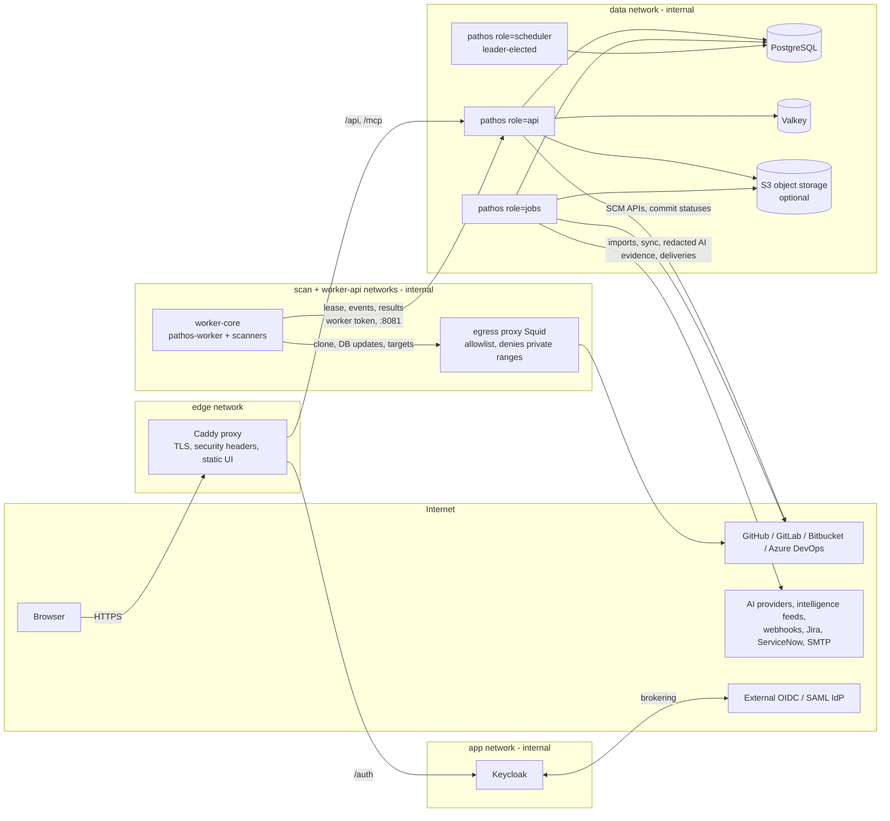

# PATHOS Architecture

How PATHOS is built and why. This page describes the system as it is today. Related pages:

- [DATABASE.md](DATABASE.md): the schema.
- [SECURITY.md](SECURITY.md): the security controls in detail.
- [SCANNING_MODULE.md](SCANNING_MODULE.md), [HUMAN_REVIEW.md](HUMAN_REVIEW.md) and [REPOSITORY_ONBOARDING.md](REPOSITORY_ONBOARDING.md): design notes per module.
- [INSTALLATION.md](INSTALLATION.md) and [OPERATIONS.md](OPERATIONS.md): running it.
- [aspm/](aspm/PATHOS_IMPLEMENTATION_ROADMAP.md): the ASPM programme (risk engine design, roadmap and register).

## 1. Architectural style

PATHOS is a **modular monolith** (Go) with **separately deployed scanner workers**:

| Responsibility | Runtime unit | Scales by |
|---|---|---|
| Web UI | Static React build, served by the `proxy` (Caddy) | Proxy replicas |
| REST API, authentication, RBAC, MCP server, ingestion of scan results | `pathos --role=api` | Replicas (stateless; sessions and rate limits in Valkey) |
| Background work: AI reviews, notifications and outbound webhooks, repository imports and sync, intelligence feeds, risk scoring, policies, ticket sync, retention | `pathos --role=jobs` (same binary) | Replicas, independent from the API |
| Scan scheduling, missed-run and offline-worker detection, lease recovery, platform metrics | `pathos --role=scheduler` (same binary, leader-elected) | Standby replicas |
| Scanner execution | `pathos-worker` agent inside the `worker-core` image | Replicas |
| Identity | Keycloak | Single instance in Compose |
| Relational data and job queues | PostgreSQL (`FOR UPDATE SKIP LOCKED` queues) | Vertical |
| Sessions, OIDC state, rate limits | Valkey | Vertical |
| Scan artifacts and source snapshots (optional) | S3-compatible object storage | Storage backend |

The same Go binary runs in the `api`, `jobs` or `scheduler` role (`PATHOS_ROLE`). This gives independent scaling without a microservice mesh. Modules talk through Go interfaces inside the binary. Only the **worker boundary** is a network boundary, because it is a **trust boundary**.

## 2. System diagram



Key properties:

- Workers **never** connect to PostgreSQL, Valkey, object storage or Keycloak, and never receive platform secrets. They speak a narrow internal API (`/internal/worker/v1/*`: register, lease, heartbeat, events, results, imports, complete, source snapshot, target file) on the API's worker listener (`:8081`), authenticated with a per-worker token.
- Workers have no route to the `app` and `data` networks and no direct internet access. Their traffic goes through the egress proxy, which allows only the hosts in `deploy/egress/allowlist.txt` and denies private ranges and cloud metadata addresses.
- The proxy never forwards `/internal/*` or `/healthz`. PostgreSQL, Valkey, object storage and the worker listener are never published to the host.

## 3. Repository layout

```
PATHOS/
├── docker-compose.yml           # `docker compose up -d` entry point (digest-pinned images)
├── docker-compose.prod.yml      # production overrides (limits, log rotation, standby scheduler)
├── docker-compose.gpu.yml       # NVIDIA GPU for the optional Ollama profile
├── .env.example                 # every setting, documented
├── Makefile                     # dev shortcuts (toolchains run in containers)
├── backend/                     # Go module
│   ├── cmd/pathos/              # api | jobs | scheduler roles
│   ├── cmd/pathos-worker/       # worker agent, built into worker-core
│   ├── cmd/pathosctl/           # migrate, keys, artifacts, RBAC matrix
│   ├── internal/                # one package per module (see below)
│   ├── migrations/              # goose SQL migrations 00001…
│   ├── api/openapi.yaml         # OpenAPI 3.1 description
│   └── test/integration/        # integration tests against PostgreSQL
├── frontend/                    # Vite + React + TypeScript + Tailwind
│   └── src/{app,api,components/{ui,layout,data},features/*,lib}
├── workers/                     # worker-core Dockerfile, PATHOS baseline Opengrep rules, rules-extra mount
├── deploy/                      # caddy, egress (Squid), keycloak (realm, theme, setup.sh),
│                                # postgres init, scanners.d (plugins), security (ZAP), scripts/
├── scripts/                     # smoke, e2e, security, DAST, load, offline bundles, SSO test
├── e2e/                         # Playwright tests
└── docs/
```

Backend packages (`backend/internal`):

| Area | Packages |
|---|---|
| Platform | `platform/{config,crypto,db,httpx,logging,objstore,ratelimit,sourcestore,telemetry}`, `server`, `secrets`, `audit` |
| Identity and access | `auth` (OIDC, sessions, CSRF, API tokens), `authz` (permissions, roles, scopes), `identity` (users, teams, MFA), `org` |
| Assets | `repos` (repositories, imports, uploads, sync, inventory), `scm` (provider clients, SSRF-safe HTTP), `ingest` (archive normalisation, ClamAV) |
| Scanning | `scanners` (catalog, parsers, plugins), `scans` (profiles, executions, ingestion, targets, PR checks), `schedule`, `worker` (agent) |
| Findings and intelligence | `vuln` (lifecycle, SLA, risk acceptance, SBOM, suppression), `intel` (EPSS, KEV, OSV, deps.dev), `risk`, `reach`, `posture` |
| Review and AI | `review` (Human Eye), `ai`, `analyst`, `mcp` |
| Governance and reporting | `policy`, `compliance`, `reporting`, `dashboard`, `search` |
| Integrations | `notify` (notifications, SMTP, outbound webhooks), `tickets` (Jira, ServiceNow) |

## 4. Authentication and authorization

- **Backend-for-frontend (BFF) OIDC.** The API runs the Authorization Code + PKCE flow against Keycloak. The browser receives only an opaque, `HttpOnly` session cookie. Tokens stay server-side, so none are exposed to JavaScript. State-changing requests need a CSRF token bound to the session.
- **Keycloak** handles local login, TOTP MFA, recovery codes, password policy and brokering to external OIDC or SAML 2.0 identity providers. The `pathos` realm is imported on first start; the `keycloak-setup` job applies the settings the import cannot (recovery codes) on every start.
- **Authorization lives in PATHOS, not Keycloak.** Scoped role assignments (`user × role × scope`, where the scope is the organization, a region, a business unit or a repository) are stored in PostgreSQL. Every handler declares a required permission. List queries are filtered by the caller's scopes in SQL, not post-filtered. The frontend hides menus as a courtesy only. See [RBAC_MATRIX.md](RBAC_MATRIX.md).
- **Personal API tokens** (`pathos_pat_…`) authenticate the MCP server and, with the `api:read` or `api:write` scope, the REST API. They act with the owner's current permissions.
- Users are provisioned just in time on first login (linked to an invitation only when the e-mail address is verified) or invited by an administrator. Deactivation revokes PATHOS sessions immediately.

The controls are listed in [SECURITY.md](SECURITY.md#authentication).

## 5. Scanner execution and isolation

Each scan job is processed in stages inside a worker container:

1. **Lease.** The worker leases a job over the internal API. The response includes the repository URL and ref (or the scan target), the profile's scanners and configuration, and a **short-lived** clone credential: a GitHub App installation token (≤ 1 hour) or the connection's stored credential. Uploaded repositories are fetched instead as a source snapshot through the worker API, which decrypts it; the worker verifies its SHA-256.
2. **Fetch.** A shallow `git clone` with hooks disabled, no `file://` or `ext::` transports, no symlinks, fsck on, no redirects and a size cap. The credential travels in environment variables, never in the URL or `.git/config`. `.git` is removed before the scanners run.
3. **Scan.** Each tool runs as a non-root process in its own process group, in a per-job `tmpfs` workspace, with a timeout that kills the whole group. **Repository code is never built or executed.** Catalogue entries that need a build (CodeQL for compiled languages, SpotBugs, Infer) are flagged `requires_build` and have no adapter.
4. **Report.** The worker uploads the raw reports (and its code inventory for reachability), the API parses and normalises them, and the workspace is destroyed.

Container hardening: read-only root filesystem, `cap_drop: [ALL]`, `no-new-privileges`, non-root UID, PID and memory limits, **no Docker socket**.

**Decision (versus a dispatcher that starts a container per scan):** starting containers needs Docker API access, which is root-equivalent on the host. That conflicts with the rule that nothing scan-facing touches the Docker socket. Long-running hardened worker pools are the safer default for Compose.

### Adapters

- **On the worker,** each tool implements `worker.Tool` (`Version`, `Run`) and writes its report; tools that only apply to some repositories (zizmor, actionlint without workflows) report themselves as skipped.
- **On the API,** `backend/internal/scanners` parses the reports. Most tools emit SARIF, so a shared SARIF parser covers them; Grype, Nuclei and actionlint have dedicated parsers. Parsing never runs on the worker.
- **Adding a built-in engine** means a catalogue entry (`scanners/catalog.go`), a tool in `worker/tools.go`, a parser if the tool has no SARIF, and the binary in the worker image.
- **Without code changes,** operators can add SARIF-producing tools as declarative plugins on the worker ([SCANNER_CATALOG.md](SCANNER_CATALOG.md#declarative-scanner-adapters-plugins)), and any tool's SARIF or JSON can be imported ([API: result imports](api-reference/result-imports.md)).

### Scan targets and pull requests

The same workers scan container images, web applications and APIs (Nuclei), uploaded SBOMs (Grype) and build artifacts (Trivy). Targets have no clone: the worker reaches the target through the egress proxy and first checks that the proxy allows it. Pull request scans run the repository's profile on the PR head and keep their results apart from the repository's findings.

## 6. AI review architecture

- Every vendor implements one provider interface: Anthropic (official Go SDK), OpenAI, xAI, and self-hosted OpenAI-compatible servers (Ollama, vLLM and similar). The scanning engine only queues findings for review and never calls a provider.
- Pipeline: normalise → fingerprint → **redact** (secret patterns, Gitleaks matches, organization patterns) → evidence (metadata plus at most ±5 lines of code, none for secret findings) → prompt with the untrusted evidence fenced by a random nonce → provider call → **strict JSON schema validation** → stored review with model, configuration version and the SHA-256 of exactly what was sent → human approval when the policy requires it.
- AI is never on the critical path. If no provider is configured or a call fails, scanning continues and the finding keeps its status.
- Guardrails: a Critical finding is **never** closed on an AI "false positive" verdict, and AI never overrides a human decision.
- The AI Security Analyst, AI reports and Human Eye assistance use the same request path (default configuration, redaction, fencing, SHA-256 of the payload).

### Claude subscriptions

- A Claude Pro or Max subscription **does not** provide API access, and its credentials may not be used in third-party products. PATHOS does not extract, proxy or reuse them.
- **Automated mode** uses a provider API key (or a self-hosted model).
- **Interactive mode** works with a person's own subscription: PATHOS exposes its own **MCP server** (`/mcp`, tools `list_pending_findings`, `get_finding_evidence`, `submit_review`), authenticated with a personal API token. The person adds it to *their own* Claude Code session; PATHOS only receives the structured results, attributed to the person with `source=interactive_mcp`.

## 7. Docker deployment architecture

What each service does is listed in [INSTALLATION.md](INSTALLATION.md#what-runs). Networks, ports and volumes:

| Service | Networks | Published port | Volumes |
|---|---|---|---|
| `proxy` | edge, app | 443, 80 | `caddy_data`, `caddy_config` |
| `migrate` (one-shot) | data | — | — |
| `api` | app, data, edge, worker-api | — | `sources` |
| `jobs` | data, edge | — | `sources`, `import_work` |
| `scheduler` | data | — | — |
| `postgres` | data | — | `pg_data` |
| `valkey` | data | — | `redis_data` |
| `keycloak` | app, data, edge | — | — |
| `keycloak-setup` (one-shot) | app | — | — |
| `egress` | scan, edge | — | `egress_logs` |
| `worker-core` | scan, worker-api | — | `scanner_cache` (vulnerability databases) |
| `mailpit` (profile `dev`) | app, edge | 127.0.0.1:8025 | — |
| `objectstore` (profile `objectstore`) | data | — | `s3_data` |
| `clamav` (profile `clamav`) | data, edge | — | `clamav_db` |
| `ollama` (profile `ollama`) | data, edge | — | `ollama_models` |
| `otel-lgtm` (profile `observability`) | data, edge | 127.0.0.1:3001 | — |

- `app`, `data`, `scan` and `worker-api` are internal networks (no route to the internet). `edge` is the only network with outbound access; `jobs`, `api` and `keycloak` use it for provider APIs, feeds and identity federation.
- Health checks on every long-running service. `depends_on: condition: service_healthy` orders startup, and `migrate` runs to completion before `api`, `jobs` and `scheduler` start.
- `docker compose up -d` is idempotent. Migrations are versioned and forward-only in normal operation. Named volumes persist across `down`/`up`; only `down -v` destroys data.
- Secrets come from `.env`, generated by `install.sh`. Nothing secret is baked into images.

## 8. User interface

- React 19 with TanStack Router and Query, Tailwind CSS 4 and Radix primitives; components under `frontend/src/components` (`ui`, `layout`, `data`) and one folder per feature under `src/features`.
- Light and dark themes from the same set of CSS variables, Inter (self-hosted) with tabular numerals, and consistent severity colours in badges, charts and tables.
- Navigation in a collapsible left rail grouped by area, with a ⌘K / Ctrl+K command palette, a notification centre and the user menu in the header.
- The dashboard KPIs are defined once in `backend/internal/dashboard/catalog.go`; the frontend renders whatever the API returns, and every KPI links to a pre-filtered list.
- The in-app Help Center bundles [docs/user-guide](user-guide/introduction.md) and [docs/api-reference](api-reference/index.md).
- A custom Keycloak login theme (`deploy/keycloak/themes/pathos`) matches the application.

## 9. Architectural decisions and risks

| # | Decision / risk | Resolution |
|---|---|---|
| D1 | **MinIO Community Edition is archived** (no images since October 2025). | Optional object store: **SeaweedFS** (Apache-2.0, S3 API). PATHOS codes against the generic S3 API (`aws-sdk-go-v2`), so any S3-compatible store works. |
| D2 | **Redis 8 is tri-licensed AGPLv3/RSALv2/SSPL**, which some organizations ban. | Default image: **Valkey** (BSD-3, Redis-protocol compatible). The Go client (`go-redis`) works with both. |
| D3 | Workers must not hold platform secrets or a Docker socket. | Workers pull jobs over a narrow HTTP lease API, not from the database or Valkey (§5). |
| D4 | A Claude subscription cannot power automated reviews. | API key or self-hosted model for automation, plus the interactive MCP mode (§6). |
| D5 | **Semgrep Registry rules** are under the Semgrep Rules License, which restricts redistribution. | **Opengrep** (LGPL-2.1 fork) is the Semgrep-compatible engine. PATHOS ships its own Apache-2.0 baseline rules; administrators can mount their own rule sets or manage custom rules. |
| D6 | **CodeQL** is free only for open-source and academic use. | Catalogued as `restricted`; no adapter. |
| D7 | Archived or abandoned tools: Whispers, Dredd, Terrascan (archived); Tern (inactive). | Excluded (see [SCANNER_CATALOG.md](SCANNER_CATALOG.md#excluded)). |
| D8 | Non-scanners: Cosign, in-toto, SLSA verifier, GUAC, CycloneDX CLI, SPDX tools. | Catalogued as supply-chain and SBOM utilities, not counted as scanners. |
| D9 | Repositories are untrusted input; build-requiring analysers execute code. | Never build; `requires_build` tools have no adapter. |
| D10 | Azure DevOps has no GitHub-App-style short-lived tokens. | Entra ID OAuth or a service principal (client secret or certificate), or a narrowly scoped PAT (*Code: Read*), all encrypted at rest. |
| R1 | Around 50 catalogued scanners would mean large worker images. | One `worker-core` image with the implemented tools; operators add tools as plugins in derived images. |
| R2 | Vulnerability databases (Trivy, Grype, OSV) are large and rate-limited. | Shared `scanner_cache` volume; offline bundles for air-gapped installs ([AIRGAP.md](AIRGAP.md)). |

Secrets at rest use **envelope encryption**: AES-256-GCM data keys wrapped by a versioned master key (`PATHOS_MASTER_KEY`). This covers SCM, AI, MCP, SMTP, webhook, scan-target and integration credentials, each kind authenticated separately. Rotation: [SECURITY.md](SECURITY.md#secrets-at-rest).

## 10. Resource requirements

| Profile | Users / repositories | vCPU | RAM | Disk |
|---|---|---|---|---|
| Evaluation | — | 4+ | 8–12 GB for the full stack | 40 GB |
| Small production | ≤ 200 users, ≤ 500 repositories | 8 | 16 GB | 200 GB SSD |
| Medium production | ≤ 1,000 users, ≤ 3,000 repositories | 16 | 32 GB | 500 GB SSD |
| Large | 1,000+ users | Database on its own host; more worker capacity |

The baseline without workers is about 3 GB (Keycloak about 1 GB, PostgreSQL 0.5–1 GB, API about 200 MB, Valkey a little). Each concurrent scan needs 1–4 GB (Opengrep at the high end). The vulnerability database cache is about 5 GB. These figures are estimates from the development host, not a benchmark; the measured load test is in [DEVELOPMENT_ROADMAP.md](DEVELOPMENT_ROADMAP.md#p8-milestone-report-2026-11-15).

## 11. Scheduling and notifications

```mermaid
flowchart LR
  subgraph scheduler[scheduler role: advisory-lock leader]
    T[tick every 15s] --> D[due schedules -> executions]
    T --> M[missed runs -> schedule.missed]
    T --> W[silent workers -> worker.offline]
    T --> L[expired leases -> requeue]
  end
  subgraph db[(PostgreSQL)]
    J[scan_jobs] -- trigger --> E[notification_events]
    R[risk_acceptances] -- trigger --> E
    F[findings.assignee_id] -- trigger --> E
  end
  subgraph jobs[jobs role]
    S[detectors: SLA, policies, reviews, imports] --> E
    E --> X[dispatcher: rules, scope, severity, recipients, templates]
    X --> N[notifications: in-app + email]
    N --> SM[SMTP sender: claim, send, retry]
    E --> WH[outbound webhooks: JSON, Slack, Teams]
  end
  D --> J
```

- **One writer per concern.** Database triggers emit the events that follow data changes (scan finished or failed, risk requested or decided, assignment), so every code path is covered. Detectors in `jobs` and `scheduler` emit time-based events.
- **Leader election:** `pg_try_advisory_lock` held on a dedicated connection. If the leader's connection dies, the lock is released and a standby takes over within one interval. `scheduler_state` records the holder and heartbeat for the UI.
- **Delivery:** e-mails are claimed with a short lease, so no transaction stays open during SMTP I/O, and retried with back-off (1 m, 5 m, 30 m, 2 h) until marked failed. Outbound webhooks have their own queue and back-off (see [SECURITY.md](SECURITY.md#outbound-webhooks-and-ticketing)). In-app notifications are rows in the same table as e-mails, filtered by user.

## 12. Extension points

| Extension | Interface |
|---|---|
| Scanner (no code) | Declarative plugin on the worker: [SCANNER_CATALOG.md](SCANNER_CATALOG.md#declarative-scanner-adapters-plugins) |
| Third-party results | SARIF, Grype JSON or the PATHOS findings JSON through the import API |
| Issue tracker | `tickets.Connector` (`Check`, `Create`, `Status`) in `backend/internal/tickets`, registered by kind. Storage, permissions, audit and status sync are shared. Jira and ServiceNow implement it |
| Outbound events | Outbound webhooks for any notification event |
| AI provider | The provider interface in `backend/internal/ai` |
| Automation | REST API with personal API tokens; MCP server |
