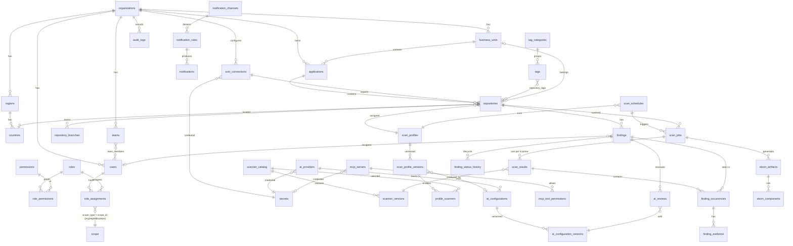

# PATHOS Database Design

Status: **implemented through Phase 3** (`backend/migrations/00001_foundation.sql`, `00002_repositories.sql`); later tables are still design. Implementation notes: SCM connections reference two secrets (credential and webhook secret); `webhook_deliveries` stores verified deliveries; same-organization integrity uses composite foreign keys.

PostgreSQL. All tables have `id uuid` primary keys (UUIDv7 generated by the app: time-ordered, index-friendly), plus `created_at` and `updated_at timestamptz`. Business tables carry `organization_id` for tenancy, and every query is scoped by it. Soft-delete (`archived_at`) applies where history must survive.

## Conventions

- Enumerations are PostgreSQL `CHECK` constraints on `text` (easier to migrate than `ENUM` types).
- JSONB is used **only** for genuinely schemaless data: scanner-specific config blobs, raw SARIF properties, and AI structured output (which is also validated against a versioned schema). Everything queried or filtered is a real column.
- Large artifacts (raw reports, SBOMs, logs) live in object storage. The DB stores `object_key`, `sha256`, `size_bytes` and `content_type`.
- Secrets are stored in `secrets` as envelope-encrypted ciphertext and referenced by `secret_id`. They are never stored inline.

## Entity relationship diagram

## Core tables (abridged)

| Table | Key columns | Notes |
|---|---|---|
| `organizations` | name, slug | Multi-org capable from day one |
| `regions` / `countries` | name, code | Seeded with Americas, EMEA, APAC. Editable |
| `business_units` | name, parent_id | Hierarchical, fully configurable |
| `users` | keycloak_subject (unique), email, display_name, status (`active`/`deactivated`), last_login_at | JIT provisioned |
| `roles` / `permissions` / `role_permissions` | key, description | 9 system roles seeded (immutable), plus custom roles |
| `role_assignments` | user_id, role_id, scope_type, scope_id | Scope ∈ `organization`,`region`,`business_unit`,`repository`. The unique tuple prevents duplicates |
| `secrets` | kind, ciphertext, wrapped_dek, key_version | Envelope-encrypted. Kinds kept separate (scm / ai / mcp / smtp) |
| `scm_connections` | provider (`github`,`github_enterprise`,`azure_devops`,`azure_devops_server`), base_url, auth_type, secret_id | |
| `applications` | name, business_unit_id, owner_user_id, security_owner_user_id, criticality | The brief's "assets" entity |
| `repositories` | scm_connection_id, external_id, name, url, default_branch, application_id, business_unit_id, country_id, technology[], environment, criticality, status, scan_enabled, scan_profile_id, archived_at | Unique (scm_connection_id, external_id) |
| `tag_categories` / `tags` / `repository_tags` | category is_mandatory, tag name/colour | Mandatory categories are enforced in the service layer |
| `scanner_catalog` | key, name, category, license_spdx, commercial_use_ok, maintained, requires_build, languages[], output_formats[], worker_family, mandatory | Gitleaks: `mandatory=true` |
| `scan_profiles` / `scan_profile_versions` | Immutable versions: severity_threshold, branch_rule, exclusions, incremental, timeout, parallelism, sbom, license_check, fail_on_critical, ai_configuration_version_id, retention_days | Edits create a new version, which gives change history |
| `profile_scanners` | profile_version_id, scanner_id, pinned_version, config jsonb | Gitleaks row enforced by trigger and service |
| `scan_jobs` | repository_id, profile_version_id, trigger (`manual`,`schedule`,`push`,`pull_request`,`merge`,`onboarding`,`emergency`), priority, status, commit_sha, dedupe_key, attempts, leased_by, lease_expires_at | Partial unique index on dedupe_key WHERE status IN (`queued`,`running`) prevents duplicate execution |
| `scan_results` | scan_job_id, scanner_version_id, status, duration_ms, raw_object_key, error | |
| `findings` | repository_id, fingerprint, scanner_key, rule_id, title, severity, cwe[], cve, cvss, file_path, status, assignee_id, first_seen_at, last_seen_at, sla_due_at, resolved_at, ai_status | Unique (repository_id, fingerprint) gives deduplication across scans |
| `finding_occurrences` | finding_id, scan_result_id, commit_sha, line, ... | Append-only: history is never overwritten |
| `finding_evidence` | occurrence_id, snippet (redacted), raw_ref | |
| `finding_status_history` | finding_id, from, to, actor, reason | Lifecycle audit |
| `ai_providers` / `ai_configurations` / `ai_configuration_versions` | provider, model, mode, instructions, thresholds, redaction policy, limits, human_approval | |
| `ai_reviews` | finding_id, config_version_id, provider, model, model_version, verdict, confidence, output jsonb, transmitted_sha256, source (`automated`,`interactive_mcp`), approved_by | |
| `mcp_servers` / `mcp_tool_permissions` | transport (`stdio`,`streamable_http`), endpoint, approved_by, enabled / tool, access (`read`,`write`), repo restrictions | |
| `scan_schedules` | cadence (cron), target_type (`repository`,`region`,`business_unit`,`profile`), target_id, next_run_at | |
| `sbom_artifacts` / `sbom_components` | format, object_key / purl, name, version, licenses | |
| `notification_channels` / `notification_rules` / `notifications` | SMTP config ref / event, recipients / delivery status, attempts | |
| `audit_logs` | actor_id, action, target_type, target_id, ip, user_agent, metadata, created_at | Append-only (app role has no UPDATE/DELETE grant) and monthly partitioning |

## Fingerprinting

`fingerprint = sha256(scanner_family | rule_id | normalized_path | normalized_snippet_hash | secondary_key)`. It deliberately excludes line numbers, so it stays stable when code shifts. For SCA findings, `secondary_key` = package purl + vulnerability ID. Each scanner family can override this through its adapter.

## Retention

Per-profile `retention_days` drives a nightly job. It prunes old `finding_occurrences`, `scan_results` and object-storage artifacts, but never `findings`, `finding_status_history`, `ai_reviews` or `audit_logs`. Those have a separate org-level retention setting.
