# PATHOS Database Design

This page describes the schema as built by migrations `00001` to `00028` (`backend/migrations`, applied by goose through `pathosctl migrate`). Every migration has a Down section and ends by calling `pathos_apply_app_grants()`, which keeps the least-privilege grants of the application role current. The original design notes of the ASPM programme, with the mapping from planned to built tables, are in [aspm/PATHOS_DATABASE_DESIGN.md](aspm/PATHOS_DATABASE_DESIGN.md).

PostgreSQL. All tables have `id uuid` primary keys (UUIDv7 generated by the app: time-ordered, index-friendly), plus `created_at` and `updated_at timestamptz`. Business tables carry `organization_id` for tenancy, and every query is scoped by it. Soft-delete (`archived_at`) applies where history must survive.

## Conventions

- Enumerations are PostgreSQL `CHECK` constraints on `text` (easier to migrate than `ENUM` types).
- JSONB is used **only** for genuinely schemaless data: scanner-specific config blobs, raw SARIF properties, and AI structured output (which is also validated against a versioned schema). Everything queried or filtered is a real column.
- Raw scanner reports and SBOM files (`scan_artifacts`) are stored gzip-compressed in PostgreSQL, or in S3-compatible storage when it is configured (then the row holds `object_key`). A CHECK constraint enforces exactly one location. Uploaded source snapshots and Human Eye evidence files live in the encrypted source store (a volume or S3).
- Secrets are stored in `secrets` as envelope-encrypted ciphertext and referenced by `secret_id`. They are never stored inline.

## Entity relationship diagram

```mermaid
erDiagram
  organizations ||--o{ regions : has
  regions ||--o{ countries : has
  organizations ||--o{ business_units : has
  organizations ||--o{ users : has
  organizations ||--o{ teams : has
  teams }o--o{ users : team_members

  roles ||--o{ role_permissions : grants
  permissions ||--o{ role_permissions : in
  users ||--o{ role_assignments : holds
  roles ||--o{ role_assignments : assigned
  role_assignments }o--|| scope : "scope_type + scope_id (org|region|bu|repo)"

  organizations ||--o{ scm_connections : configures
  scm_connections }o--|| secrets : credential
  organizations ||--o{ applications : owns
  business_units ||--o{ applications : contains
  applications ||--o{ repositories : contains
  scm_connections ||--o{ repositories : imports
  repositories }o--o| countries : located
  repositories }o--o| business_units : belongs

  tag_categories ||--o{ tags : groups
  tags }o--o{ repositories : repository_tags

  scan_profiles ||--o{ scan_profile_versions : versioned
  scan_profile_versions ||--o{ profile_scanners : enables
  scanner_catalog ||--o{ profile_scanners : selected
  repositories }o--o| scan_profiles : assigned
  workers ||--o{ scan_jobs : leases

  ai_providers ||--o{ ai_configurations : backs
  ai_providers }o--|| secrets : credential
  ai_configurations ||--o{ ai_configuration_versions : versioned
  mcp_servers }o--o| secrets : credential
  mcp_servers ||--o{ mcp_tool_permissions : allows

  scan_schedules ||--o{ scan_schedule_targets : plan
  scan_schedules ||--o{ scan_schedule_runs : activations
  scan_schedule_runs ||--o{ scan_jobs : triggers
  repositories ||--o{ scan_jobs : scanned
  scan_targets ||--o{ scan_jobs : scanned
  scan_jobs ||--o{ scan_results : "one per scanner"
  scan_jobs ||--o{ scan_job_events : stages
  scan_jobs ||--o{ scan_job_logs : log
  scan_results ||--o{ scan_artifacts : "raw report, SBOM"
  scan_results ||--o{ finding_occurrences : contains

  findings ||--o{ finding_occurrences : "seen in"
  findings ||--o{ finding_status_history : lifecycle
  findings ||--o{ risk_acceptances : accepted
  findings ||--o| human_reviews : "Human Eye"
  findings ||--o{ finding_tickets : tickets
  ticket_connections ||--o{ finding_tickets : creates
  security_policies ||--o{ policy_violations : matches
  findings ||--o{ policy_violations : violates
  findings ||--o{ ai_reviews : reviewed
  ai_reviews }o--|| ai_configuration_versions : with
  repositories ||--o{ findings : has
  findings }o--o| users : assignee

  repositories ||--o{ sbom_components : inventory
  repositories ||--o{ sbom_dependencies : "edges (by bom_ref)"
  repositories ||--o{ pr_checks : "pull requests"
  pr_checks ||--o{ pr_findings : found

  notification_events ||--o{ notifications : "delivered as"
  notification_rules ||--o{ notifications : produces
  notification_events ||--o{ outbound_webhook_deliveries : "sent as"
  outbound_webhooks ||--o{ outbound_webhook_deliveries : receives
  organizations ||--o{ audit_logs : records
```

## Core tables (abridged)

| Table | Key columns | Notes |
|---|---|---|
| `organizations` | name, slug | Multi-org capable from day one |
| `regions` / `countries` | name, code | Seeded with Americas, EMEA, APAC. Editable |
| `business_units` | name, parent_id | Hierarchical, fully configurable |
| `users` | keycloak_subject (unique), email, display_name, status (`invited`/`active`/`deactivated`), last_login_at | JIT provisioned |
| `roles` / `permissions` / `role_permissions` | key, description | 11 system roles synced from `backend/internal/authz/catalog.go` on every `migrate` (immutable), plus custom roles. See [RBAC_MATRIX.md](RBAC_MATRIX.md) |
| `role_assignments` | user_id, role_id, scope_type, scope_id | Scope ∈ `organization`,`region`,`business_unit`,`repository`. The unique tuple prevents duplicates |
| `secrets` | kind, ciphertext, wrapped_dek, key_version | Envelope-encrypted. Kinds kept separate: `scm`, `ai`, `mcp`, `smtp`, `webhook`, `worker`, `scan_target`, `integration` |
| `scm_connections` | provider (`github`, `github_enterprise`, `gitlab`, `bitbucket`, `azure_devops`, `azure_devops_server`), base_url, auth_type (`pat`, `github_app`, `oauth`, `api_token`, `service_principal`), secret_id, webhook_secret_id | GitLab, Bitbucket and the later auth types came with migration 00009 |
| `applications` | name, business_unit_id, owner_user_id, security_owner_user_id, criticality | The brief's "assets" entity |
| `repositories` | scm_connection_id, external_id, name, url, default_branch, application_id, business_unit_id, country_id, technology[], environment, criticality, status, scan_enabled, scan_profile_id, archived_at | Unique (scm_connection_id, external_id) |
| `tag_categories` / `tags` / `repository_tags` | category is_mandatory, tag name/colour | Mandatory categories are enforced in the service layer |
| `scanner_catalog` | key, name, category, license_spdx, decision, worker_family, requires_build, mandatory, adapter_available, default_enabled, output_format, homepage, notes | Synced from `backend/internal/scanners/catalog.go`. Gitleaks: `mandatory=true`. Imported tools and worker plugins add rows only through `SECURITY DEFINER` functions (00014, 00023) |
| `scan_profiles` / `scan_profile_versions` | Immutable versions: severity_threshold, branch_rule, exclusions, incremental, timeout, parallelism, sbom, license_check, fail_on_critical, ai_configuration_version_id, retention_days | Edits create a new version, which gives change history |
| `profile_scanners` | profile_version_id, scanner_id, pinned_version, config jsonb | Gitleaks row enforced by trigger and service |
| `workers` | name, family, version, token_sha256, scanners, last_seen_at, revoked_at | One row per registered worker; the token is stored as SHA-256 |
| `scan_jobs` | repository_id, profile_version_id, trigger (`manual`, `schedule`, `push`, `pull_request`, `merge`, `onboarding`, `emergency`, `import`), priority, status (`queued`, `running`, `succeeded`, `partial`, `failed`, `cancelled`), commit_sha, attempts, leased_by, lease_expires_at | A partial unique index allows one queued execution per repository, profile version, target and pull request; leasing runs at most one execution per repository at a time. Later columns: see 00011, 00015 and 00020 below |
| `scan_results` | scan_job_id, scanner_key, scanner_version, status (`succeeded`, `failed`, `skipped`, `timed_out`), duration_ms, findings_count, error | One engine job per scanner |
| `scan_artifacts` | scan_result_id, kind (`raw`,`sbom`), content_type, sha256, size_bytes, data_gzip **or** object_key | Exactly one location (CHECK). `object_key` = `artifacts/<org>/<uuidv7>.gz` in S3-compatible storage |
| `findings` | repository_id, fingerprint, scanner_key, rule_id, title, severity, cwe[], cve, cvss, file_path, snippet, status (`open`, `in_progress`, `needs_review`, `fixed`, `false_positive`, `accepted_risk`), assignee_id, first_seen_at, last_seen_at, sla_due_at, resolved_at, ai_status | Unique (repository_id, fingerprint) gives deduplication across scans. Many columns were added later; see the migration sections below |
| `finding_occurrences` | finding_id, scan_result_id, commit_sha, line, ... | Append-only: history is never overwritten |
| `finding_status_history` | finding_id, from_status, to_status, actor_id, source (`user`,`scanner`,`ai`,`expiry`,`system`), reason | Written only by the `pathos_finding_lifecycle` trigger; append-only for the app role |
| `sla_policies` | severity, days (null = no SLA) | Trigger sets `findings.sla_due_at` on insert; edits recompute open findings |
| `risk_acceptances` | finding_id, justification, expires_at, status (`pending`,`approved`,`rejected`,`revoked`,`withdrawn`,`expired`), requested_by, decided_by | CHECK decided_by <> requested_by; one pending/active per finding |
| `license_policies` | spdx_id, decision (`deny`,`review`) | Applied to SBOM components at query time |
| `ai_providers` / `ai_configurations` / `ai_configuration_versions` | provider, model, mode, instructions, thresholds, redaction policy, limits, human_approval | |
| `ai_reviews` | finding_id, config_version_id, provider, model, model_version, verdict, confidence, output jsonb, transmitted_sha256, source (`automated`,`interactive_mcp`), approved_by | |
| `ai_review_queue` | finding_id, config_version_id, status, attempts, lease_expires_at, not_before | Automated review queue (one active entry per finding) |
| `api_tokens` | user_id, name, prefix, token_sha256, scopes (`mcp`, `api:read`, `api:write`), expires_at, last_used_at, revoked_at | Personal tokens for MCP and the REST API |
| `webhook_deliveries` | scm_connection_id, delivery_id, event, repository_id, ref, commit_sha, pull_request, payload_sha256, status | Verified inbound SCM webhooks; the delivery ID de-duplicates replays |
| `mcp_servers` / `mcp_tool_permissions` | transport (`stdio`,`streamable_http`), endpoint, approved_by, enabled / tool, access (`read`,`write`), repo restrictions | |
| `scan_schedules` | name, kind, cron or run time or interval, timezone, scan window, priority (0–90), retries, max concurrency, next_run_at, last_run_at, last_status, missed_runs | At most hourly. The execution plan and activations are in `scan_schedule_targets` and `scan_schedule_runs` (00011). `scan_jobs.schedule_id` and `schedule_run_id` link runs |
| `scheduler_state` | name, holder, heartbeat_at, stats | Written by the scheduler leader |
| `sbom_components` | repository_id, scan_job_id, purl, name, version, type, licenses[] | Replaced per repository on each SBOM-producing scan; the raw CycloneDX stays with the scan result |
| `smtp_settings` | host, port, tls_mode (`starttls`,`tls`,`none`), username, secret_id (kind `smtp`), from_address | One row per organization |
| `notification_rules` | event_key, min_severity, scope_type/scope_id, recipients jsonb (roles, users, emails, dynamic), email, in_app, system_key | Built-in rules can be edited or disabled but not deleted |
| `notification_templates` | event_key, subject, body | Organization overrides of the built-in Go `text/template` defaults |
| `notification_events` | event_key, repository_id, severity, subject_id, payload, processed_at | Outbox written by triggers (`scan_jobs`, `risk_acceptances`, `findings.assignee_id`) and detectors |
| `notifications` | event_id, rule_id, channel (`email`,`in_app`), user_id/email, subject, body, link, status, attempts, next_attempt_at, read_at | Delivery history and in-app inbox. Deduplicated per event, channel and recipient. The app role cannot delete rows |
| `audit_logs` | actor_id, action, target_type, target_id, ip, user_agent, metadata, created_at | Append-only (app role has no UPDATE/DELETE grant) and monthly partitioning |

## Repository onboarding (migration 00009)

| Table | Purpose |
|---|---|
| `repositories` (extended) | Asset metadata: owners, teams, department, regions, hosting region, data classification, internet exposure, lifecycle, colour; `source_type` (`scm` / `upload`), head commit, sync state, current snapshot |
| `asset_classifications`, `asset_settings` | Per-organization catalogs and required-field policy |
| `repository_compliance_scopes` | Compliance scope (applicability) per repository |
| `scm_oauth_apps`, `scm_oauth_states` | OAuth applications and in-flight authorizations |
| `source_uploads`, `source_upload_parts`, `source_snapshots` | Resumable uploads and immutable source versions |
| `repository_import_jobs`, `repository_import_items` | Background import engine |
| `repository_sync_runs` | Synchronization history (180 days) |
| `repositories.repository_key` (00010) | Permanent Repository ID (`QD-REPO-000001`), trigger-assigned from `repository_key_seq`, immutable |
| `repository_public_endpoints` (00010) | Public URLs, domains and IPs of exposed assets |

`docs/REPOSITORY_ONBOARDING.md` describes the design.

## Scanning module (migration 00011)

| Object | Purpose |
|---|---|
| `scan_jobs.scan_key` | Permanent Scan ID (`QD-SCAN-000001`), assigned by `pathos_assign_scan_key()` from `scan_key_seq`; unique and immutable |
| `scan_jobs.config_snapshot` | The effective profile configuration captured at enqueue time. `pathos_protect_scan_job()` rejects changes to it and to `scan_key` |
| `scan_jobs.progress`, `stage`, `retry_of`, `retry_count`, `schedule_id`, `schedule_run_id` | Progress from recorded stages; retries are new rows linked to the failed one |
| `scan_job_events`, `scan_job_logs` | Stage events and the redacted execution log, pruned after `PATHOS_SCAN_LOG_RETENTION_DAYS` (default 400, minimum 360) |
| `scan_schedules` (extended) | `kind` (`cron`, `once`, `interval`), `run_at`, `interval_minutes` (≥ 60), scan window (`window_start`, `window_end`, `window_days`), `retry_max` (0–5), `retry_delay_minutes`, `max_concurrent`, `notify_on` |
| `scan_schedule_targets` | Execution plan: asset scope × profile (NULL = each repository's own profile) |
| `scan_schedule_runs` | One row per activation; `(schedule_id, due_at)` is unique, so a schedule never runs twice for the same due time |

[SCANNING_MODULE.md](SCANNING_MODULE.md) describes the design.

## Human Eye (migration 00012)

| Table | Purpose |
|---|---|
| `human_reviews` | One per finding (`UNIQUE (finding_id)`): permanent `review_key` (`QD-HR-000001`), scanned commit / branch / snapshot, preserved scanner severity, score, vector and output (immutable, trigger-protected), status, disposition, remediation status, priority, reviewer, independent reviewer, due date, round, human-assessed severity and CVSS, remediation tracking |
| `human_review_assessments` | Structured assessment per review round (answers, fields, reproduction, risk, remediation, data flow notes; JSON objects) |
| `human_review_decisions` | Append-only submitted dispositions with reason, duplicate reference, risk owner and expiry |
| `human_review_approvals` | Append-only independent review outcomes; a trigger rejects approval by the decision's author |
| `human_review_evidence` | Evidence metadata (`QD-EV-000001`), SHA-256, encrypted object key or inline text; deletion keeps the record |
| `human_review_comments`, `human_review_recommendations` | Append-only comments and AI suggestions (provenance, transmitted SHA-256) |
| `human_review_history` | Append-only activity history (actor, action, field, old and new value) |
| `human_review_settings` | Per-organization workflow configuration |
| `findings.human_*` | Human outcome on the finding: review, disposition, assessed severity, time |

The application role cannot update or delete history, decisions, approvals, comments or suggestions, nor delete evidence rows. `pathos_review_remediation_sync` (AFTER UPDATE OF status on `findings`) moves confirmed reviews to *pending verification* when a scan no longer detects the finding and to *reopened* when it is detected again. `docs/HUMAN_REVIEW.md` describes the design.

## Finding intelligence and risk (migration 00013)

| Object | Purpose |
|---|---|
| `findings` (extended) | `cvss_version`, `cvss_vector`, `confidence`, `epss_score`, `epss_percentile`, `kev`, `kev_due_date`, `exploit_available`, `reachability`, `risk_score`, `risk_factors` (explanation), `risk_scored_at`, `risk_dirty` |
| `pathos_finding_risk_dirty`, `pathos_repository_risk_dirty`, `pathos_application_risk_dirty` | Triggers that mark findings for re-scoring when an input changes (status, severity, CVE, confidence, Human Eye outcome; repository or application criticality and exposure) |
| `intel_epss`, `intel_kev` | Reference data shared by all organizations, replaced atomically by each feed import |
| `intel_feeds`, `intel_feed_runs` | Feed configuration (enabled, https URL, interval) and run history (online or file, records, SHA-256, error) |
| `risk_models` | Versioned weights per organization; findings record the version in `risk_factors` |
| `applications` (extended) | `application_key` (`QD-APP-000001`, trigger-assigned, immutable), `technical_owner_user_id`, `lifecycle`, `environment` |

The unified lifecycle status is derived in SQL (`scans.LifecycleExpr`) and is not stored.

## Imports and custom rules (migration 00014)

| Object | Purpose |
|---|---|
| `import_jobs` | Every result or SBOM import: format, tool, scanner key, repository, execution, SHA-256, size, outcome |
| `pathos_register_import_tool()` | `SECURITY DEFINER`: the only way the app role adds catalog rows, restricted to `import-<category>-<tool>` keys |
| `scan_jobs.trigger` | Adds `import` |
| `findings.category` | Adds `dast` |
| `sbom_components.source`, nullable `scan_job_id` | Imported inventories |
| `custom_rules`, `custom_rule_versions` | Opengrep rule files and their saved versions; scan snapshots pin `(id, version)` |

## Scan targets (migration 00015)

| Object | Purpose |
|---|---|
| `scan_targets` | Container images, web applications, APIs and SBOMs scanned for a repository: kind, reference, egress host, config, OpenAPI document, gzip SBOM with SHA-256 and size, authentication type and encrypted secret (`secrets.kind = scan_target`), authorization statement (`authorized_by`, `authorized_at`, note; required for `url` and `api`), enabled |
| `scan_jobs.target_id`, `target_kind` | The target an execution scanned (`repository` for source scans). The queued-execution unique index includes the target |
| `findings.scan_target_id` | The target a finding belongs to. Target findings use target-namespaced fingerprints and are resolved only by scans of the same target. A target with findings cannot be deleted (foreign key) |

## Dependency graph and SCM inventory (migration 00016)

| Object | Purpose |
|---|---|
| `sbom_components.bom_ref`, `depth` | The component's SBOM identifier and its shortest distance from a root (0 root, 1 direct, 2+ transitive, NULL without graph data) |
| `sbom_dependencies` | "parent depends on child" edges of each repository's latest SBOM (CycloneDX `dependencies`, SPDX `DEPENDS_ON` / `*DEPENDENCY_OF`) |
| `scm_remote_repositories` | Every repository each SCM connection sees (refreshed daily); compared with `repositories` to report shadow repositories |
| `scm_inventory_runs` | Inventory refreshes: status, count, truncation, error |

## Vulnerability intelligence (migration 00017)

| Object | Purpose |
|---|---|
| `intel_vulns` | OSV records (aliases, description, vendor CVSS, CWEs, references, exploit references, affected packages); `found = false` remembers unknown identifiers |
| `intel_feeds` | Adds the `osv` feed |
| `repository_code_imports`, `repositories.imports_scanned_at`, `imports_files` | Packages each repository's code imports or names, per ecosystem, from its latest scan |
| `findings.reachability_basis` | Why a dependency finding is reachable, not reachable or unknown |
| `suppression_rules`, `findings.suppression_rule_id` | Governed, expiring decisions for every finding matching a pattern; four eyes enforced by the API and a CHECK |

## Human Eye extras (migration 00018)

| Object | Purpose |
|---|---|
| `human_review_settings.final_approval_severities`, `final_approval_dispositions` | Decisions needing a third person's final approval |
| `human_review_approvals.level` | 1 independent reviewer, 2 final approver; unique per decision and level, and per decision and person |
| `human_review_recommendations` kinds `patch`, `risk_explanation`, `duplicate_candidates`; `patch_status`, `patch_decided_by/at`, `patch_note` | AI patch proposals and their human decision. The app role may update only these four columns: suggestions stay immutable |

## AI Security Analyst (migration 00019)

| Object | Purpose |
|---|---|
| `ai_conversations`, `ai_messages` | Private conversations; answers keep their citations (finding IDs that were in the context), follow-ups, context SHA-256, model and tokens |
| `ai_reports` | Technical and executive reports: PATHOS-computed `facts`, the AI `narrative` (or a `narrative_error`), model and tokens |

## Supply chain and pull request checks (migration 00020)

| Object | Purpose |
|---|---|
| `findings.malicious` | Malicious package (OSV `MAL-*` advisory or malware report), maintained by the risk engine |
| `package_health` | Per package (purl without version), shared by all organizations: deps.dev latest version and publish date, deprecated versions, OpenSSF Scorecard, verified SLSA provenance per version, `found`, `fetched_at` |
| `intel_feeds` | Adds the `depsdev` feed, **disabled by default** because it sends package names (which can be private) to deps.dev |
| `scan_targets` kind `artifact` | Uploaded build artifact (archive, Java archive, binary): `artifact_name`, gzip file in the object store (`artifact_key`) or inline (`artifact_gzip`); digest and size in `sbom_sha256` / `sbom_size` |
| `repositories.pr_checks_enabled`, `pr_gate_severity` | Opt-in pull request checks and the gate severity (`critical` to `low`, or `none`; default `high`) |
| `scan_jobs.pull_request` | The pull request a PR scan ran for; part of the queued-execution unique index |
| `pr_checks` | One per PR scan: head ref and SHA, status (`pending`, `passed`, `failed`, `error`), gate, new and existing counts, commit-status posting state |
| `pr_findings` | Findings of a PR scan, kept apart from `findings`; `is_new` when not already known on the scan branch, `existing_finding_id` otherwise |

## Governance (migration 00021)

| Object | Purpose |
|---|---|
| `security_policies` | Named, versioned policies per organization: `conditions` and `actions` (JSON), `enabled`, `evaluated_at` |
| `policy_violations` | Open findings that match an enabled policy (`policy_id`, `finding_id`); resolved when the finding closes or stops matching, and kept for the record |
| `pr_findings.cwe`, `policy_ids` | Policies a PR finding violates; blocking policies fail the check |

Compliance frameworks and their control mappings are a catalog in code (`backend/internal/compliance`), not tables.

## Integrations and reports (migration 00022)

| Object | Purpose |
|---|---|
| `secrets.kind` | Adds `integration` |
| `outbound_webhooks` | Outbound endpoints: format (`json`, `slack`, `teams`), URL **encrypted** (`url_secret_id`; Slack and Teams URLs are credentials) with only `url_host` shown, optional signing secret, events (1–50), minimum severity, `allow_private`, enabled |
| `outbound_webhook_deliveries` | One per endpoint and notification event: status (`pending`, `succeeded`, `failed`), attempts, next attempt, response status, error |
| `ticket_connections` | Jira and ServiceNow connections: base URL, auth type (`basic`, `bearer`), username, encrypted secret, `config` (Jira project, issue type, labels; ServiceNow table, assignment group, caller), `allow_private` |
| `finding_tickets` | The ticket created for a finding on a connection (unique per pair): external key and URL, remote status, `remote_done`, sync error and time |
| `saved_reports` | Report definitions over the Findings filters (`definition`), sharing, optional schedule (`daily`, `weekly`, `monthly`) and recipients |

## Scanner plugins (migration 00023)

| Object | Purpose |
|---|---|
| `pathos_register_plugin_scanner(key, name, category, homepage)` | `SECURITY DEFINER`, revoked from `PUBLIC` and granted to `pathos_app`. The only way the application role adds catalog rows for worker plugins: the key must match `plugin-<category>-<name>`, the category must match the key, and a non-https homepage is dropped. Existing rows are updated only when they are plugins (`worker_family = 'plugin'`) |

## Developer context (migration 00028)

| Object | Purpose |
|---|---|
| `material_change_runs` | One per compared branch scan: status (`computed`, `baseline`, `unchanged`, `unavailable`) and reason, base and head commits, changed files, truncation, change count, dependency comparison status, whether the commit range was complete |
| `material_changes` | Security-material changes of a run: category, rule, level, file, change type, side, line range, match count, redacted snippet, explanation, dependency detail, and the last author name (only while attribution is on) |
| `material_dependency_baselines` | Per repository, the dependency set (`type:name`) of the latest compared SBOM |
| `developer_insight_settings` | Per organization, `attribution_enabled` (default **false**) |
| `scan_commits` | Commits between two scans (SHA, author **name**, time, touched files), stored only while attribution is on |
| `finding_attribution` | Per finding: introduced by / commit / scan / time and fixed by / commit / scan / time (author names) |
| `developer_identities` | Administrator links from a git author name (unique per organization, case-insensitive) to a user |

Turning attribution off deletes the rows of `scan_commits`, `finding_attribution` and `developer_identities` and clears `material_changes.author_name`. No table stores author e-mail addresses.

## Finding lifecycle trigger

`pathos_finding_lifecycle` (BEFORE INSERT/UPDATE on `findings`) is the single writer of `finding_status_history`. Callers describe *why* a change happens with transaction-local settings, set through `db.SetChangeContext`: `pathos.actor`, `pathos.source` and `pathos.reason`. The trigger sets `sla_due_at` on insert, `status_changed_at` and `resolved_at` on transitions, increments `recurrence_count` on `fixed → open`, and clears `accepted_until` when a finding leaves `accepted_risk`. Changes made without context are recorded as `source=system`, so no change is silently untracked.

## Fingerprinting

`fingerprint = sha256(family | rule | normalized_path | snippet_key | secondary_key)` (`scanners.Fingerprint`). Line numbers are deliberately excluded, so it stays stable when code shifts. For SCA findings the family is `sca`, the rule is `sca` and `secondary_key` is `package@version|CVE` (or the advisory ID), so the same vulnerability reported by Trivy, Grype and OSV-Scanner is one finding. For every other category the family is the scanner key. Scan-target findings use target-namespaced fingerprints (00015).

## Retention

- Raw reports and SBOM files (`scan_artifacts`, and their objects in S3-compatible storage) are pruned after the `retention_days` of the profile version that produced them (7–3650 days). The row is deleted first, then the object.
- Execution logs and stage events (`scan_job_logs`, `scan_job_events`) are pruned after `PATHOS_SCAN_LOG_RETENTION_DAYS`.
- Executions, results, `findings`, `finding_occurrences`, `finding_status_history`, `ai_reviews` and `audit_logs` are not pruned.
