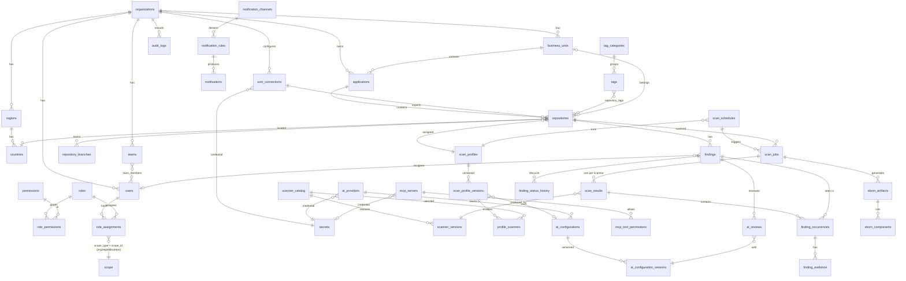

# PATHOS Database Design

Status: **implemented through Phase 4** (`00001_foundation.sql`, `00002_repositories.sql`, `00003_scanning.sql`: scanner catalog, profiles and immutable versions, workers, jobs, results, `scan_artifacts`, findings and occurrences; `00004_ai_mcp.sql`: AI providers, versioned configurations, reviews, review queue, finding snippets, personal API tokens, MCP registry); later tables are still design. Implementation notes: SCM connections reference two secrets (credential and webhook secret); `webhook_deliveries` stores verified deliveries; same-organization integrity uses composite foreign keys.

PostgreSQL. All tables have `id uuid` primary keys (UUIDv7 generated by the app: time-ordered, index-friendly), plus `created_at` and `updated_at timestamptz`. Business tables carry `organization_id` for tenancy, and every query is scoped by it. Soft-delete (`archived_at`) applies where history must survive.

## Conventions

- Enumerations are PostgreSQL `CHECK` constraints on `text` (easier to migrate than `ENUM` types).
- JSONB is used **only** for genuinely schemaless data: scanner-specific config blobs, raw SARIF properties, and AI structured output (which is also validated against a versioned schema). Everything queried or filtered is a real column.
- Large artifacts (raw reports, SBOMs, logs) live in object storage. The DB stores `object_key`, `sha256`, `size_bytes` and `content_type`.
- Secrets are stored in `secrets` as envelope-encrypted ciphertext and referenced by `secret_id`. They are never stored inline.

## Entity relationship diagram

## Core tables (abridged)

| Table | Key columns | Notes |
|---|---|---|
| `organizations` | name, slug | Multi-org capable from day one |
| `regions` / `countries` | name, code | Seeded with Americas, EMEA, APAC. Editable |
| `business_units` | name, parent_id | Hierarchical, fully configurable |
| `users` | keycloak_subject (unique), email, display_name, status (`active`/`deactivated`), last_login_at | JIT provisioned |
| `roles` / `permissions` / `role_permissions` | key, description | 9 system roles seeded (immutable), plus custom roles |
| `role_assignments` | user_id, role_id, scope_type, scope_id | Scope ∈ `organization`,`region`,`business_unit`,`repository`. The unique tuple prevents duplicates |
| `secrets` | kind, ciphertext, wrapped_dek, key_version | Envelope-encrypted. Kinds kept separate (scm / ai / mcp / smtp) |
| `scm_connections` | provider (`github`,`github_enterprise`,`azure_devops`,`azure_devops_server`), base_url, auth_type, secret_id | |
| `applications` | name, business_unit_id, owner_user_id, security_owner_user_id, criticality | The brief's "assets" entity |
| `repositories` | scm_connection_id, external_id, name, url, default_branch, application_id, business_unit_id, country_id, technology[], environment, criticality, status, scan_enabled, scan_profile_id, archived_at | Unique (scm_connection_id, external_id) |
| `tag_categories` / `tags` / `repository_tags` | category is_mandatory, tag name/colour | Mandatory categories are enforced in the service layer |
| `scanner_catalog` | key, name, category, license_spdx, commercial_use_ok, maintained, requires_build, languages[], output_formats[], worker_family, mandatory | Gitleaks: `mandatory=true` |
| `scan_profiles` / `scan_profile_versions` | Immutable versions: severity_threshold, branch_rule, exclusions, incremental, timeout, parallelism, sbom, license_check, fail_on_critical, ai_configuration_version_id, retention_days | Edits create a new version, which gives change history |
| `profile_scanners` | profile_version_id, scanner_id, pinned_version, config jsonb | Gitleaks row enforced by trigger and service |
| `scan_jobs` | repository_id, profile_version_id, trigger (`manual`,`schedule`,`push`,`pull_request`,`merge`,`onboarding`,`emergency`), priority, status, commit_sha, dedupe_key, attempts, leased_by, lease_expires_at | Partial unique index on dedupe_key WHERE status IN (`queued`,`running`) prevents duplicate execution |
| `scan_results` | scan_job_id, scanner_key, scanner_version, status, duration_ms, findings_count, error | |
| `scan_artifacts` | scan_result_id, kind (`raw`,`sbom`), content_type, sha256, size_bytes, data_gzip **or** object_key | Exactly one location (CHECK). `object_key` = `artifacts/<org>/<uuidv7>.gz` in S3-compatible storage |
| `findings` | repository_id, fingerprint, scanner_key, rule_id, title, severity, cwe[], cve, cvss, file_path, status, assignee_id, first_seen_at, last_seen_at, sla_due_at, resolved_at, ai_status | Unique (repository_id, fingerprint) gives deduplication across scans |
| `finding_occurrences` | finding_id, scan_result_id, commit_sha, line, ... | Append-only: history is never overwritten |
| `finding_evidence` | occurrence_id, snippet (redacted), raw_ref | |
| `finding_status_history` | finding_id, from_status, to_status, actor_id, source (`user`,`scanner`,`ai`,`expiry`,`system`), reason | Written only by the `pathos_finding_lifecycle` trigger; append-only for the app role |
| `sla_policies` | severity, days (null = no SLA) | Trigger sets `findings.sla_due_at` on insert; edits recompute open findings |
| `risk_acceptances` | finding_id, justification, expires_at, status (`pending`,`approved`,`rejected`,`revoked`,`withdrawn`,`expired`), requested_by, decided_by | CHECK decided_by <> requested_by; one pending/active per finding |
| `license_policies` | spdx_id, decision (`deny`,`review`) | Applied to SBOM components at query time |
| `ai_providers` / `ai_configurations` / `ai_configuration_versions` | provider, model, mode, instructions, thresholds, redaction policy, limits, human_approval | |
| `ai_reviews` | finding_id, config_version_id, provider, model, model_version, verdict, confidence, output jsonb, transmitted_sha256, source (`automated`,`interactive_mcp`), approved_by | |
| `mcp_servers` / `mcp_tool_permissions` | transport (`stdio`,`streamable_http`), endpoint, approved_by, enabled / tool, access (`read`,`write`), repo restrictions | |
| `scan_schedules` | name, cron, timezone, target_type (`organization`,`region`,`business_unit`,`repository`,`profile`), target_id, priority (0–90), next_run_at, last_run_at, last_status, missed_runs | At most hourly. `scan_jobs.schedule_id` links runs |
| `scheduler_state` | name, holder, heartbeat_at, stats | Written by the scheduler leader |
| `sbom_components` | repository_id, scan_job_id, purl, name, version, type, licenses[] | Replaced per repository on each SBOM-producing scan; the raw CycloneDX stays with the scan result |
| `smtp_settings` | host, port, tls_mode (`starttls`,`tls`,`none`), username, secret_id (kind `smtp`), from_address | One row per organization |
| `notification_rules` | event_key, min_severity, scope_type/scope_id, recipients jsonb (roles, users, emails, dynamic), email, in_app, system_key | Built-in rules can be edited or disabled but not deleted |
| `notification_templates` | event_key, subject, body | Organization overrides of the built-in Go `text/template` defaults |
| `notification_events` | event_key, repository_id, severity, subject_id, payload, processed_at | Outbox written by triggers (`scan_jobs`, `risk_acceptances`, `findings.assignee_id`) and detectors |
| `notifications` | event_id, rule_id, channel (`email`,`in_app`), user_id/email, subject, body, link, status, attempts, next_attempt_at, read_at | Delivery history and in-app inbox. Deduplicated per event, channel and recipient. The app role cannot delete rows |
| `audit_logs` | actor_id, action, target_type, target_id, ip, user_agent, metadata, created_at | Append-only (app role has no UPDATE/DELETE grant) and monthly partitioning |

## Repository onboarding (migration 00009)

| Table | Purpose |
|---|---|
| `repositories` (extended) | Asset metadata: owners, teams, department, regions, hosting region, data classification, internet exposure, lifecycle, colour; `source_type` (`scm` / `upload`), head commit, sync state, current snapshot |
| `asset_classifications`, `asset_settings` | Per-organization catalogs and required-field policy |
| `repository_compliance_scopes` | Compliance scope (applicability) per repository |
| `scm_oauth_apps`, `scm_oauth_states` | OAuth applications and in-flight authorizations |
| `source_uploads`, `source_upload_parts`, `source_snapshots` | Resumable uploads and immutable source versions |
| `repository_import_jobs`, `repository_import_items` | Background import engine |
| `repository_sync_runs` | Synchronization history (180 days) |
| `repositories.repository_key` (00010) | Permanent Repository ID (`QD-REPO-000001`), trigger-assigned from `repository_key_seq`, immutable |
| `repository_public_endpoints` (00010) | Public URLs, domains and IPs of exposed assets |

`docs/REPOSITORY_ONBOARDING.md` describes the design.

## Human Eye (migration 00012)

| Table | Purpose |
|---|---|
| `human_reviews` | One per finding (`UNIQUE (finding_id)`): permanent `review_key` (`QD-HR-000001`), scanned commit / branch / snapshot, preserved scanner severity, score, vector and output (immutable, trigger-protected), status, disposition, remediation status, priority, reviewer, independent reviewer, due date, round, human-assessed severity and CVSS, remediation tracking |
| `human_review_assessments` | Structured assessment per review round (answers, fields, reproduction, risk, remediation, data flow notes; JSON objects) |
| `human_review_decisions` | Append-only submitted dispositions with reason, duplicate reference, risk owner and expiry |
| `human_review_approvals` | Append-only independent review outcomes; a trigger rejects approval by the decision's author |
| `human_review_evidence` | Evidence metadata (`QD-EV-000001`), SHA-256, encrypted object key or inline text; deletion keeps the record |
| `human_review_comments`, `human_review_recommendations` | Append-only comments and AI suggestions (provenance, transmitted SHA-256) |
| `human_review_history` | Append-only activity history (actor, action, field, old and new value) |
| `human_review_settings` | Per-organization workflow configuration |
| `findings.human_*` | Human outcome on the finding: review, disposition, assessed severity, time |

The application role cannot update or delete history, decisions, approvals, comments or suggestions, nor delete evidence rows. `pathos_review_remediation_sync` (AFTER UPDATE OF status on `findings`) moves confirmed reviews to *pending verification* when a scan no longer detects the finding and to *reopened* when it is detected again. `docs/HUMAN_REVIEW.md` describes the design.

## Finding intelligence and risk (migration 00013)

| Object | Purpose |
|---|---|
| `findings` (extended) | `cvss_version`, `cvss_vector`, `confidence`, `epss_score`, `epss_percentile`, `kev`, `kev_due_date`, `exploit_available`, `reachability`, `risk_score`, `risk_factors` (explanation), `risk_scored_at`, `risk_dirty` |
| `pathos_finding_risk_dirty`, `pathos_repository_risk_dirty`, `pathos_application_risk_dirty` | Triggers that mark findings for re-scoring when an input changes (status, severity, CVE, confidence, Human Eye outcome; repository or application criticality and exposure) |
| `intel_epss`, `intel_kev` | Reference data shared by all organizations, replaced atomically by each feed import |
| `intel_feeds`, `intel_feed_runs` | Feed configuration (enabled, https URL, interval) and run history (online or file, records, SHA-256, error) |
| `risk_models` | Versioned weights per organization; findings record the version in `risk_factors` |
| `applications` (extended) | `application_key` (`QD-APP-000001`, trigger-assigned, immutable), `technical_owner_user_id`, `lifecycle`, `environment` |

The unified lifecycle status is derived in SQL (`scans.LifecycleExpr`) and is not stored.

## Imports and custom rules (migration 00014)

| Object | Purpose |
|---|---|
| `import_jobs` | Every result or SBOM import: format, tool, scanner key, repository, execution, SHA-256, size, outcome |
| `pathos_register_import_tool()` | `SECURITY DEFINER`: the only way the app role adds catalog rows, restricted to `import-<category>-<tool>` keys |
| `scan_jobs.trigger` | Adds `import` |
| `findings.category` | Adds `dast` |
| `sbom_components.source`, nullable `scan_job_id` | Imported inventories |
| `custom_rules`, `custom_rule_versions` | Opengrep rule files and their saved versions; scan snapshots pin `(id, version)` |

## Scan targets (migration 00015)

| Object | Purpose |
|---|---|
| `scan_targets` | Container images, web applications, APIs and SBOMs scanned for a repository: kind, reference, egress host, config, OpenAPI document, gzip SBOM with SHA-256 and size, authentication type and encrypted secret (`secrets.kind = scan_target`), authorization statement (`authorized_by`, `authorized_at`, note; required for `url` and `api`), enabled |
| `scan_jobs.target_id`, `target_kind` | The target an execution scanned (`repository` for source scans). The queued-execution unique index includes the target |
| `findings.scan_target_id` | The target a finding belongs to. Target findings use target-namespaced fingerprints and are resolved only by scans of the same target. A target with findings cannot be deleted (foreign key) |

## Dependency graph and SCM inventory (migration 00016)

| Object | Purpose |
|---|---|
| `sbom_components.bom_ref`, `depth` | The component's SBOM identifier and its shortest distance from a root (0 root, 1 direct, 2+ transitive, NULL without graph data) |
| `sbom_dependencies` | "parent depends on child" edges of each repository's latest SBOM (CycloneDX `dependencies`, SPDX `DEPENDS_ON` / `*DEPENDENCY_OF`) |
| `scm_remote_repositories` | Every repository each SCM connection sees (refreshed daily); compared with `repositories` to report shadow repositories |
| `scm_inventory_runs` | Inventory refreshes: status, count, truncation, error |

## Vulnerability intelligence (migration 00017)

| Object | Purpose |
|---|---|
| `intel_vulns` | OSV records (aliases, description, vendor CVSS, CWEs, references, exploit references, affected packages); `found = false` remembers unknown identifiers |
| `intel_feeds` | Adds the `osv` feed |
| `repository_code_imports`, `repositories.imports_scanned_at`, `imports_files` | Packages each repository's code imports or names, per ecosystem, from its latest scan |
| `findings.reachability_basis` | Why a dependency finding is reachable, not reachable or unknown |
| `suppression_rules`, `findings.suppression_rule_id` | Governed, expiring decisions for every finding matching a pattern; four eyes enforced by the API and a CHECK |

## Human Eye extras (migration 00018)

| Object | Purpose |
|---|---|
| `human_review_settings.final_approval_severities`, `final_approval_dispositions` | Decisions needing a third person's final approval |
| `human_review_approvals.level` | 1 independent reviewer, 2 final approver; unique per decision and level, and per decision and person |
| `human_review_recommendations` kinds `patch`, `risk_explanation`, `duplicate_candidates`; `patch_status`, `patch_decided_by/at`, `patch_note` | AI patch proposals and their human decision. The app role may update only these four columns: suggestions stay immutable |

## Finding lifecycle trigger

`pathos_finding_lifecycle` (BEFORE INSERT/UPDATE on `findings`) is the single writer of `finding_status_history`. Callers describe *why* a change happens with transaction-local settings, set through `db.SetChangeContext`: `pathos.actor`, `pathos.source` and `pathos.reason`. The trigger sets `sla_due_at` on insert, `status_changed_at` and `resolved_at` on transitions, increments `recurrence_count` on `fixed → open`, and clears `accepted_until` when a finding leaves `accepted_risk`. Changes made without context are recorded as `source=system`, so no change is silently untracked.

## Fingerprinting

`fingerprint = sha256(scanner_family | rule_id | normalized_path | normalized_snippet_hash | secondary_key)`. It deliberately excludes line numbers, so it stays stable when code shifts. For SCA findings, `secondary_key` = package purl + vulnerability ID. Each scanner family can override this through its adapter.

## Retention

Per-profile `retention_days` drives a nightly job. It prunes old `finding_occurrences`, `scan_results` and object-storage artifacts, but never `findings`, `finding_status_history`, `ai_reviews` or `audit_logs`. Those have a separate org-level retention setting.
