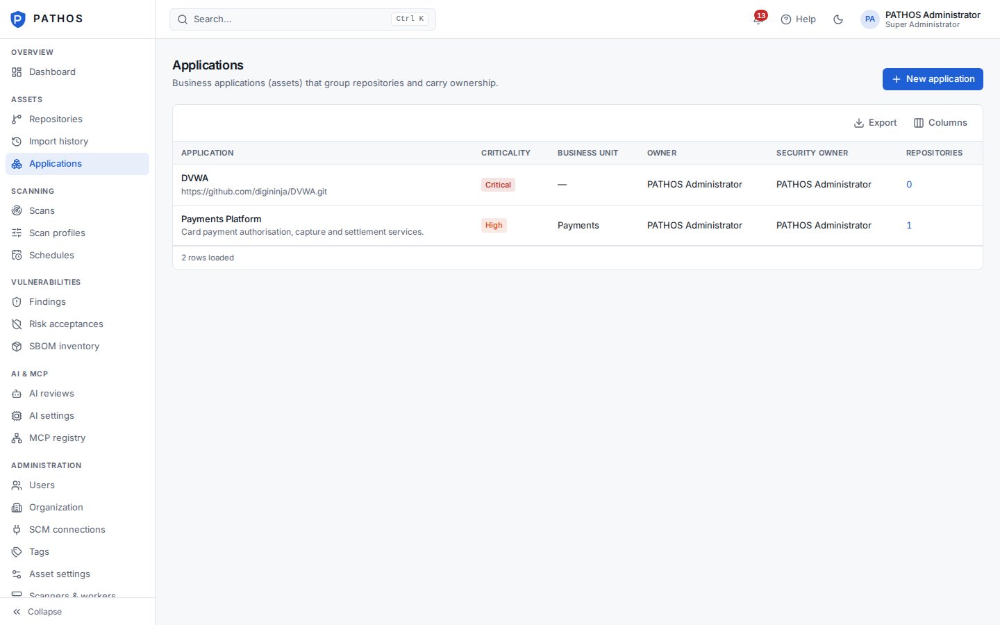
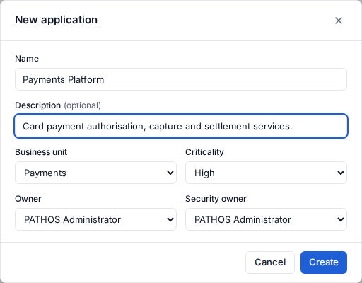

# Applications

## Application versus repository

| | Repository | Application |
|---|---|---|
| What it represents | One code base (Git repository or uploaded archive) | A business application, for example *Payments Platform*, made of one or more code bases |
| Identifier | Permanent Repository ID (`QD-REPO-000042`) | Name (unique among active applications) and an optional **Application ID** (for example a CMDB reference) |
| Scanned | Yes | No: findings belong to its repositories |
| Ownership | Business, technical and application owner, teams | **Owner** and **Security owner** |
| Placement | Business unit, department, country, regions | **Business unit** |
| Classification | Criticality, data classification, environment, compliance, exposure, URLs | **Criticality** |

A repository is linked to **at most one** application; an application can have **many** repositories.

## What the Applications page supports

Open **Assets → Applications** (`/applications`).

| Capability | Available | How |
|---|---|---|
| List applications with criticality, business unit, owner, security owner and repository count | Yes | Applications page; **Export** downloads the loaded rows as CSV |
| Create an application | Yes | **New application** (needs `repos.manage`) |
| Edit name, description, business unit, criticality, owner, security owner | Yes | Select the row |
| Archive an application | Yes | **Archive** in the edit dialog. Repositories are unlinked, not deleted |
| Delete an application | **Not available** | Archive it instead |
| Application ID (CMDB reference) | Yes | Enter it in **New application** or **Edit** on the Applications page, or when creating an application from the wizard (**Create a new application → Application ID**). It is shown in the Applications list and in CSV exports. |
| Link one or many repositories | Yes | In the wizard (**General → Application**) or by editing a repository |
| View linked repositories | Yes | Select the number in the **Repositories** column; the repository inventory opens filtered by the application |
| Staging / production URLs, public exposure per application | **Not available** | Recorded per repository; see [Asset registration](asset-registration.md#classification) |
| Linking APIs, cloud resources, hosts or other non-repository assets to an application | **Not available** | Only repositories can be linked |
| Application risk, coverage and benchmarking | Yes | **Posture → Application posture**, **Benchmarking** and **Context graph**; see [Posture](posture.md) |

The **Owner** and **Security owner** pickers are shown only to users who may list users organization-wide (`users.read`); others can create applications without them.

## Step-by-step: create an application and link repositories

**Purpose.** Group the repositories that make up one business application so ownership and posture can be reported per application.

**Prerequisites.** The business unit exists. The repositories are registered, or you are about to import them.

**Required permissions.** `repos.manage` at the application's business unit (or organization-wide when no business unit is set) to create or edit the application; to link a repository, permission to edit that repository (`repos.manage` in its scope, or being one of its owners).

**Example values.** Name *Payments Platform*; description *Card payment authorisation, capture and settlement services.*; business unit *Payments*; criticality *High*; owner and security owner *Dana Owner*.

1. Open **Assets → Applications** and select **New application**.
2. Enter **Name**, optional **Description**, **Business unit** (or *None (organization)*), **Criticality** and, if shown, **Owner** and **Security owner**.
   
3. Select **Create**. The application appears in the list with *0* repositories.
4. Link repositories, either:
   - **while importing**: in the wizard's **General** step choose **Existing application** and search for *Payments Platform* (all repositories in that import are linked), or choose **Create a new application** to create one on the fly with a name and optional **Application ID**. A new application created this way takes the repository's business unit and criticality and the application owner as its owner;
   - **for an existing repository**: open it in **Repositories**, select **Edit metadata**, set **Application** to *Payments Platform* and **Save changes**. Repeat for each repository. To link many repositories quickly, filter the inventory first (for example by business unit) and edit them one after another.
5. Back on **Applications**, select the repository count to see the linked repositories.

**Expected result.** The **Repositories** column shows the number of linked active repositories; the inventory filter **Application** (under **More filters**) lists them; the column **Application** can be shown in the inventory with **Columns**.

**Troubleshooting.**

| Problem | Fix |
|---|---|
| **New application** button missing | You lack `repos.manage` |
| Name rejected as a duplicate | Another active application has the same name (case-insensitive) |
| Application not offered in the wizard | It is archived; archived applications cannot be chosen |
| Cannot change the application of a repository | You are not an owner of the repository and lack `repos.manage` |

**Related APIs.** [Applications API](../api-reference/applications.md), [Repositories API](../api-reference/repositories.md).

## Viewing posture per application

1. **Posture → Application posture**: risk, open findings by severity, KEV findings, SLA breaches, mean time to fix, coverage and last scan per application. **Context graph** shows everything connected to it. See [Posture](posture.md).
2. **Repositories → More filters → Application**: the inventory, KPI strip and **Insights** are filtered to the application's repositories (exposure, criticality, environment, compliance scope, owners).
3. **Findings**: add the **Application** column, or export the findings (the Application column is always exported).
4. **Overview → Reports** can count findings per application, and **AI & MCP → AI reports** can cover one application. See [Dashboards and reporting](dashboards.md#reports) and [AI reports](ai-analyst.md#ai-reports).

## Archive an application

Open the application, select **Archive** and confirm. Its repositories are **unlinked, not deleted**; it disappears from the application pickers. There is no unarchive or delete on the Applications page.

## Versions

Select **Versions** on an application's row to record releases with their components and findings, and to export VEX for them. See [Application versions, VEX and component policies](releases-and-vex.md#record-an-application-version).
