# Asset registration

Every import method uses the same **registration wizard**: **Source**, then six metadata steps (**General**, **Business ownership**, **Geography**, **Classification**, **Tags & colour**, **Lifecycle**), then **Review**. The same fields are used when you edit a repository later.

When you import several repositories in one run, they all receive the metadata you enter; only **Display name** and **Asset name** are set per item (in the Source step).

## Mandatory, optional and configurable fields

| Category | Fields |
|---|---|
| **Always required** (cannot be switched off) | Business owner, Business unit, Business region, Public exposure (the answer Yes / No / Unknown) |
| **Required by default** (a new organization's policy) | Technical owner, Criticality, Data classification, Environment, in addition to the four above |
| **Always required per item** | Display name, Asset name |
| **Optional unless your administrator requires them** | Description, Application, Application type, Business purpose, Staging URL, Production URL, Application owner, Department, Responsible team, Supporting team, Cost centre, Country, Hosting region, Data residency region, Primary operational location, Network reachability detail, Compliance scope, Tags, Lifecycle status |
| **Always optional** | Exposure notes, Asset colour, Go-live date, Retirement date |

Administrators with `assets.configure` change the policy in **Administration → Asset settings → Required fields**; locked fields (lock icon) are always required. Required fields are marked with a red asterisk in the wizard, and **Next** is blocked until they are filled. The policy applies to imports *and* edits.

**Mandatory tag categories** (set in **Administration → Tags**) add a further rule: at least one tag of each such category must be chosen.

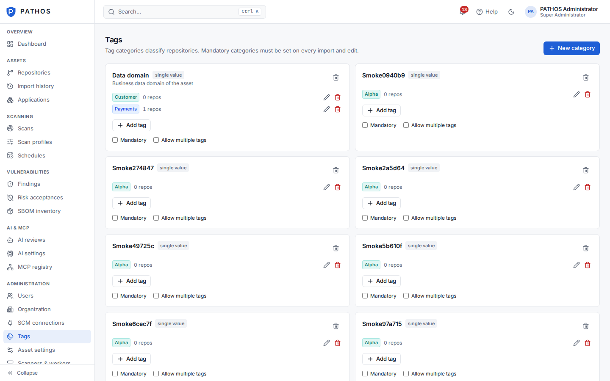

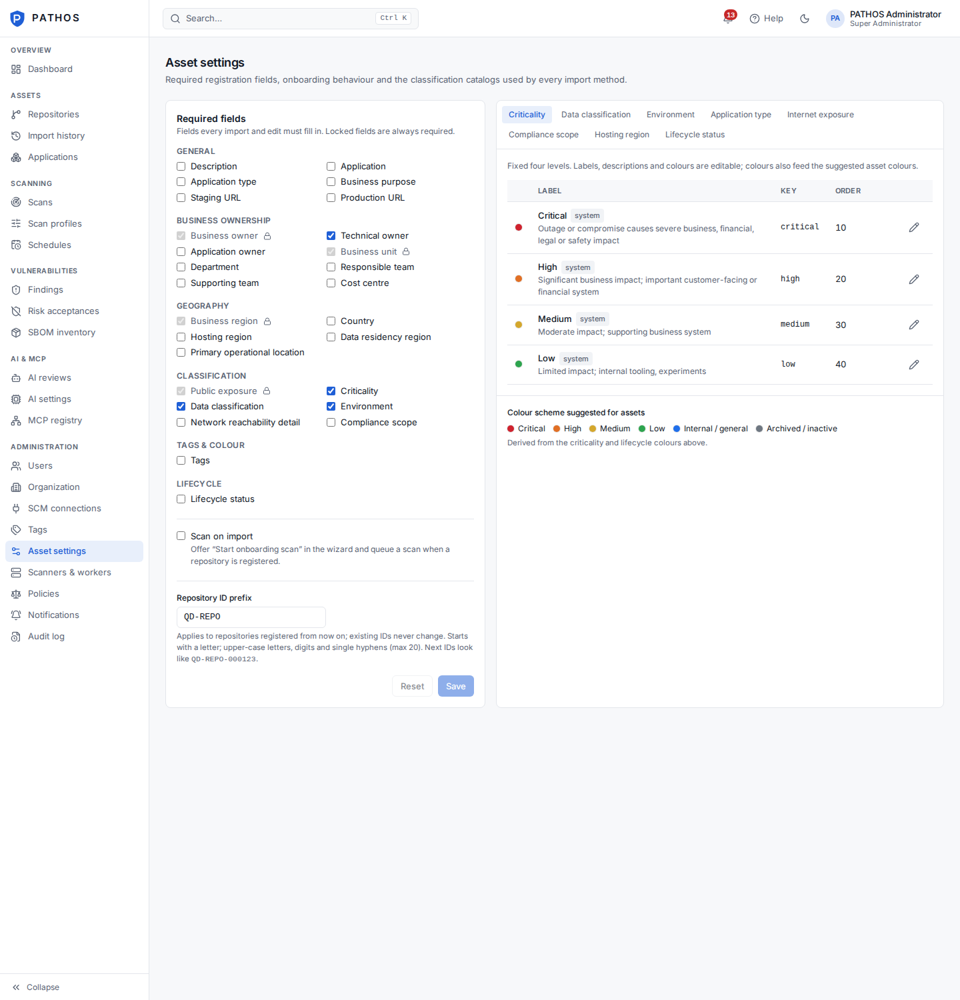

The selectable values of Criticality labels, Data classification, Environment, Application type, Internet exposure (network reachability), Compliance scope, Hosting region and Lifecycle status come from the **classification catalogs** on the same page. Administrators can add, relabel, recolour, reorder and archive entries; archived entries can no longer be chosen but stay on existing assets. Criticality has four fixed levels (Critical, High, Medium, Low) whose labels, descriptions and colours can be edited.

## Field reference

### General

| Field | Purpose |
|---|---|
| Display name / Asset name | Shown in the General step when you import a single item. Asset name: unique, lower-case letters, digits and hyphens |
| Description | What the code does |
| Application | **Existing application** (search and select) or **Create a new application** with **New application name** and optional **Application ID** (CMDB or enterprise application identifier). See [Applications](applications.md) |
| Application type | Web application, Mobile application, Backend service, API, Microservice, Library / package, Infrastructure as Code, Database project, Desktop application, Other (default catalog) |
| Business purpose | Why the business needs it |
| Staging URL, Production URL | Where the running application is reachable. Absolute `http(s)://` URLs, no user name or password, up to 2,048 characters. **Metadata only, never contacted or scanned** |

### Business ownership

| Field | Purpose |
|---|---|
| Business owner | Accountable person (always required) |
| Technical owner | Person responsible for the code |
| Application owner | Person responsible for the application |
| Business unit | Organizational placement (always required); also determines who can see and manage the repository |
| Department | A sub-unit of the chosen business unit (*Choose a business unit first.*) |
| Responsible team, Supporting team | Teams |
| Cost centre | Free text |

Owners are chosen with a people search; you see users of your organization (name and e-mail).

### Geography

| Field | Purpose |
|---|---|
| Business region | The region of the business that owns the asset (always required) |
| Country | The country the asset belongs to, grouped by region. Part of the placement used for region-scoped access |
| Hosting region | Where the workload runs, for example a cloud region or data centre (catalog: On-premises, Europe, North America, South America, Asia Pacific, Middle East and Africa, Multi-region / global) |
| Data residency region | Where the data must remain |
| Primary operational location | City, site or data centre, free text |

**Business region, hosting region and data residency region are independent.** A payments service can be owned by the European business, run in a North American cloud region, and still have to keep customer data in the EU:

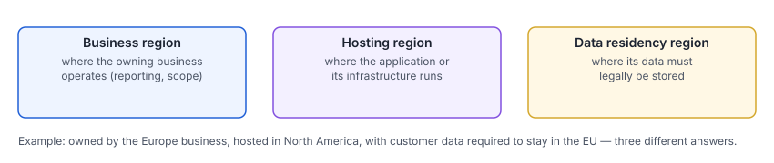

### Classification

| Field | Purpose |
|---|---|
| **Is this application or asset publicly exposed to the internet?** | **Yes** (reachable from the internet), **No** (internal or private only) or **Unknown** (not assessed yet). Always required, no default |
| Public-facing URLs, Public domain names, Public IP addresses | Only with **Yes**: at least one entry in total is required; up to 50 per list. Domains may use wildcards such as `*.example.com`. IP addresses must be public IPv4 or IPv6 addresses (private, loopback and link-local addresses are rejected) |
| Network reachability detail | Only with **No**: optional detail from the *Internet exposure* catalog, for example *Internally accessible* or *Private* |
| Exposure notes | Optional context, for example "Behind the corporate WAF; confirmed by Dana Owner" (up to 2,000 characters) |
| Criticality | Critical, High, Medium, Low, with the descriptions configured by your administrator |
| Data classification | Public, Internal, Confidential, Restricted (default catalog) |
| Environment | Production, Staging, Testing, Development, Disaster Recovery, Sandbox, Other (default catalog) |
| Compliance scope | Checkboxes, for example GDPR, PCI DSS, ISO 27001, SOC 2, HIPAA, Internal Security Policy, Other |

Notes:

- *Answering Yes records metadata only; PATHOS does not crawl or scan these addresses.* Registering a URL, domain or IP does not create any network traffic. Verifying exposure is a separate, authorised assessment.
- Choosing **No** or **Unknown** after entering endpoints removes them when you save (*The public endpoints entered earlier are removed when you save. Choose Yes to keep them.*).
- **Unknown** is a valid answer and is counted on dashboards as *Unknown exposure*, so that unassessed assets stay visible.
- **Compliance scope indicates applicability, not certification.** Ticking PCI DSS records that the regime applies to the asset; it does not state that the asset is certified or compliant.

### Tags & colour

| Field | Purpose |
|---|---|
| Tags | Tags grouped by tag category (from **Administration → Tags**). *required* marks mandatory categories, *choose one* marks single-choice categories. Use **Search tags** to filter |
| Asset colour | Optional colour dot shown in lists and charts. Swatches are suggested from the criticality and lifecycle colours. *The colour is a visual indicator in lists and charts only; it does not change risk or access.* |

### Lifecycle

| Field | Purpose |
|---|---|
| Lifecycle status | Planned, In development, Active, Maintenance only, Deprecated, Retired (default catalog; new repositories default to Active) |
| Go-live date | Optional |
| Retirement date | Optional, on or after the go-live date |

## Step-by-step: register an asset with the wizard

**Purpose.** Describe a new repository completely so that it is owned, correctly placed and prioritised.

**Prerequisites.** The source is chosen (uploaded archive or selected provider repositories, see [Importing repositories](repository-import.md)); the business unit exists; for tags, the tag categories exist.

**Required permissions.** `repos.manage` at the business unit you choose. Creating a new application from the wizard is covered by the same permission. Tags are only selected here; creating tags requires `tags.manage`.

**Example values.** As in the screenshots: archive `payments-api.zip`, application *Payments Platform*, business unit *Payments*, owners *Dana Owner*.

1. **Source.** Upload the archive or select the repositories. Check **Display name** and **Asset name**. Select **Next**.
   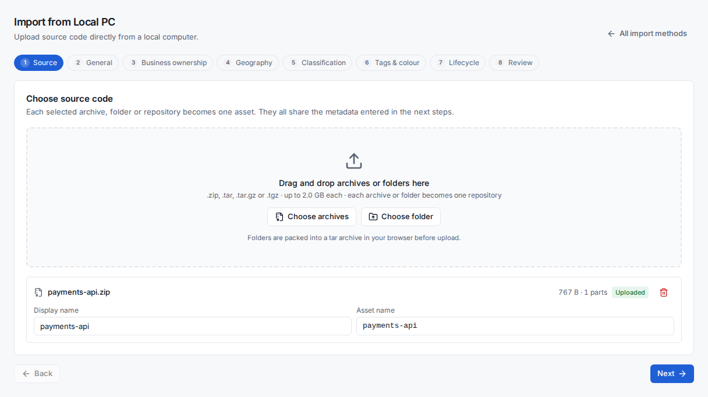
2. **General.** Description `REST API that authorises and captures card payments.`; Application: **Existing application** → *Payments Platform*; Application type *API*; Business purpose `Processes customer card payments for the web shop.`; Staging URL `https://staging.payments.example.com`; Production URL `https://payments.example.com`. Select **Next**.
   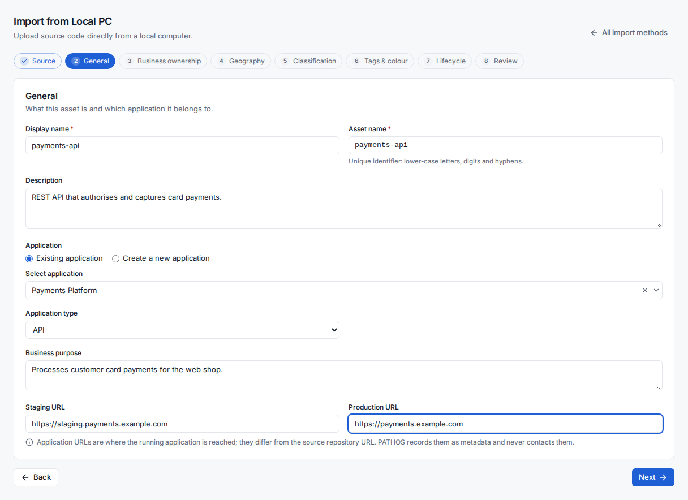
3. **Business ownership.** Business owner, Technical owner and Application owner *Dana Owner*; Business unit *Payments*; Cost centre `CC-4711`. Select **Next**.
   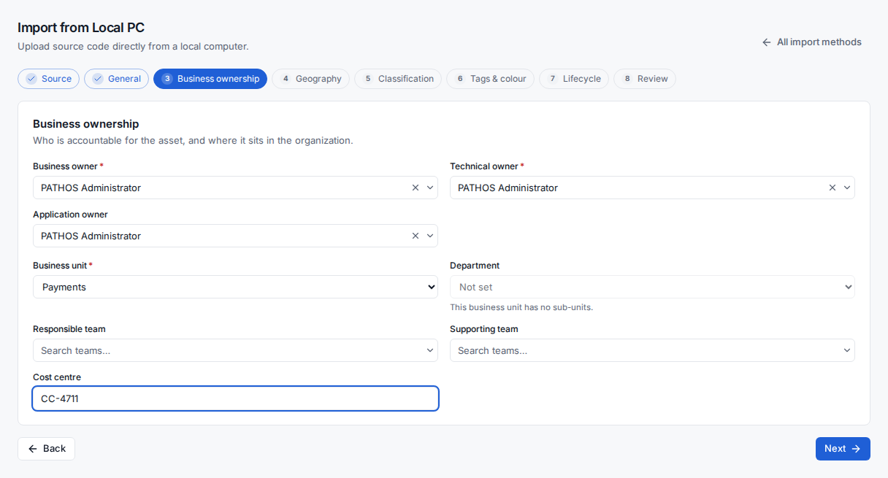
4. **Geography.** Business region *Europe, Middle East & Africa*; Country *Germany*; Hosting region *Europe*; Data residency region *Europe, Middle East & Africa*; Primary operational location `Frankfurt data centre`. Select **Next**.
   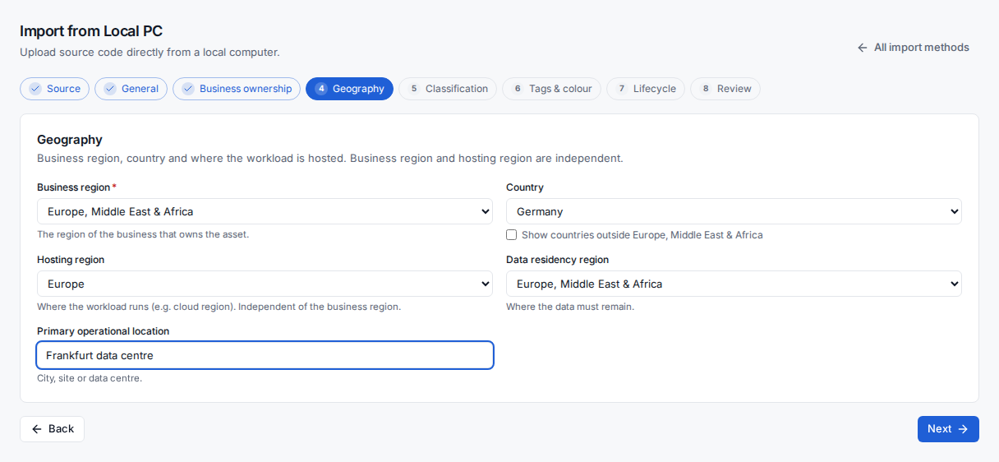
5. **Classification.** Public exposure **Yes**; Public-facing URL `https://payments.example.com`; **Add domain** `api.payments.example.com`; **Add IP address** `203.0.113.10`; Exposure notes; Criticality **High**; Data classification *Confidential*; Environment *Production*; Compliance scope *GDPR* and *PCI DSS*. Select **Next**.
   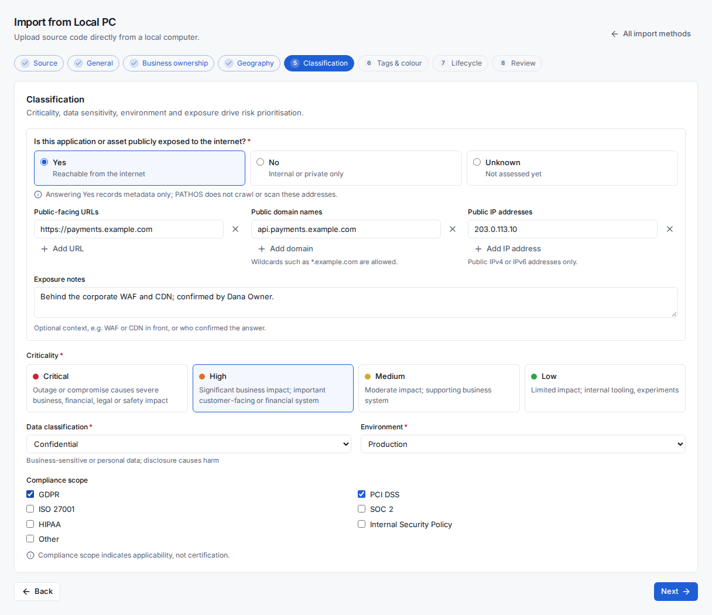
6. **Tags & colour.** Select the tag *Payments* in category *Data domain* and a colour. Select **Next**.
   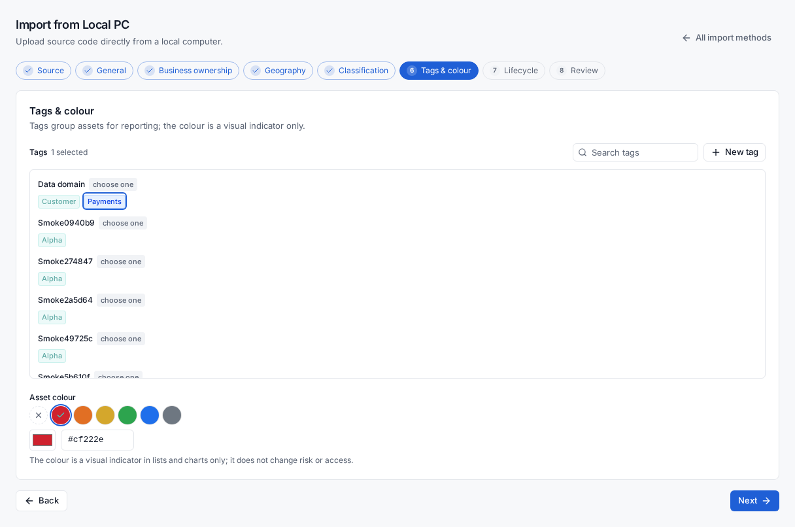
7. **Lifecycle.** Lifecycle status *Active*; Go-live date `2026-03-01`. Select **Check and review**.
   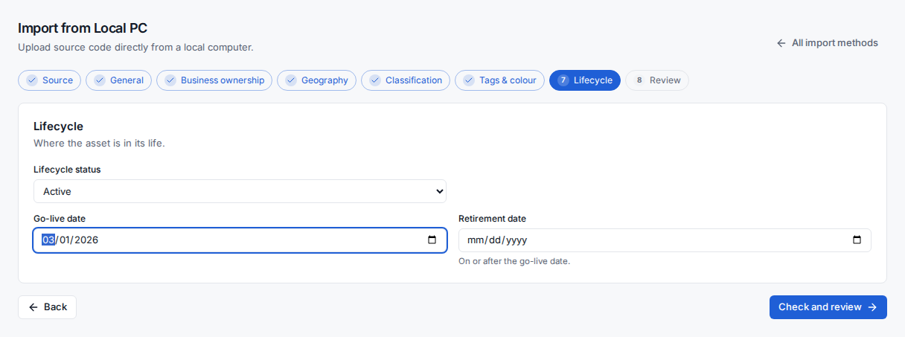
8. **Review.** Check the items and the **Shared metadata**. Use the edit links to jump back to a section. If your administrator enabled **Scan on import**, choose whether to **Start onboarding scan**. Select **Start import (1)**.
   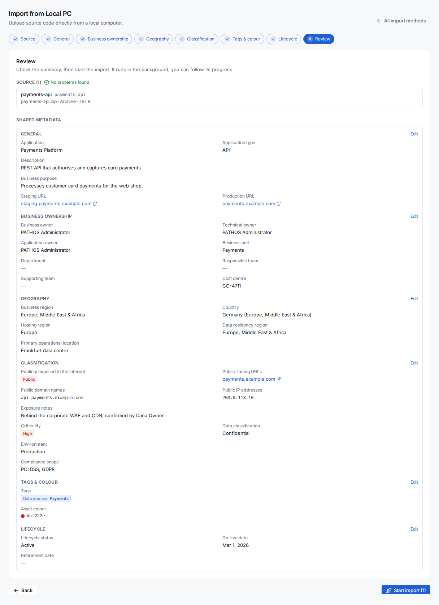

**Expected result.** The import job starts and the progress page opens. When it completes, the repository has all values shown in Review and a new Repository ID.

**Troubleshooting.**

| Message | Fix |
|---|---|
| *Complete the required fields in this section.* / *`<Field>` is required* | Fill the field, or ask an administrator whether it should be required |
| *Answer whether the application or asset is publicly exposed to the internet* | Choose Yes, No or Unknown |
| *Add at least one public URL, domain name or IP address* | With **Yes**, enter at least one endpoint, or choose Unknown |
| *Enter an absolute http:// or https:// URL* / *URLs must not contain user names or passwords* | Correct the URL |
| *… is not a public address (private, loopback and link-local addresses are not allowed)* | Enter the public address, or leave the IP list empty |
| *"…" is not a valid domain name* | Use a host name such as `app.example.com` or `*.example.com` |
| *Choose a tag in: `<category>`* | A mandatory tag category has no tag selected |
| *Use the form #rrggbb* | Enter the colour as a hex value |
| *Retirement date must be on or after the go-live date* | Correct the dates |
| *Every repository needs a display name and an asset name.* / *Asset names must be unique.* / `name_clash` | Fix the names in the Source step |
| *Enter a name for the new application* | Give the new application a name, or choose an existing one |
| *Could not check the import: …* | A server-side check failed; the message names the problem. Correct and select **Check and review** again |

**Related APIs.** [Imports API](../api-reference/imports.md) (validate and create), [Assets API](../api-reference/assets.md) (asset settings and catalogs), [Applications API](../api-reference/applications.md).

## Step-by-step: configure required fields and the Repository ID prefix

**Purpose.** Adapt the registration policy to your organization.

**Required permissions.** `assets.configure` (organization-wide; `super_admin` and `platform_admin` by default).

1. Open **Administration → Asset settings**.
2. Under **Required fields**, tick the fields every import and edit must fill in. Locked fields cannot be unticked.
3. Optionally tick **Scan on import** (default off) to offer *Start onboarding scan* in the wizard.
4. Optionally change the **Repository ID prefix**, for example `ACME-REPO`. It applies to repositories registered from now on; existing IDs never change.
5. Select **Save**. *Settings saved.* confirms the change.
6. To change catalog values, choose a catalog tab (for example **Compliance scope**), then add, edit (label, description, colour, sort order) or archive entries. Keys cannot be changed after creation.

**Related APIs.** [Assets API](../api-reference/assets.md).
