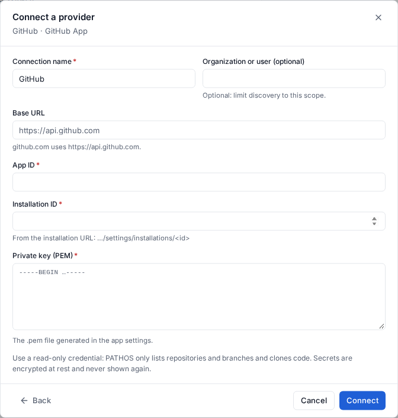
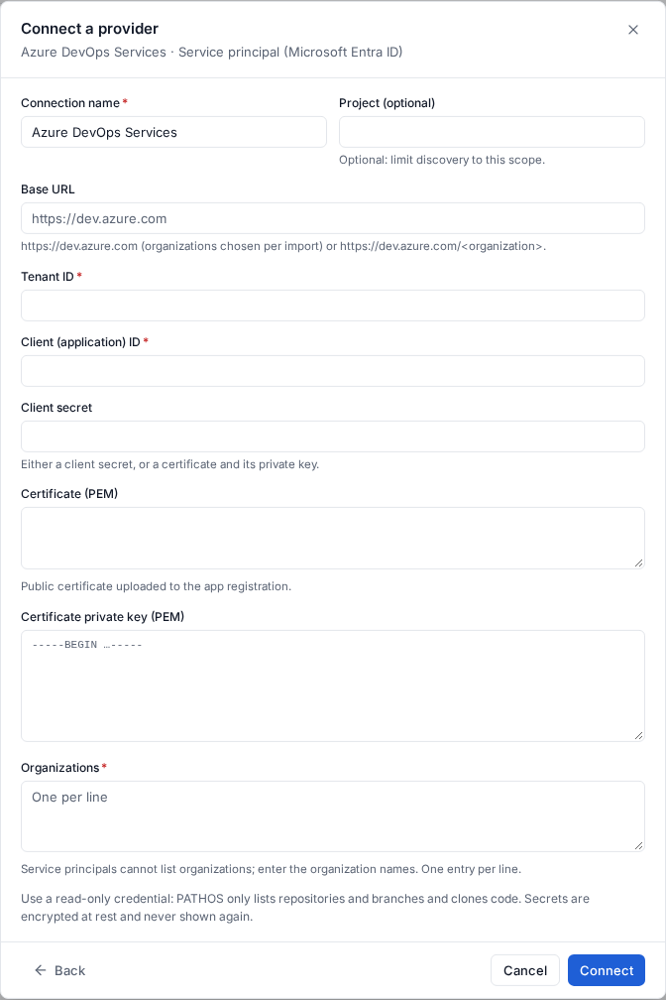

# Authentication methods

This page describes every authentication method PATHOS supports for SCM connections. For each method you find: what it is, when to use it, where to configure it at the provider, what PATHOS needs, how to connect, how to test, how to troubleshoot, and how to rotate or revoke it.

All methods are set up in **Administration → SCM connections → Connect provider** (permission `scm.manage`). See [Provider integrations](provider-integrations.md) for the dialog itself, and [Connection statuses and messages](provider-integrations.md#connection-statuses-and-messages) for what the status and error messages mean. Provider portals change their menus from time to time; where this page describes a portal location, the **Provider documentation** link in the dialog (listed with each method below) is authoritative.

> Never paste real secrets into tickets, chat or this Help Center. In the examples below, values such as `<client-secret>` are placeholders.

## Overview

| Provider | Method (label in PATHOS) | Type | Recommended for |
|---|---|---|---|
| GitHub, GitHub Enterprise Server | **GitHub App** | App installation, short-lived tokens | Organizations (least privilege) |
| GitHub, GitHub Enterprise Server | **Personal access token** | Static token | Small setups, single users |
| GitHub, GitHub Enterprise Server | **OAuth App** | Browser sign-in | Users who should connect with their own GitHub account |
| GitLab (gitlab.com, self-managed) | **Access token** | Personal, group or project access token | Most setups; group tokens for one group |
| GitLab | **OAuth application** | Browser sign-in | Users connecting with their own account |
| Bitbucket Cloud | **Access token** | Workspace, project or repository access token | One workspace |
| Bitbucket Cloud | **API token** | Atlassian account e-mail + scoped API token | Several workspaces, user-based access |
| Bitbucket Cloud | **OAuth consumer** | Browser sign-in | Users connecting with their own account |
| Azure DevOps Services | **Service principal (Microsoft Entra ID)** | Client secret or certificate | Unattended, organization-owned access |
| Azure DevOps Services | **Personal access token** | Static token | Quick setups |
| Azure DevOps Services | **Microsoft Entra ID (OAuth)** | Delegated browser sign-in | Users connecting with their own account |
| Azure DevOps Server | **Personal access token** | Static token | On-premises servers |

---

## GitHub

The same three methods exist for **GitHub** (`https://api.github.com`) and **GitHub Enterprise Server** (enter the **Base URL**, the server's API URL such as `https://github.example.com/api/v3`). For Enterprise Server, use the documentation at `https://docs.github.com/enterprise-server@latest`.

### GitHub App

1. **What it is.** An app registered in GitHub and installed on an organization or account. PATHOS signs a JWT with the app's private key and exchanges it for an installation token valid for one hour, which it renews automatically.
2. **When to use.** Recommended for organizations: least privilege, scoped to the repositories the installation grants, not tied to a person, short-lived tokens.
3. **Where to configure.** GitHub → your organization's **Settings → Developer settings → GitHub Apps → New GitHub App**. Generate a private key in the app settings, then **Install App** on the organization. Docs: `https://docs.github.com/apps/creating-github-apps/authenticating-with-a-github-app/authenticating-as-a-github-app-installation`.
4. **What PATHOS needs.** Repository permissions **Contents: read**, **Metadata: read**, **Pull requests: read** (webhooks optional). The **App ID** (app settings page), the **Installation ID** (from the installation URL `…/settings/installations/<id>`) and the private key (`.pem` file, RSA).
5. **Connect in PATHOS.** Provider **GitHub** (or **GitHub Enterprise Server**) → **GitHub App** → fields **Connection name**, **Organization or user (optional)**, **Base URL** (Enterprise Server only), **App ID**, **Installation ID**, **Private key (PEM)** → **Connect**.
   
6. **Test.** The connection is tested on creation; use **Test** later. The card shows *GitHub App `<App ID>`* and **Connected**.
7. **Troubleshooting.** *scm: GitHub App private key must be an RSA key in PEM format* → paste the complete `.pem` including the `BEGIN`/`END` lines. 401 → wrong App ID or key, or the key was deleted. 404 / not found → wrong Installation ID, or the app is not installed on the organization. Repositories missing → the installation is limited to selected repositories.
8. **Rotate / revoke.** Generate a new private key in the app settings, **Rotate credential** with the new key, then delete the old key at GitHub. To revoke, uninstall the app or delete its keys; deleting the connection in PATHOS destroys the stored key.

### GitHub OAuth App

1. **What it is.** Users sign in with GitHub through an OAuth App that an administrator registered; PATHOS stores the resulting user token.
2. **When to use.** When each connection should act as the signed-in user, without handling tokens manually.
3. **Where to configure.** GitHub → **Settings → Developer settings → OAuth Apps → New OAuth App** (Enterprise Server: same path on your server). Authorization callback URL: `<PATHOS URL>/api/v1/scm-oauth/callback`. Docs: `https://docs.github.com/apps/oauth-apps/building-oauth-apps/authorizing-oauth-apps`.
4. **What PATHOS needs.** Client ID and client secret, entered under **OAuth applications** (see [Provider integrations](provider-integrations.md#oauth-applications)); scopes `repo read:org`. GitHub OAuth has no read-only scope for private repositories, so `repo` grants write access as well: prefer a GitHub App for least privilege.
5. **Connect in PATHOS.** **GitHub** → **OAuth App** (*browser sign-in*) → **Connection name** (optional), **Organization or user (optional)**, **OAuth application** → **Continue with GitHub** → approve at GitHub.
6. **Test.** After the redirect the connection is saved; select **Test**. The card shows *Signed in as `<account>`*.
7. **Troubleshooting.** Redirect URI mismatch → the callback URL at GitHub must equal the URI shown in PATHOS. Organization repositories missing → the organization restricts OAuth Apps; an organization owner must approve the app. **Expired** → **Reconnect**.
8. **Rotate / revoke.** **Reconnect** re-runs the sign-in for the same connection. Deleting the connection revokes the OAuth token at GitHub. Users can also revoke the app under their GitHub **Settings → Applications**; the connection then fails with 401 and needs **Reconnect**. To change the client secret, edit the OAuth application in PATHOS.

### GitHub personal access token

1. **What it is.** A token created by a GitHub user.
2. **When to use.** Small setups or trials. Prefer fine-grained tokens limited to selected repositories.
3. **Where to configure.** GitHub → **Settings → Developer settings → Personal access tokens** (fine-grained or classic). Docs: `https://docs.github.com/authentication/keeping-your-account-and-data-secure/managing-your-personal-access-tokens`.
4. **What PATHOS needs.** Fine-grained: **Contents: read** and **Metadata: read** on the repositories (resource owner = your organization). Classic: the `repo` scope.
5. **Connect in PATHOS.** **GitHub** → **Personal access token** → **Connection name**, **Organization or user (optional)**, **Base URL** (Enterprise Server), **Token** → **Connect**.
6. **Test.** **Test** on the card.
7. **Troubleshooting.** 401 → token expired or revoked. 403 or organization repositories missing → the organization requires SSO authorisation of the token, or the fine-grained token was not approved by the organization, or the resource owner is wrong.
8. **Rotate / revoke.** Create a new token, **Rotate credential**, then delete the old token at GitHub. PATHOS cannot renew PATs; note the expiry date.

---

## GitLab

Works with gitlab.com and self-managed GitLab (enter the root URL in **Base URL**, without `/api/v4`).

### GitLab personal, group and project access tokens

1. **What it is.** One method, **Access token**, accepts any of the three GitLab token types: a personal access token (acts as the user), a group access token (one group and its subgroups), or a project access token (one project).
2. **When to use.** Group access tokens are a good default: not tied to a person and limited to one group. Use project tokens for a single repository.
3. **Where to configure.** Personal: user **Preferences → Access tokens**. Group: the group's **Settings → Access tokens**. Project: the project's **Settings → Access tokens**. Docs: `https://docs.gitlab.com/user/profile/personal_access_tokens/`.
4. **What PATHOS needs.** Scopes **`read_api`** and **`read_repository`**; for group and project tokens the role **Reporter** or higher.
5. **Connect in PATHOS.** **GitLab** → **Access token** → **Connection name**, **Group (optional)**, **Base URL**, **Token** → **Connect**.
6. **Test.** **Test**; the card shows **Connected**.
7. **Troubleshooting.** 401 → expired token (GitLab tokens always have an expiry date). 403 → missing scope or role below Reporter. Groups missing → group and project tokens only see their own group or project.
8. **Rotate / revoke.** Create a new token (or use GitLab's rotate function), **Rotate credential**, then revoke the old token in GitLab.

### GitLab OAuth application

1. **What it is.** Browser sign-in with a GitLab application registered by an administrator; tokens are refreshed automatically.
2. **When to use.** When users should connect with their own GitLab account.
3. **Where to configure.** GitLab → user or group **Settings → Applications** → new **confidential** application with redirect URI `<PATHOS URL>/api/v1/scm-oauth/callback`. Docs: `https://docs.gitlab.com/integration/oauth_provider/`.
4. **What PATHOS needs.** Application ID (**Client ID**) and secret; scopes `read_api read_repository`; **Base URL** for self-managed GitLab.
5. **Connect in PATHOS.** Register the application under **OAuth applications** (provider *GitLab*). Then **GitLab** → **OAuth application** → **Connection name** (optional), **Group (optional)**, **OAuth application** → **Continue with GitLab**.
6. **Test.** **Test** after returning to PATHOS.
7. **Troubleshooting.** *the provider declined the authorization* → the user cancelled or the scopes are not allowed. Redirect URI mismatch → fix the URI in GitLab. **Expired** → **Reconnect**.
8. **Rotate / revoke.** **Reconnect** for a new authorization. Deleting the connection revokes the token at GitLab. Users can revoke it under **Preferences → Applications**.

---

## Bitbucket Cloud

Bitbucket Cloud only (`https://api.bitbucket.org/2.0`). Bitbucket Data Center / Server is **not supported**.

### Bitbucket access tokens

1. **What it is.** A workspace, project or repository access token. It belongs to the workspace, not to a person.
2. **When to use.** Access to one workspace (or one project or repository).
3. **Where to configure.** Workspace / project / repository **settings → Access tokens**. Docs: `https://support.atlassian.com/bitbucket-cloud/docs/access-tokens/`.
4. **What PATHOS needs.** Scope **`repository:read`**, plus `account:read` / `project:read` to browse. Access tokens **cannot list workspaces**, so the workspace must be set on the connection.
5. **Connect in PATHOS.** **Bitbucket Cloud** → **Access token** → **Connection name**, **Workspace (required for access tokens)**, **Access token** → **Connect**.
6. **Test.** **Test**.
7. **Troubleshooting.** Empty organization list → set **Workspace**. 403 → missing scope. 401 → token revoked or expired.
8. **Rotate / revoke.** Create a new token, **Rotate credential**, revoke the old one in Bitbucket (Bitbucket has no revocation API that PATHOS could call).

### Bitbucket API token

1. **What it is.** An Atlassian account API token with scopes, used with the account's e-mail address (HTTP Basic authentication).
2. **When to use.** When one user-based credential should see several workspaces.
3. **Where to configure.** `id.atlassian.com` → **Security → API tokens** → create an API token *with scopes*, app **Bitbucket**. Docs: `https://support.atlassian.com/bitbucket-cloud/docs/using-api-tokens/`.
4. **What PATHOS needs.** Scopes **`read:user`**, **`read:workspace`**, **`read:project`**, **`read:repository`** for Bitbucket; the Atlassian account e-mail.
5. **Connect in PATHOS.** **Bitbucket Cloud** → **API token** → **Connection name**, **Workspace (required for access tokens)** (optional for this method), **Atlassian account e-mail** (for example `dana.owner@example.com`), **API token** → **Connect**.
6. **Test.** **Test**.
7. **Troubleshooting.** 401 → wrong e-mail, token expired, or a token *without* scopes. 403 → a scope is missing.
8. **Rotate / revoke.** Create a new API token, **Rotate credential**, revoke the old token at id.atlassian.com.

### Bitbucket OAuth consumer

1. **What it is.** Browser sign-in through a private OAuth consumer of a workspace.
2. **When to use.** When users should connect with their own Bitbucket account.
3. **Where to configure.** **Workspace settings → OAuth consumers → Add consumer**: private consumer, callback URL `<PATHOS URL>/api/v1/scm-oauth/callback`. Docs: `https://support.atlassian.com/bitbucket-cloud/docs/use-oauth-on-bitbucket-cloud/`.
4. **What PATHOS needs.** Key (**Client ID**) and secret. Permissions are set on the consumer: **repository** (read) and **account** (read); add **webhook** only if you want to grant that permission.
5. **Connect in PATHOS.** Register under **OAuth applications** (provider *Bitbucket Cloud*), then **Bitbucket Cloud** → **OAuth consumer** → **OAuth application** → **Continue with Bitbucket Cloud**.
6. **Test.** **Test** after the redirect.
7. **Troubleshooting.** Callback mismatch → fix the consumer's callback URL. Consumer must be **private** to receive a client secret. **Expired** → **Reconnect**.
8. **Rotate / revoke.** **Reconnect** for a new authorization; revoke the access in the user's Bitbucket settings, or delete the consumer. Bitbucket offers no revocation API, so deleting the PATHOS connection only destroys the stored token.

---

## Azure DevOps

### Microsoft Entra ID (delegated OAuth)

1. **What it is.** Users sign in with their Microsoft Entra ID (work) account; PATHOS receives a delegated token for Azure DevOps and refreshes it.
2. **When to use.** Azure DevOps Services organizations connected to Entra ID, where each connection acts as a user.
3. **Where to configure.** Microsoft Entra admin center → **App registrations → New registration**, platform **Web**, redirect URI `<PATHOS URL>/api/v1/scm-oauth/callback`; **API permissions → Add → Azure DevOps → Delegated → `user_impersonation`**; create a client secret under **Certificates & secrets**. Docs: `https://learn.microsoft.com/azure/devops/integrate/get-started/authentication/entra-oauth`.
4. **What PATHOS needs.** **Tenant ID** (directory ID), **Client ID** (application ID), **Client secret**, scopes `499b84ac-1321-427f-aa17-267ca6975798/.default offline_access`. The signing-in user needs access to the Azure DevOps organizations and projects.
5. **Connect in PATHOS.** Register under **OAuth applications** (provider *Azure DevOps Services*, see the screenshot in [Provider integrations](provider-integrations.md#oauth-applications)), then **Azure DevOps Services** → **Microsoft Entra ID (OAuth)** → **OAuth application** → **Continue with Azure DevOps Services**.
6. **Test.** **Test**; organizations of the user are listed during import.
7. **Troubleshooting.** Admin consent required → an Entra administrator must grant consent for `user_impersonation`. *token exchange failed* → wrong client secret or tenant. **Expired** → refresh token expired or was revoked (for example after a password change or conditional access); **Reconnect**.
8. **Rotate / revoke.** Client secret expiry: create a new secret in Entra ID and edit the OAuth application in PATHOS (existing connections keep working). Revoke user tokens by removing the app's consent or the user's sessions in Entra ID; then delete or reconnect the connection.

### Azure DevOps service principal (client secret or certificate)

1. **What it is.** An Entra ID app registration used as an application identity (client credentials). PATHOS authenticates with a client secret or with a certificate (signed JWT client assertion) and caches the token until it expires.
2. **When to use.** Organization-owned, unattended access that does not depend on a person.
3. **Where to configure.** Entra admin center → **App registrations → New registration**; under **Certificates & secrets** add a client secret or upload a certificate. Then, in **each Azure DevOps organization**: **Organization settings → Users → Add users**, add the service principal with **Basic** access, and give it **Reader** on the projects (group membership granting Code (read) and Project and team (read)). Docs: `https://learn.microsoft.com/azure/devops/integrate/get-started/authentication/service-principal-managed-identity`.
4. **What PATHOS needs.** **Tenant ID**, **Client (application) ID**, and *either* a **Client secret** *or* a **Certificate (PEM)** with its **Certificate private key (PEM)** (RSA), not both; the **Organizations** to discover (service principals cannot list organizations).
5. **Connect in PATHOS.** **Azure DevOps Services** → **Service principal (Microsoft Entra ID)** → **Connection name**, **Project (optional)**, **Base URL** (`https://dev.azure.com`), **Tenant ID**, **Client (application) ID**, **Client secret** or **Certificate (PEM)** + **Certificate private key (PEM)**, **Organizations** (one per line, for example `contoso-payments`) → **Connect**.
   
6. **Test.** **Test**; the card shows *Limited to: contoso-payments*.
7. **Troubleshooting.** *scm: tenant ID and client ID are required*; *scm: provide either a client secret or a certificate, not both*; *scm: a client secret or a certificate and private key is required*; *scm: certificate must be PEM encoded*; *scm: certificate private key must be an RSA key in PEM format*. 401 → expired secret or certificate, wrong tenant. 401/403 for one organization → the service principal was not added to that organization, or has Stakeholder instead of Basic access.
8. **Rotate / revoke.** Add a new secret or certificate in Entra ID, **Rotate credential** in PATHOS (blank secret fields keep their value), then delete the old one in Entra ID. To revoke, delete the secret/certificate or remove the service principal from the organizations.

### Azure DevOps personal access token (Services)

1. **What it is.** A user's personal access token for Azure DevOps Services.
2. **When to use.** Quick setups, or where service principals are not allowed.
3. **Where to configure.** Azure DevOps → **User settings → Personal access tokens → New token**. Docs: `https://learn.microsoft.com/azure/devops/organizations/accounts/use-personal-access-tokens-to-authenticate`.
4. **What PATHOS needs.** Scopes **Code (Read)** and **Project and Team (Read)**; scope the token to the organizations it should read.
5. **Connect in PATHOS.** **Azure DevOps Services** → **Personal access token** → **Connection name**, **Project (optional)**, **Base URL**, **Token**, **Organizations** (optional: limits discovery) → **Connect**.
6. **Test.** **Test**.
7. **Troubleshooting.** 401 → token expired (PATs have a maximum lifetime) or the organization's policy disallows PATs. Organization missing → the token is limited to other organizations.
8. **Rotate / revoke.** Regenerate or create a new PAT, **Rotate credential**, revoke the old one in Azure DevOps.

### Azure DevOps Server personal access token

1. **What it is.** A personal access token on your on-premises Azure DevOps Server.
2. **When to use.** The only method PATHOS supports for Azure DevOps Server.
3. **Where to configure.** Your server → **User settings → Personal access tokens**. Docs: `https://learn.microsoft.com/azure/devops/organizations/accounts/use-personal-access-tokens-to-authenticate?view=azure-devops-server`.
4. **What PATHOS needs.** **Code (Read)** and **Project and Team (Read)**; the **collection URL**.
5. **Connect in PATHOS.** **Azure DevOps Server** → (only one method, so the dialog goes straight to the details) **Connection name**, **Project (optional)**, **Base URL** (required, for example `https://ado.example.com/tfs/DefaultCollection`), **Token** → **Connect**.
6. **Test.** **Test**.
7. **Troubleshooting.** *scm: destination address is not allowed* → the server's address is blocked by the outbound policy; ask your PATHOS administrator. TLS errors → the server certificate must be trusted by PATHOS. 401 → token expired.
8. **Rotate / revoke.** New PAT, **Rotate credential**, revoke the old one on the server.

---

## Not available

These methods are deliberately **not available** in PATHOS:

| Method | Status | Reason |
|---|---|---|
| Azure managed identity | **Not available** | Only usable by workloads running on Azure, and the instance metadata endpoint it needs is blocked by PATHOS' outbound address policy. Use a service principal |
| Azure DevOps OAuth (legacy `app.vssps.visualstudio.com` apps) | **Not available** | Deprecated by Microsoft for new registrations; use Microsoft Entra ID (OAuth) |
| Bitbucket app passwords | **Not available** | Retired by Atlassian; use an access token or an API token |
| GitLab deploy tokens | **Not available** | Clone access only, no API access for discovery |
| SSH keys | **Not available** | PATHOS uses the providers' HTTPS APIs for discovery and HTTPS for cloning |
| Bitbucket Data Center / Server, other Git servers | **Not available** | No adapter; upload such code with [Import from Local PC](repository-import.md#a-import-from-local-pc) |
| Azure DevOps Server with OAuth or service principal | **Not available** | Personal access token only |
