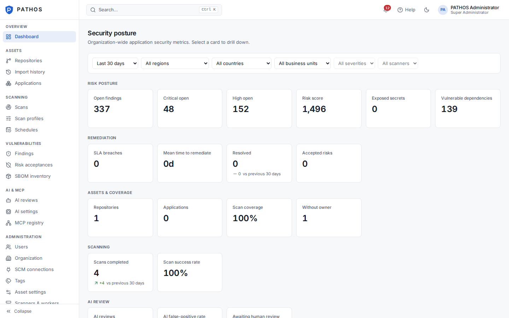
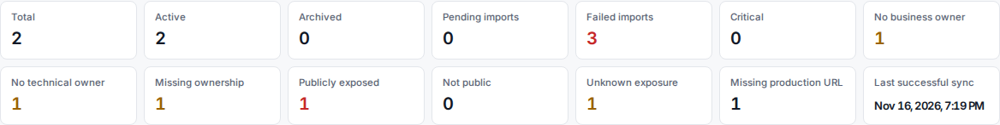
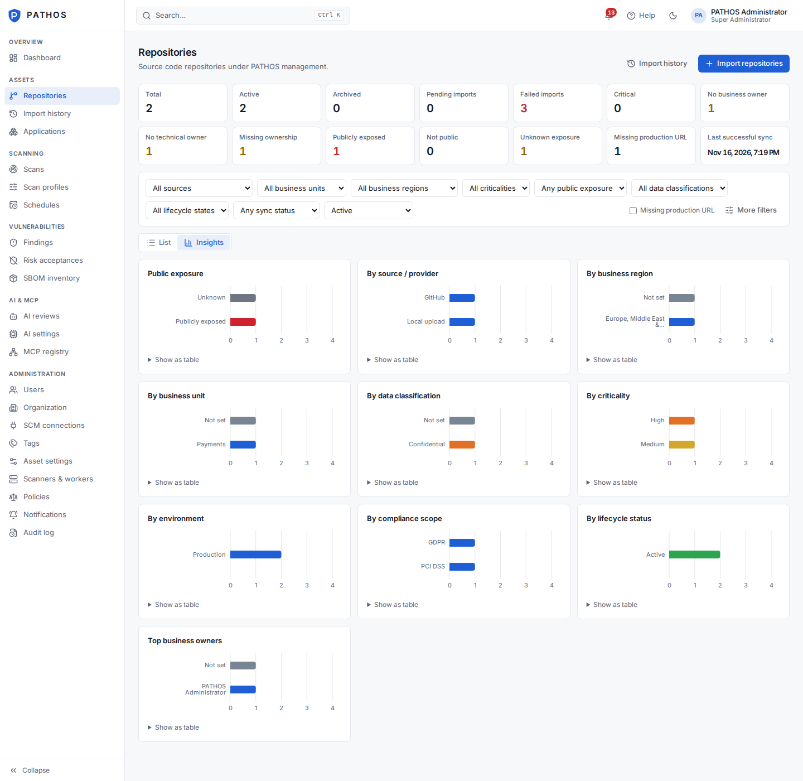
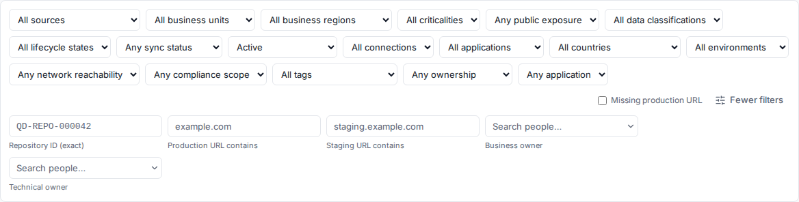

# Dashboards and reporting

PATHOS reports in these places:

| Where | For |
|---|---|
| **Overview → Dashboard** | Organization-wide metrics with drill-down |
| **Overview → Executive overview** | A printable summary for leadership |
| **Overview → Reports** | Saved finding reports, shared and delivered on a schedule |
| **Assets → Repositories** (KPI strip and **Insights**) | Inventory and ownership gaps |
| **Export** on every list | CSV of the loaded rows |

Application risk, coverage and benchmarking are on the [Posture](posture.md) pages; AI-written summaries are [AI reports](ai-analyst.md#ai-reports). Everything respects your permissions: you only see and count what is in your scope.

## Security posture dashboard

**Overview → Dashboard** shows organization-wide metrics grouped into *Risk posture*, *Remediation*, *Assets & coverage*, *Scanning*, *AI review*, *Supply chain* and *Platform*. Select a card to drill down.

Selected cards:

| Card | Meaning |
|---|---|
| Repositories | Active repositories under management |
| Applications | Applications grouping repositories |
| **Scan coverage** | Share of active repositories scanned in the selected period |
| Without owner | Repositories with no application or owner |
| Open findings, Critical open, High open, Risk score, Exposed secrets, Vulnerable dependencies | Finding metrics (risk score: severity-weighted open findings per repository, critical 10, high 5, medium 2, low 0.5; not the same as the [contextual risk](vulnerability-intelligence.md#contextual-risk) of a finding) |
| SLA breaches, Mean time to remediate, Resolved, Accepted risks | Remediation metrics |
| Repositories by criticality, Riskiest repositories | Charts |

Dashboard filters: **Period** (Last 7 / 30 / 90 days, Last 12 months), **Region**, **Country**, **Business unit**. The **Severity** and **Scanner** filters are shown but disabled. Filtering the dashboard by provider, environment, criticality or application is **not available**; use the Repositories page filters and Insights for those.

## Executive overview

**Overview → Executive overview** (permission `findings.read`) summarizes the security posture for leadership over 30, 90, 180 or 365 days: open critical and high findings, actively exploited vulnerabilities, SLA compliance and overdue findings, findings found and fixed each week, the open backlog, mean time to fix by severity, and the applications and business units with the most critical findings. **Print** produces a clean page (or a PDF from the print dialog). Everything is computed from the findings you can access.

## Reports

**Overview → Reports** keeps the views you need again and again. **New report**: choose the findings (status, severity, type, risk, KEV, past SLA, repository), then show them as a list with the columns you want or as counts per severity, status, type, repository, application, business unit, scanner, assignee or vulnerability. The preview updates as you change it.

- **Share with everyone who can read findings**, or keep it to yourself.
- **Deliver** it daily, weekly or monthly to **Recipients**: they get the *Scheduled report* notification with a link. Scheduling needs `findings.export`. A report always shows each person only the findings they may see, whoever created it.
- **CSV** downloads the result (needs `findings.export`); **Print** gives a printable page; **Run again** refreshes it.

## Repository KPI strip

The strip at the top of **Assets → Repositories** summarises the repositories that match the current filters. Each card is a link to the matching list.

| Card | Counts | Opens |
|---|---|---|
| Total | Active and archived repositories | List with status *Active and archived* |
| Active | Repositories that are not archived | Default list |
| Archived | Archived repositories | List filtered to Archived |
| Pending imports | Import items still running | Import history, *Active* |
| Failed imports | Import items that failed or need attention in the last 30 days | Import history, *Finished* |
| Critical | Active repositories with criticality Critical | Filter Criticality |
| No business owner | Active repositories without a business owner | Filter Missing owner |
| No technical owner | Active repositories without a technical owner | Filter Missing owner |
| Missing ownership | Active repositories without a business **or** a technical owner | Filter *Missing any owner* |
| Publicly exposed | Active repositories with public exposure Yes | Filter Public exposure |
| Not public | Active repositories with public exposure No | Filter Public exposure |
| Unknown exposure | Active repositories with public exposure Unknown | Filter Public exposure |
| Missing production URL | Active repositories without a production URL | *Missing production URL* filter |
| Last successful sync | Time of the most recent successful sync; below it, the number of active repositories whose sync failed, is missing upstream or has no access (*n sync failures*) | List filtered to *Sync failed* when there are failures, otherwise sorted by last sync |

Warning and danger colours highlight cards that need action (for example failed imports, missing owners, publicly exposed assets).

## Insights

Switch the Repositories page from **List** to **Insights** to see charts for the current filters: **Public exposure**, **By source / provider**, **By business region**, **By business unit**, **By data classification**, **By criticality**, **By environment**, **By compliance scope**, **By lifecycle status** and **Top business owners**. *Not set* shows repositories without a value. **Show as table** displays the numbers.

## Filters, search and sorting

| Control | Options |
|---|---|
| Standard filters | Source (provider or Local upload), Business unit, Business region, Criticality, Public exposure, Data classification, Lifecycle, Sync status, Status (Active / Archived / Active and archived) |
| **More filters** | Connection, Application, Country, Environment, Network reachability, Compliance scope, Tag, Missing owner, Application ownership (*No application*), **Repository ID (exact)**, **Production URL contains**, **Staging URL contains**, Business owner, Technical owner |
| Checkbox | **Missing production URL** |
| Search | **Search repositories** matches names, Repository IDs and staging or production URLs; the **Repository ID** filter matches one exact ID such as `QD-REPO-000042`. The top-bar **Search…** (Ctrl K) also finds repositories by Repository ID |
| Sort | Default order, Name (A–Z / Z–A), Repository ID (ascending / descending), Newest / Oldest first, Most / Least critical first, Recently / Least recently synced |
| Columns | **Columns** shows or hides columns, for example Application, Environment, Technical owner, Lifecycle, Last sync, Technologies |

Filters are kept in the page address, so you can bookmark or share a filtered view.

## CSV export

Every table (repositories, applications, import history, scans, findings) has **Export**, which downloads the **loaded rows** as CSV (*Export loaded rows as CSV*). Scroll or load further pages first if you need more rows. Some columns are always exported even when hidden, for example **Public exposure** in the repository list and **Repository ID** in scans and findings. Owner columns are exported as e-mail addresses.

## Reporting scenarios

### 1. Which internet-facing, critical assets do we have?

1. Open **Repositories**.
2. Set **Public exposure** to *Public* and **Criticality** to *Critical* (repeat with *High*).
3. Show the **Public endpoints** and **Production URL** columns.
4. Select **Export**.

### 2. Which assets still lack an exposure assessment?

1. Select the **Unknown exposure** card.
2. Add **Business unit** to split by owner organization.
3. Show the **Business owner** column and **Export** to send the list to the owners.

### 3. Ownership gaps per business unit

1. Select the **Missing ownership** card (or **More filters → Missing owner → Missing any owner**).
2. Switch to **Insights** and look at **By business unit**.
3. Back in **List**, **Export** for follow-up.

### 4. Repositories of one application, with their posture

1. **More filters → Application** → *Payments Platform*.
2. Check the KPI strip (exposure, critical, ownership) and **Insights**.
3. Open **Posture → Application posture** for the application's risk, open findings, SLA breaches and coverage, or export the findings and filter on the **Application** column.

### 5. Import and sync health

1. Select **Failed imports** to open finished jobs; open each failed job for the error code ([Import history](import-history.md#error-codes)).
2. Set **Sync status** to *Sync failed* or *No access* to find repositories whose connection lost access.
3. Check **Administration → SCM connections** for connections in **Error** or **Expired**.

### 6. Scan coverage by region

1. Open **Dashboard**, choose **Period** *Last 30 days* and a **Region**.
2. Read **Scan coverage** and **Repositories**.
3. To find unscanned repositories, open **Repositories**, filter the same business region and sort or show the **Last scan** column (*Never* for unscanned ones).

## Related APIs

[Repositories API](../api-reference/repositories.md) (list filters, insights), [Applications API](../api-reference/applications.md), [Imports API](../api-reference/imports.md), [Integrations and reporting](../api-reference/integrations-reporting.md) (executive overview, reports).
