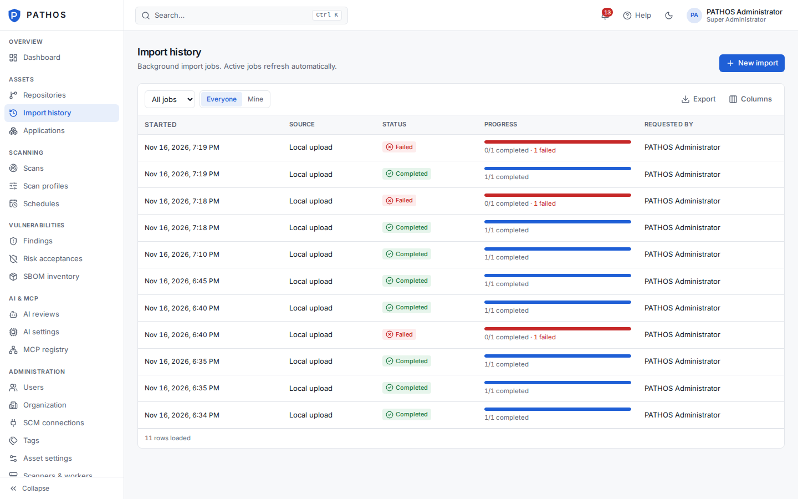
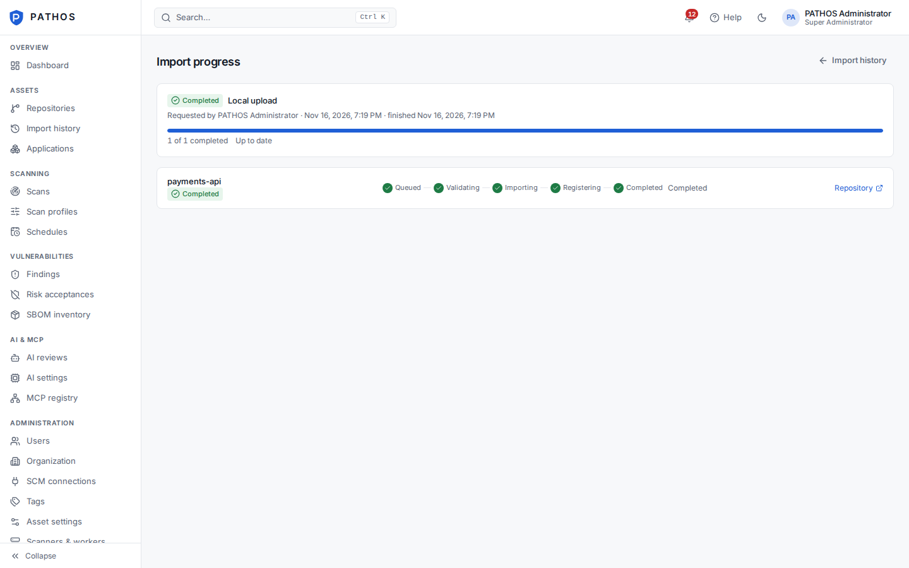
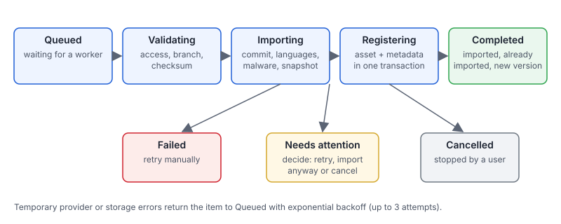
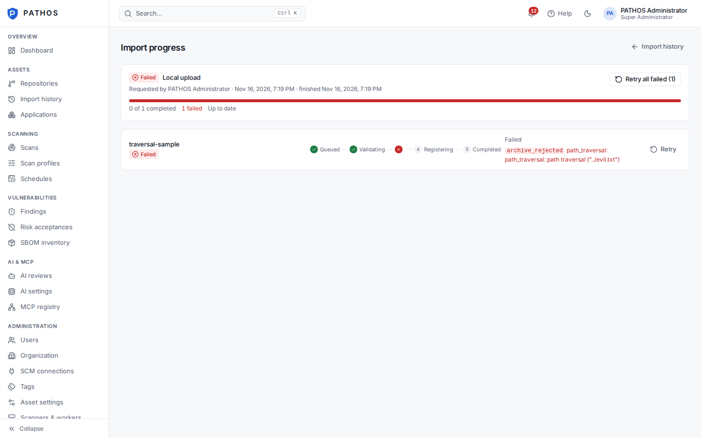

# Import history

Every import, whatever its source, runs as a background **import job** with one **item** per repository or archive. **Import history** lists these jobs so that you can follow progress, find out why an import failed, and retry or cancel it. Imports keep running when you close the browser.

Open **Assets → Import history** (`/repositories/imports`).

**Who sees which jobs.** You always see the jobs you started. Users with `repos.manage` organization-wide see all jobs. Use **Everyone** / **Mine** to switch.

## Fields

### Job list

| Column | Meaning |
|---|---|
| Started | When the job was created |
| Source | **Local upload**, **Git** or **DevOps**, with the connection name for Git and DevOps |
| Status | The job's overall status (see below) |
| Progress | Bar and *n/m completed*, plus *n failed* and *n need attention* |
| Requested by | The user who started the import |
| Finished | Hidden by default (**Columns**); when the job finished |

Filter with **All jobs / Active / Finished**. **Export** downloads the loaded rows as CSV.

### Job detail (Import progress)

Select a job to open **Import progress** (`/repositories/imports/<job ID>`). The **job ID** is the last part of this address; it is also the value to quote in support requests and the target of the audit entries.

| Element | Meaning |
|---|---|
| Status badge, source and connection | For example *Completed · Local upload* or *Failed · Git · GitHub (acme)* |
| *Requested by … · `<start>` · finished `<end>`* | Initiator and timestamps; *onboarding scan requested* if a scan was requested |
| Overall progress | *n of m completed*, failures, items needing attention, and *Updating every 2 seconds…* while active or *Up to date* |
| **Retry all failed (n)** | Retries every failed, cancelled or needs-attention item |
| **Cancel import** | Cancels the job while it is active |
| Per item: name and status | Display name and the item's status; *already imported* or *new version added* where applicable |
| Per item: *attempt n/m* | Shown after an automatic retry (at most 3 attempts) |
| Per item: stage stepper | Queued → Validating → Importing → Registering → Completed; a failure is marked on the stage where it stopped |
| Per item: progress and message | For example *Reading branch and commit*, *Retrying after a temporary error* |
| Per item: error | The **error code** (for example `archive_rejected`) and message |
| Per item: **Repository** link | Opens the registered repository (or the existing one for duplicates); its Repository ID is shown there |
| Per item: **Retry** / **Import anyway** | Retry one item; **Import anyway** only for `duplicate` |

Some information is kept on the repository rather than in the import history: the **Repository ID**, **branch**, **commit SHA** (Git, **Source → Latest commit** and **Sync history**) and the **snapshot** and archive SHA-256 (uploads, **Source → Source snapshots**). The audit log entry `repository.import` records the import job ID, Repository ID, source, file name, archive and snapshot SHA-256, file counts, skipped entries, malware-scan result and the registered metadata.

## Statuses

| Status | Meaning |
|---|---|
| Draft, Pending | Internal states; not normally visible |
| **Queued** | Waiting for an import worker. Items waiting for an automatic retry are also queued |
| **Validating** | Git / DevOps: the connection is resolved and PATHOS checks that it can read the repository and that the branch exists. Upload: all parts present, archive SHA-256 verified |
| **Importing** | Git / DevOps: latest commit, languages and size are read. Upload: malware scan (if configured), normalization into an encrypted snapshot, language and manifest detection |
| **Registering** | Repository, metadata, owners, compliance scopes, tags, snapshot and audit entry are saved in one transaction; the Repository ID is assigned |
| **Completed** | Done: *imported*, *already imported* (same connection and repository; nothing new created) or *new version added* (new snapshot) |
| **Failed** | A permanent error, or a temporary error that persisted after 3 attempts. Retry manually after fixing the cause |
| **Needs attention** | A decision or action is required: `duplicate`, `token_expired`, `permission_denied` (requester lost access), `validation_failed`, `requester_unavailable` |
| **Cancelled** | Stopped by a user before completion |

A **job's** status summarises its items: active while any item is active, then **Completed**, **Failed**, **Needs attention** or **Cancelled**. When a job finishes with failures, PATHOS sends the `import.failed` notification.

Temporary errors (provider unavailable, rate limits, timeouts, storage or malware scanner unavailable) return the item to **Queued** and retry automatically with exponential backoff (about 30 seconds, then 60 seconds) up to 3 attempts in total. Each item has a time limit (default 30 minutes); exceeding it fails the item with `timeout`.

## Error codes

### Git and Azure DevOps imports

| Code | Status | Meaning | Fix |
|---|---|---|---|
| `repository_not_found` | Failed | The repository does not exist or the connection cannot see it | Check the name; give the credential access |
| `permission_denied` | Failed | The connection's credential lacks read permission on the repository | Add the permission (see [Authentication methods](authentication.md)), then retry |
| `authentication_failed` | Failed | The provider rejected the credential | **Test** the connection; rotate the credential |
| `token_expired` | Needs attention | The OAuth authorization expired | **Reconnect** the connection, then retry |
| `invalid_branch` | Failed | The chosen branch does not exist | Import again with an existing branch |
| `duplicate` | Needs attention | The same clone URL is already registered through another connection | **Import anyway** to create a second record, or leave it |
| `connection_unavailable` | Failed | The SCM connection was deleted | Recreate the connection and import again |
| `untrusted_clone_url` | Failed | The provider returned a clone URL that does not match the connection's host | Check the base URL of the connection |
| `blocked_address` | Failed | The provider address is blocked by the outbound address policy | Contact your administrator |
| `provider_unavailable`, `provider_error`, `timeout` | Retried, then Failed | Temporary provider problem, rate limit or slow answer | Wait and **Retry** |

### Local uploads

| Code | Status | Meaning | Fix |
|---|---|---|---|
| `archive_rejected` | Failed | The archive breaks a safety rule. The message starts with the rule: `path_traversal`, `absolute_path`, `invalid_path`, `duplicate_path`, `too_many_files`, `too_large`, `file_too_large`, `compression_ratio`, `encrypted_entry`, `unsupported_format`, `corrupt_archive` | Fix the archive (for example remove `../` entries) and import it again as a new upload |
| `checksum_mismatch` | Failed | The stored archive or a part does not match its SHA-256 | Upload again |
| `upload_corrupt` | Failed | Stored upload data failed its integrity check | Upload again |
| `upload_missing`, `upload_incomplete` | Failed | The upload expired (24 hours), was deleted, or parts are missing | Upload again |
| `upload_consumed` | Failed | The upload was already imported | Nothing to do, or upload again |
| `malware_detected` | Failed | ClamAV found malware (signature in the message); the upload is discarded | Do not import; inform your security team |
| `malware_scan_too_large` | Failed | Larger than the ClamAV stream limit | Administrator raises the limit, or split the archive |
| `malware_scanner_unavailable` | Retried, then Failed | ClamAV is required but unreachable | Wait or contact your administrator |
| `storage_unavailable` | Retried, then Failed | The source store could not be read or written | Wait or contact your administrator |
| `uploads_unavailable` | Failed | Local uploads are not configured on this server | Contact your administrator |
| `duplicate` | Needs attention | An identical archive was already imported | **Import anyway** to keep a second copy |

### Any source

| Code | Status | Meaning | Fix |
|---|---|---|---|
| `validation_failed` | Needs attention | Metadata is no longer valid (for example a required field changed, or an owner, team, unit, region or tag was deleted after you submitted) | Import again with corrected metadata |
| `name_clash` | Failed | Another asset already uses this asset name | Import again with another asset name |
| `permission_denied` | Needs attention | The requester no longer has `repos.manage` for the placement or the target repository | Ask an administrator, then retry |
| `requester_unavailable` | Needs attention | The requesting user was deactivated | Another user imports again |
| `invalid_item` | Failed | The item has no upload or connection reference | Import again |
| `cancelled` | Cancelled | Cancelled before completion | Retry if needed |
| `timeout` | Failed | The item did not finish within the time limit | Retry; for very large archives ask your administrator to raise `PATHOS_IMPORT_TIMEOUT` |
| `internal_error` | Failed | Unexpected error, details in the server log | Retry; contact your administrator with the job ID |

## Audit entries

| Action | When |
|---|---|
| `repository_import.create` | A job was created |
| `repository_import.retry` | Items were retried |
| `repository_import.cancel` | A job was cancelled |
| `repository_import.item_failed` | An item failed or needs attention (code and message in the metadata) |
| `repository.import` | A repository was registered (or a new snapshot added) by an import |

See **Administration → Audit log** (permission `audit.read`).

## Step-by-step: investigate a failed import

**Purpose.** Find out why an import did not complete and fix it.

**Prerequisites.** A job with status **Failed** or **Needs attention**.

**Required permissions.** `repos.read`; you see your own jobs, or all jobs with `repos.manage` organization-wide.

**Example.** A ZIP containing an entry `../evil.txt`.

1. Open **Import history**. Use **Finished** to hide active jobs, or select **Failed imports** in the repository KPI strip.
2. Select the job. The failed item shows where it stopped and the error.
   
3. Read the code and message, here `archive_rejected` with `path_traversal: path traversal ("../evil.txt")`, and look it up in [Error codes](#error-codes).
4. Fix the cause (here: rebuild the archive without the `../` entry).

**Expected result.** You know whether a retry will help (temporary or access problems) or whether you must import again (problems with the archive or the metadata).

**Related APIs.** [Imports API](../api-reference/imports.md).

## Retry a failed import

**Required permissions.** The requester of the job, or `repos.manage` organization-wide. Only items with status Failed, Needs attention or Cancelled can be retried.

1. Fix the cause first (for example **Reconnect** an expired connection, or grant access).
2. Open the job. Select **Retry** on one item, or **Retry all failed (n)**.
3. For a `duplicate` item, select **Import anyway** if you deliberately want a second record.

The item returns to **Queued** with a new set of attempts and the job becomes active again. Retrying reuses the original source and metadata; to change the metadata or the archive, start a new import instead.

## Cancel an import

**Required permissions.** The requester of the job, or `repos.manage` organization-wide. **Cancel import** is offered while items are active, and also for items that need attention (to close them without retrying).

1. Open the job and select **Cancel import**.
2. Confirm in *Cancel this import?*.

Queued repositories are cancelled immediately; repositories being processed stop at the next stage. Repositories that were already registered stay registered. Cancelled items can be retried later.

## Duplicate detection

See [What happens to duplicates](repository-import.md#what-happens-to-duplicates). In short: the same repository through the same connection is *already imported* (completed, nothing new); the same clone URL through another connection, or the same archive SHA-256, needs a decision (**Import anyway**).
