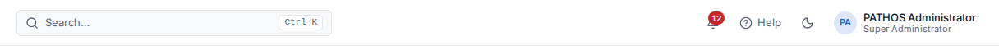
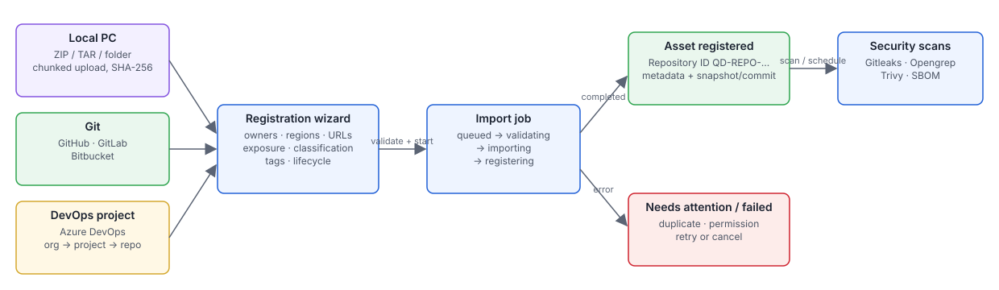

# Introduction to PATHOS

PATHOS is a self-hosted platform for managing the security posture of the software your organization builds. It keeps an inventory of your source code repositories, records who owns them and how important they are, scans them with open-source security scanners in isolated workers, ranks the findings by contextual risk, supports their triage and manual review, and turns the results into dashboards, posture views and reports that can be filtered by business unit, region, application and owner.

This Help Center covers the whole product, from registering repositories to administration. It is bundled with PATHOS, so it always matches the version you run.

## Software security posture management in plain terms

*Software Security Posture Management* (SSPM) and *Application Security Posture Management* (ASPM) describe the same idea: instead of running scanners in isolation and collecting separate reports, you keep one current picture of

1. **what software you have** (the asset inventory),
2. **who is accountable for it and how much it matters** (ownership, criticality, data classification, exposure),
3. **what is wrong with it** (findings from secret scanning, static analysis, dependency analysis and infrastructure-as-code checks), and
4. **what is being done about it** (triage, remediation deadlines, accepted risks, trends).

PATHOS implements this as follows:

| Posture question | Where PATHOS answers it |
|---|---|
| What do we have? | **Repositories** inventory, each with a permanent Repository ID such as `QD-REPO-000042`, and **Applications** that group repositories |
| Who owns it and how critical is it? | Registration metadata: business, technical and application owner, business unit, regions, criticality, data classification, environment, compliance scope, public exposure |
| What is wrong with it? | **Scans** run by isolated workers (secrets, code, dependencies, infrastructure as code, CI/CD workflows) and **scan targets** (container images, web applications and APIs, SBOMs, build artifacts), normalized into **Findings** and ranked by **contextual risk** |
| What is being done? | Finding status, assignment and SLA, **Risk acceptances**, **Human Eye** reviews, **security policies**, **Posture** and **Dashboard** trends, and the audit log |

Application URLs, public domains and IP addresses that you record on a repository are **metadata only**: PATHOS never contacts, resolves or scans them. Running applications are tested only when someone registers them as an authorized [scan target](scanning.md#scan-targets).

## Repository asset management

PATHOS makes sure every repository that should be assessed is known, described and owned:

- **One registration process for every source.** All three import methods share the same registration wizard and the same background import engine, so a repository uploaded as a ZIP file and one imported from Azure DevOps carry the same metadata.
- **A permanent identity.** Every repository receives a Repository ID that never changes and is never reused. It appears in the inventory, scan jobs, findings, CSV exports, global search and the audit log.
- **Accountability.** A business owner, a business unit, a business region and an answer to "Is this publicly exposed to the internet?" are always required; your administrator can require more.
- **Traceability.** Every import is a job with a status history, error codes and audit entries. Every scan records the commit (Git) or snapshot (upload) it analysed.

## Repositories, applications and business assets

| Concept | What it is in PATHOS |
|---|---|
| **Repository** | One code base: a Git repository from a provider, or an uploaded archive. It is the unit that is scanned, carries the Repository ID and holds all registration metadata, including staging and production URLs and public exposure. |
| **Application** | A business application (for example "Payments Platform") that groups one or more repositories and has its own owner, security owner, business unit and criticality. |
| **Business asset** | In PATHOS terms, the application together with its repositories. There is no separate asset object: the repository record plus its application *is* the asset record. |

A repository belongs to at most one application; an application can have many repositories. See [Applications](applications.md).

## How repository data feeds assessments and reporting

1. **Registration** stores ownership, placement (business unit, country, region) and classification on the repository.
2. **Access control** uses the placement: role assignments can be scoped to a business unit, a region or a single repository, and every list is filtered accordingly.
3. **Scanning** uses the source: the scan branch or the current upload snapshot. Findings are linked to the repository and its Repository ID.
4. **Prioritisation and reporting** combine both: dashboards and the repository insights can be filtered by business unit, region, criticality, exposure and application, and the KPI strip highlights gaps such as repositories without an owner, without a production URL or with unknown exposure.

## How this Help Center is organised

**Getting started**

1. [Introduction to PATHOS](introduction.md) (this page)
2. [Sign-in, MFA and single sign-on](sign-in-and-sso.md): signing in, two-factor authentication, recovery codes, SSO

**Connecting providers and importing**

3. [Provider integrations](provider-integrations.md): SCM connections, OAuth applications, statuses, webhooks, re-sync, deletion
4. [Authentication methods](authentication.md): every supported credential per provider, and the unsupported ones
5. [Importing repositories](repository-import.md): Local PC, GitHub / GitLab / Bitbucket, Azure DevOps
6. [Asset registration](asset-registration.md): every wizard field, what is required, regions, exposure
7. [Import history](import-history.md): statuses, error codes, retry and cancel

**Assets**

8. [Repository management](repository-management.md): the repository record, the Repository ID, status, viewing and editing
9. [Applications](applications.md): grouping repositories into business applications

**Scanning and findings**

10. [Security scanning: scanners and profiles](security-scanning.md): triggers, scanners, plugins, profiles, custom rules, offline mode
11. [Running scans](scanning.md): executions, schedules, comparison, scan targets, result imports
12. [Working with findings](findings.md): status, assignment, bulk actions, risk acceptance, SLAs, suppression rules
13. [Contextual risk and vulnerability intelligence](vulnerability-intelligence.md): risk score, CVE details, reachability, feeds
14. [Human Eye](human-review.md): manual security assessment and independent review

**Posture and reporting**

15. [Posture](posture.md): application posture, coverage, unmanaged assets, attack paths, blast radius
16. [Dashboards and reporting](dashboards.md): dashboard, executive overview, reports, KPIs, CSV export
17. [Material changes and developer insights](developer-insights.md): security-material changes between scans, opt-in developer attribution

**Supply chain and governance**

18. [Supply chain and pull requests](supply-chain.md): SBOM export, package health, end of life, signatures, malicious packages, pull request checks, fix pull requests
19. [Application versions, VEX and component policies](releases-and-vex.md): release snapshots, VEX import and export, portfolio search, component policies
20. [Secret push protection](secret-push-protection.md): pre-commit and pre-receive hooks, push-event secret alerts
21. [Security policies and compliance](policies-and-compliance.md): SLAs, license policy, security policies, compliance frameworks

**Integrations and developer tools**

22. [Integrations and API tokens](reporting-and-integrations.md): webhooks, Jira, ServiceNow, REST API tokens
23. [CI/CD integration](ci-cd-integration.md): the `pathos` CLI, GitHub Action, GitLab, Azure Pipelines and Jenkins templates, security gate
24. [IDE integration (VS Code)](ide-integration-vscode.md): findings in the editor, triage from VS Code

**AI and administration**

25. [AI features](ai-analyst.md): AI settings, AI reviews, MCP, AI Security Analyst, AI reports, AI usage
26. [Administration](administration.md): users and roles, organization, notifications, workers, audit log
27. [Troubleshooting and FAQ](troubleshooting.md)

The [API reference](../api-reference/index.md) documents the endpoints behind every screen.

> **Permissions.** What you can see and do depends on your role and its scope. This guide names the permission each task needs, for example `repos.manage` to import repositories. Ask your PATHOS administrator if a menu item or button is missing.
