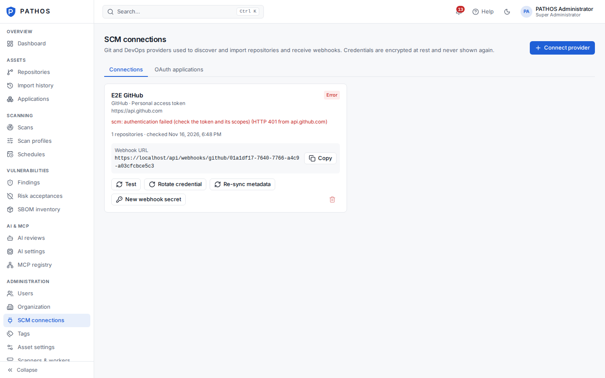
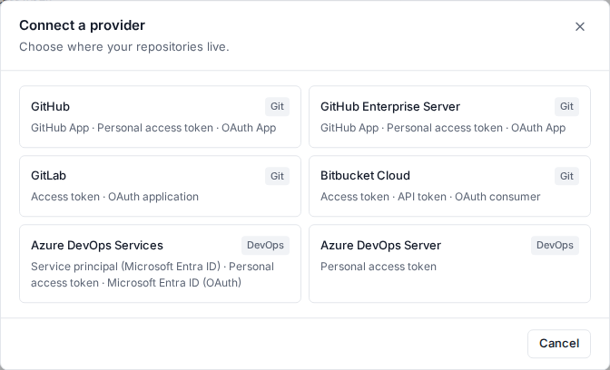
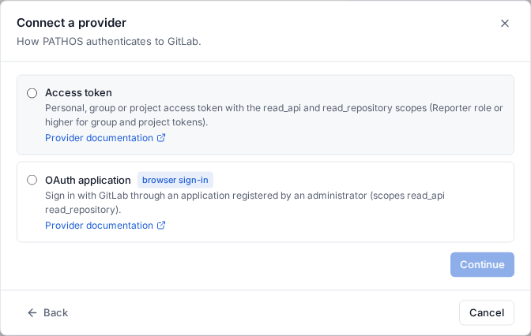
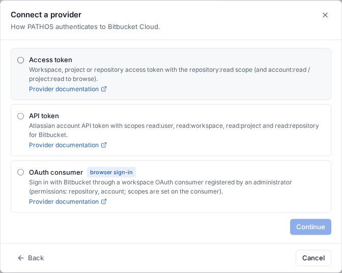
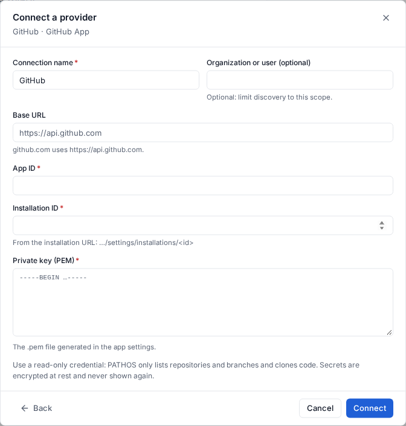
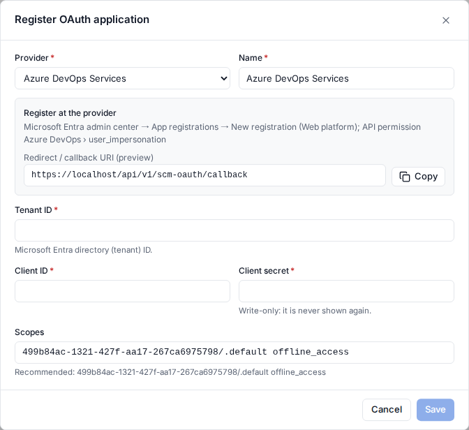
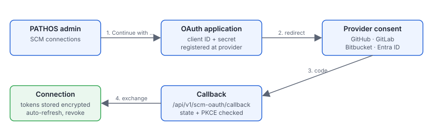

# Provider integrations

An **SCM connection** links PATHOS to one account, organization or server of a source code provider. Connections are used to discover and import repositories, to read branch and commit metadata during sync, to let scan workers clone code, and to receive webhooks.

Manage them under **Administration → SCM connections** (`/admin/scm`). This page requires the permission `scm.manage` (organization-wide); by default only `super_admin` and `platform_admin` have it.

## Supported providers

| Provider | Category | Base URL | Authentication methods |
|---|---|---|---|
| GitHub | Git | `https://api.github.com` (fixed) | GitHub App, Personal access token, OAuth App |
| GitHub Enterprise Server | Git | Required, e.g. `https://github.example.com/api/v3` | GitHub App, Personal access token, OAuth App |
| GitLab | Git | `https://gitlab.com` or a self-managed root URL (without `/api/v4`) | Access token (personal, group or project), OAuth application |
| Bitbucket Cloud | Git | `https://api.bitbucket.org/2.0` (fixed) | Access token, API token, OAuth consumer |
| Azure DevOps Services | DevOps | `https://dev.azure.com` or `https://dev.azure.com/<organization>` | Service principal (Microsoft Entra ID), Personal access token, Microsoft Entra ID (OAuth) |
| Azure DevOps Server | DevOps | Required: the collection URL, e.g. `https://ado.example.com/tfs/DefaultCollection` | Personal access token |

Each method is explained in [Authentication methods](authentication.md).

## Connection card

| Element | Meaning |
|---|---|
| Name, provider, method | For example *GitHub · Personal access token*, or *GitHub App 123456* |
| Owner scope | The organization, group, workspace or project the connection is limited to, if set |
| *Signed in as …* | The provider account (OAuth connections) |
| Status badge | **Connected**, **Untested**, **Error**, **Expired** or **Revoked**, see [Connection statuses and messages](#connection-statuses-and-messages) |
| Status message | The last error, for example *scm: authentication failed (check the token and its scopes) (HTTP 401 from api.github.com)* |
| *n repositories · checked …* | Imported repositories and the time of the last test |
| *Token expires …* | Expiry of an OAuth token (*refreshed automatically*) or a known token expiry |
| *Limited to: …* | Azure DevOps organizations entered on the connection |
| Webhook URL | The address to configure at the provider (see [Webhooks](#webhooks)) |
| Actions | **Reconnect** (OAuth), **Test**, **Rotate credential** (non-OAuth), **Re-sync metadata**, **New webhook secret**, delete (bin icon) |

## Step-by-step: connect a provider

**Purpose.** Create a connection so repositories can be imported from a provider.

**Prerequisites.** A credential created at the provider (token, GitHub App, service principal), or a registered [OAuth application](#oauth-applications) for browser sign-in.

**Required permissions.** `scm.manage`.

**Example values.** Provider *GitHub*, method *GitHub App*, connection name *GitHub (acme)*, organization `acme`.

1. Open **Administration → SCM connections** and select **Connect provider**.
2. Choose the provider. Each tile lists its methods.
   
3. Choose the authentication method. Methods marked **browser sign-in** use OAuth. **Provider documentation** opens the provider's official instructions.
   , Personal access token or OAuth App")
   
   
   ")
4. Select **Continue** and fill in the details: **Connection name**, the optional scope (**Organization or user**, **Group**, **Workspace** or **Project**), **Base URL** where needed, and the method's credential fields.
   
5. Select **Connect** (token methods) or **Continue with `<provider>`** (OAuth methods; you are sent to the provider to approve access and come back to PATHOS).

**Expected result.** The connection card appears and is tested immediately: **Connected** on success, otherwise **Error** with the provider's message. After OAuth, *The provider connection was authorised and saved.* is shown.

**Troubleshooting.** *Required: …* lists missing fields. *No OAuth application is registered for `<provider>`. Register one first.* means an administrator must first [register an OAuth application](#oauth-applications). For error messages see [Connection statuses and messages](#connection-statuses-and-messages).

**Related APIs.** [Integrations API](../api-reference/integrations.md).

> Use a read-only credential: PATHOS only lists repositories and branches and clones code. Secrets are encrypted at rest (envelope encryption) and are never shown again, not even to administrators.

## OAuth applications

OAuth lets users connect a provider by signing in instead of pasting a token. An administrator first registers an **OAuth application** at the provider and enters its client ID and secret in PATHOS.

")

### Step-by-step: register an OAuth application

**Purpose.** Enable "sign in with GitHub / GitLab / Bitbucket / Microsoft" connections.

**Prerequisites.** Administrator access at the provider (GitHub organization owner, GitLab group owner, Bitbucket workspace admin, or Microsoft Entra application administrator).

**Required permissions.** `scm.manage`.

1. Open **Administration → SCM connections → OAuth applications** and select **Register application**.
2. Choose the **Provider** and enter a **Name**.
3. Copy the **Redirect / callback URI**. It is always `<your PATHOS URL>/api/v1/scm-oauth/callback`, for example `https://pathos.example.com/api/v1/scm-oauth/callback`.
4. At the provider, create the application where the dialog says (*Register at the provider*), with that redirect URI and the recommended scopes:

   | Provider | Where to register | Scopes |
   |---|---|---|
   | GitHub | Settings → Developer settings → OAuth Apps → New OAuth App | `repo read:org` |
   | GitHub Enterprise Server | Settings → Developer settings → OAuth Apps (also enter the **Base URL**) | `repo read:org` |
   | GitLab | User or group settings → Applications (confidential application); for self-managed GitLab enter the **Base URL** | `read_api read_repository` |
   | Bitbucket Cloud | Workspace settings → OAuth consumers → Add consumer (private, with callback URL) | permissions `repository account` (add `webhook` only if you want that permission) |
   | Azure DevOps (Microsoft Entra ID) | Microsoft Entra admin center → App registrations → New registration (Web platform); API permission Azure DevOps › `user_impersonation` (also enter the **Tenant ID**) | `499b84ac-1321-427f-aa17-267ca6975798/.default offline_access` |

5. Enter the **Client ID** and **Client secret** (write-only) and keep or adjust **Scopes**. Select **Save**.

**Expected result.** The application card shows the client ID, scopes and redirect URI. The provider's OAuth method can now be used in **Connect provider**.

**Troubleshooting.** A redirect URI mismatch at the provider means the URI registered there differs from the one PATHOS shows (scheme, host, path). Changing the public URL of PATHOS requires updating the redirect URI at the provider.

**Related APIs.** [Integrations API](../api-reference/integrations.md).

To change the secret, edit the application (leave **Client secret** blank to keep the current one). Deleting an OAuth application destroys its secret; connections that use it can no longer refresh their tokens and must be reconnected with another application.

## Connection statuses and messages

| Where | Value or message | Meaning |
|---|---|---|
| Connection status | **Connected** (`ok`) | The last test succeeded |
| | **Untested** (`untested`) | Not tested yet, or reconnected and awaiting the next check |
| | **Error** (`error`) | The last test failed; the message says why |
| | **Expired** (`expired`) | An OAuth token could not be refreshed. Reconnect |
| | **Revoked** (`revoked`) | The connection was deleted and its credential destroyed |
| Status message | *scm: authentication failed (check the token and its scopes)* (with the HTTP status and host) | The provider rejected the credential (HTTP 401): wrong, expired or revoked token, wrong IDs |
| | *scm: the credential does not have permission for this operation* | Valid credential, missing permission or scope (HTTP 403) |
| | *scm: not found or not visible to this credential* | Wrong organization / project, or no access |
| | *scm: rate limited by the provider, try again later* | Provider rate limit; temporary |
| | *scm: the authorization has expired or was revoked; reconnect the connection* | OAuth refresh failed (status **Expired**) |
| | *scm: destination address is not allowed* | The base URL resolves to an address that PATHOS' outbound policy blocks (for example a private or metadata address) |
| Import error codes | `authentication_failed`, `permission_denied`, `repository_not_found`, `token_expired`, `blocked_address`, `provider_unavailable`, `provider_error`, `timeout` | See [Import history](import-history.md#error-codes) |
| OAuth sign-in | *the provider declined the authorization: …*, *the provider did not return an authorization code*, *token exchange failed: …*, *the OAuth application no longer exists*, *this authorization was started by another user* | Shown on the SCM connections page after a failed browser sign-in |

### Troubleshooting authentication failures

1. Select **Test** on the connection and read the status message.
2. **HTTP 401 / authentication failed**: the secret is wrong, expired or revoked, or an ID (App ID, Installation ID, Tenant ID, Client ID) is wrong. Create a new credential and use **Rotate credential**, or **Reconnect** for OAuth.
3. **HTTP 403 / no permission**: add the missing scope or permission listed for the method in [Authentication methods](authentication.md); for GitHub organizations with SAML SSO, authorise the token for the organization.
4. **Not found**: check the scope on the connection (organization, group, workspace, project) and that the identity is a member.
5. **Expired**: select **Reconnect** (OAuth). For tokens, rotate.
6. **Blocked address / timeouts with self-managed servers**: the base URL must be reachable from the PATHOS server and resolve to an allowed address; contact your PATHOS administrator.

## Test a connection

Select **Test**. PATHOS calls the provider with the stored credential and shows *Test succeeded.* or *Test finished: `<message>`*. The status badge and *checked* time are updated. A test that fails because an OAuth authorization cannot be refreshed sets the status to **Expired**.

## Reconnect (OAuth connections)

OAuth access tokens are refreshed automatically (PATHOS checks every 10 minutes for tokens expiring within 30 minutes). If the provider rejects the refresh, for example because the user revoked access or the refresh token expired, the connection becomes **Expired** and shows *The credential expired and could not be refreshed. Reconnect to authorise PATHOS again.*

Select **Reconnect** to run the sign-in again for the **same** connection; imported repositories stay attached. Imports that stopped with `token_expired` can then be retried.

## Rotate a credential (token, GitHub App, service principal)

Select **Rotate credential**, enter the new token, private key, client secret or certificate, and select **Replace credential**. The new credential replaces the stored one immediately and is tested. Secret fields left blank keep their current value; non-secret fields such as **Organizations** can be edited in the same dialog.

Rotate before a token expires: PATHOS cannot renew personal access tokens, API tokens, client secrets or certificates for you.

## Webhooks

Webhooks tell PATHOS about pushes and pull/merge requests so that sync and scanning react immediately. Each connection has its own **Webhook URL** and **webhook secret**:

1. Select **New webhook secret**. The dialog shows the **Payload URL** and the **Secret** once; copy both (*it is not shown again*). Creating a new secret invalidates the previous one.
2. Configure the webhook at the provider:

| Provider | Webhook URL | How the secret is used | Events |
|---|---|---|---|
| GitHub / GitHub Enterprise Server | `<PATHOS URL>/api/webhooks/github/<connection ID>` | Webhook secret (HMAC-SHA256 signature, `X-Hub-Signature-256`) | Content type `application/json`; events **Pushes** and **Pull requests** |
| GitLab | `<PATHOS URL>/api/webhooks/gitlab/<connection ID>` | Secret token (`X-Gitlab-Token`) | Push events, Merge request events |
| Bitbucket Cloud | `<PATHOS URL>/api/webhooks/bitbucket/<connection ID>` | Webhook secret (HMAC signature) | Repository push, pull request created / updated / merged |
| Azure DevOps Services / Server | `<PATHOS URL>/api/webhooks/azure-devops/<connection ID>` | Service hook with **basic authentication**: the secret is the password | Code pushed (`git.push`), pull request created / updated / merged |

PATHOS does not create webhooks at the provider for you. Webhooks only have an effect for repositories that are registered through that connection; deliveries for unknown repositories are recorded and ignored. A push or merge to the repository's **scan branch** queues a scan (see [Security scanning](security-scanning.md#how-repositories-enter-the-scanning-pipeline)); pull requests are scanned only when [pull request checks](supply-chain.md#pull-request-checks) are on for the repository. The provider must be able to reach your PATHOS URL.

## Re-sync metadata

**Re-sync metadata** refreshes the names, default branches, visibility and archive state of all repositories imported through the connection. It runs automatically every night as well. The result shows *Re-synced: n checked, n updated, n no longer visible*. The per-repository sync (nightly, or **Sync now**) sets the sync status **Missing upstream** or **No access** on repositories the connection can no longer see.

To sync a single repository and record its latest commit, open the repository's **Source** tab and select **Sync now**.

## Delete a connection and revoke access

1. Archive and delete (or move) all repositories of the connection first: the delete button is disabled while the connection has repositories (*Archive or delete its repositories first*).
2. Select the bin icon and **Delete connection**.

PATHOS asks the provider to revoke the credential where the provider supports it (OAuth tokens on GitHub and GitLab), then destroys the stored secret and webhook secret. Webhooks pointing at the connection stop working.

> For every other method, also revoke the token or app authorisation at the provider: delete the personal access token, uninstall the GitHub App or delete its key, revoke the Bitbucket access or API token, delete the Entra ID client secret or certificate. Bitbucket Cloud and Azure DevOps offer no revocation API that PATHOS could call.

## Related pages

- [Authentication methods](authentication.md)
- [Importing repositories](repository-import.md)
- [Integrations API](../api-reference/integrations.md)
