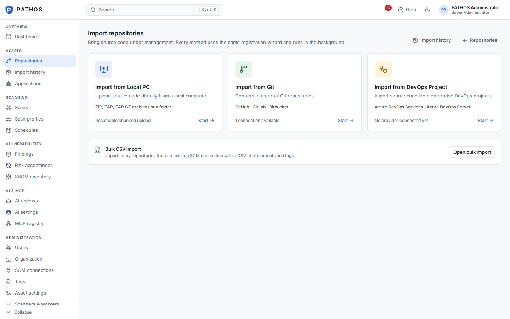
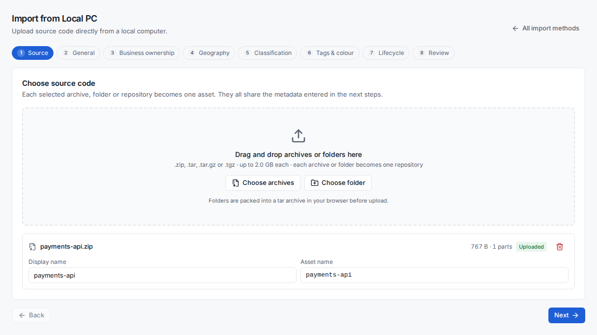
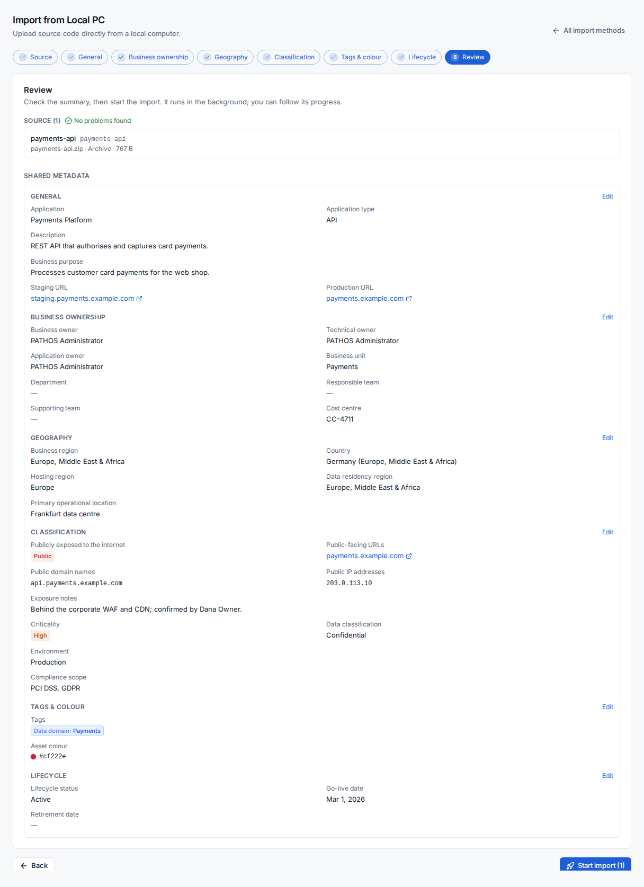
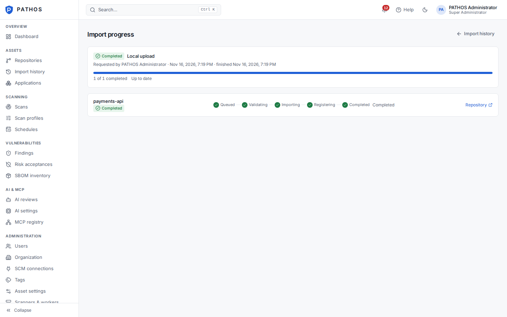

# Importing repositories

PATHOS offers three import methods. All of them lead into the same [registration wizard](asset-registration.md) and create a background **import job** that you can follow in [Import history](import-history.md).

Open **Assets → Repositories → Import repositories** (or go to `/repositories/import`).

| Card | Sources | Notes |
|---|---|---|
| **Import from Local PC** | ZIP, TAR, TAR.GZ (`.tgz`) archives or a folder | Resumable chunked upload; no provider connection needed |
| **Import from Git** | GitHub, GitHub Enterprise Server, GitLab, Bitbucket Cloud | Needs an SCM connection; the card shows how many are available |
| **Import from DevOps Project** | Azure DevOps Services, Azure DevOps Server | Needs an SCM connection |
| **Bulk CSV import** | An existing SCM connection plus a CSV of placements and tags | Older bulk path for many provider repositories; it does not run the registration wizard |

Each archive, folder or repository you select becomes **one repository**. All items selected in one run share the metadata you enter in the wizard; display name and asset name are set per item.

**Required permission for every method:** `repos.manage` at the target business unit (or region, or organization). Without it the landing page shows *Importing requires the repository management permission for the target business unit. You can still view the options.*

---

## A. Import from Local PC

### What is accepted

| Rule | Value |
|---|---|
| Formats | `.zip`, `.tar`, `.tar.gz`, `.tgz`, or a folder (packed into a tar archive in your browser before upload) |
| Maximum archive size | Shown in the drop zone. Default **2 GiB** per archive (server setting `PATHOS_UPLOAD_MAX_BYTES`) |
| Maximum entries | Default 200,000 files (`PATHOS_IMPORT_MAX_FILES`) |
| Maximum uncompressed size | Default 8 GiB (`PATHOS_IMPORT_MAX_EXTRACTED_BYTES`) |
| Maximum single file | Default 1 GiB (`PATHOS_IMPORT_MAX_FILE_BYTES`) |
| Open uploads per user | At most 50 unfinished upload sessions |
| Upload expiry | Uploads that are not imported are deleted after 24 hours |

Your administrator can change the limits; the wizard always shows the effective maximum archive size.

### How the upload works

1. Your browser computes the **SHA-256** of the whole file (*Computing checksum*).
2. It sends the file in **8 MiB parts**, each with its own SHA-256. Each part is encrypted as soon as it arrives.
3. If the connection drops, select **Retry** (or **Resume** after **Pause**): only missing parts are sent again.
4. When all parts are in, the upload is sealed and shows **Uploaded**.

You can continue filling in the wizard while uploads are running; **Check and review** waits until they finish.

### What happens during the import

The import job, not your browser, validates and processes the archive:

1. **Validating**: all parts are present and the archive's SHA-256 matches the one your browser computed.
2. **Importing**:
   - optional **malware scan** with ClamAV if your administrator has configured it (otherwise the snapshot is recorded as `not_configured`);
   - the archive is **normalized** into an encrypted snapshot. Nothing is extracted to disk and nothing is executed.
     - **Rejected** (the import fails with `archive_rejected`): absolute paths, `..` path traversal, drive letters or UNC paths, backslashes in paths, NUL or control characters, invalid UTF-8 names, over-long or over-deep paths, duplicate paths, encrypted ZIP entries, unsupported compression methods, corrupt or empty archives, and archives over the file-count, size, per-file or compression-ratio limits.
     - **Skipped and reported**: symbolic links, hard links, devices and FIFOs.
     - **Kept as plain files**: archives inside the archive (they are not expanded).
     - A single top-level folder, as in a GitHub "Download ZIP", is removed.
   - languages and dependency manifests are detected.
3. **Registering**: the repository, its metadata and the snapshot are saved in one transaction and a Repository ID is assigned.

### Step-by-step: import from Local PC

**Purpose.** Register source code you have as an archive or folder, for example a supplier delivery or a code base without a supported provider.

**Prerequisites.** The archive is on your computer; the business unit you will assign exists.

**Required permissions.** `repos.manage` at the target business unit.

**Example values.** Archive `payments-api.zip`; business unit *Payments*; application *Payments Platform*.

1. Open **Import repositories** and select **Import from Local PC**.
2. In **Source**, drag the archive or folder onto the drop zone, or select **Choose archives** / **Choose folder**.
3. Wait until the item shows **Uploaded**. Check **Display name** (`payments-api`) and **Asset name** (`payments-api`; lower-case letters, digits and hyphens, unique).
   
4. Select **Next** and complete the metadata steps: **General**, **Business ownership**, **Geography**, **Classification**, **Tags & colour**, **Lifecycle**. Every field is described in [Asset registration](asset-registration.md).
5. On the last metadata step select **Check and review**. PATHOS validates everything on the server.
6. On **Review**, check the summary and select **Start import (1)**.
   
7. The **Import progress** page opens and refreshes every 2 seconds.
   

**Expected result.** The item shows **Completed** and a **Repository** link. The repository appears in the inventory with its new Repository ID, source **Local upload** and a snapshot in the **Source** tab.

**Troubleshooting.** See [common upload errors](#common-upload-errors) and [Import history](import-history.md#error-codes).

**Related APIs.** [Imports API](../api-reference/imports.md), [Repositories API](../api-reference/repositories.md).

### Upload a new version of an uploaded repository

Open the repository, go to **Source**, select **Upload new version** and choose one archive. The wizard has only **Source** and **Review**; metadata is unchanged. The import job adds a new snapshot (`snapshot_added`) and keeps the old ones with their SHA-256.

### Common upload errors

| Message or code | Meaning | What to do |
|---|---|---|
| *only .zip, .tar, .tar.gz and .tgz archives are accepted* | Unsupported file type | Re-pack the code in a supported format |
| `too_large` (HTTP 413) | The archive exceeds the maximum size | Remove build output, dependencies and binaries, or split the code base |
| `too_many_uploads` (HTTP 429) — *finish, import or cancel your open uploads first* | 50 open uploads, or too much staged data | Import or remove pending uploads in the wizard |
| `uploads_unavailable` (HTTP 503) | Local uploads are not configured on this server | Contact your administrator |
| `checksum_mismatch` (part) — *the part does not match its SHA-256; resend it* | A part was corrupted in transit | Select **Retry**; the browser resends the part |
| *N of M parts are missing* | Upload not finished | Select **Retry** / **Resume** |
| `rate_limited` (HTTP 429) | Too many requests in a short time | Wait a moment and select **Retry** |
| Import fails with `archive_rejected` | The archive breaks a safety rule (see above); the message names the rule and path, for example `path_traversal: path traversal ("../evil.txt")` | Fix the archive and import again |
| Import fails with `checksum_mismatch` | The stored archive does not match the SHA-256 your browser computed | Upload again |
| `malware_detected` | ClamAV found malware; the upload is discarded and the event is audited | Do not import the archive; contact your security team |
| `malware_scan_too_large` | The archive exceeds the ClamAV size limit | Ask the administrator to raise the limit or split the archive |
| `malware_scanner_unavailable` | ClamAV is required but not reachable; retried automatically | Wait or contact your administrator |
| `upload_missing`, `upload_incomplete`, `upload_consumed` | The upload expired, was not finished, or was already imported | Upload the archive again |
| Review: *an identical archive was already imported* (`duplicate`) | The same archive (same SHA-256) is already registered | Remove it, or tick **Import anyway** to register a second copy |

---

## B. Import from GitHub, GitLab or Bitbucket

### Before you start

An administrator with `scm.manage` must have created a working connection under **Administration → SCM connections** (see [Provider integrations](provider-integrations.md) and [Authentication methods](authentication.md)). The connection's credential determines which organizations and repositories you can see.

If no connection exists, the Source step shows *No Git provider is connected* with a link to connect one. Connections with status **Expired** or **Revoked** are shown but cannot be selected (*Reconnect it under SCM connections to use it.*).

### What you can browse

| Provider | Scope selector | Search | Projects |
|---|---|---|---|
| GitHub / GitHub Enterprise Server | Organization or user | Server-side (GitHub's search API, at most 1,000 results) | – |
| GitLab | Group | Server-side | – |
| Bitbucket Cloud | Workspace | Server-side | Project (optional) |

Repositories that are already imported through the same connection are greyed out and marked **Already imported →**.

### Step-by-step: import from a Git provider

**Purpose.** Register one or more repositories from GitHub, GitLab or Bitbucket so they are scanned and reported on.

**Prerequisites.** A tested SCM connection for the provider; read access of that connection to the repositories.

**Required permissions.** `repos.manage` at the target business unit. (Creating the connection needs `scm.manage`.)

**Example values.** Connection *GitHub (acme)*, organization `acme`, repository `acme/payments-api`, branch `main`.

1. Open **Import repositories** and select **Import from Git**.
2. Under **Connection**, select the connection.
3. Choose the **Organization or user** (GitHub), **Group** (GitLab) or **Workspace** (Bitbucket); for Bitbucket optionally a **Project**.
4. Type in **Search repositories** to narrow the list; use **Load more** for further pages.
5. Tick the repositories to import (or **Select all loaded**). Each selected repository appears on the right.
6. For each selected repository, optionally:
   - choose a **Branch** (default: *Default (main)*). Branches are loaded when you open the list;
   - tick **Full history** to clone the complete history so secret scanning covers past commits (slower);
   - adjust **Display name** and **Asset name**;
   - expand the preview to see the **Latest commit**, **Branches** and the connection's **Access**.
7. Select **Next** and complete the metadata steps (see [Asset registration](asset-registration.md)), then **Check and review**.
8. Review any problems (for example *already imported; it will be skipped*) and select **Start import (n)**.

**Expected result.** One import job with one item per repository. During **Validating** PATHOS confirms the connection can read the repository and that the branch exists; during **Importing** it reads the latest commit, languages and size. Completed items link to the new repository. The source code itself is cloned only later, by the scan workers.

**Troubleshooting.**

| Symptom | Cause and fix |
|---|---|
| An organization or group is missing | The credential cannot see it. GitHub App: install the app on that organization. PAT: grant access to the organization (and authorise SSO if your organization enforces it). GitLab group/project tokens only see their own group or project. Bitbucket access tokens cannot list workspaces: set the workspace on the connection |
| *Could not list organizations: …* | The connection test fails; see [Authentication methods](authentication.md#troubleshooting-authentication-failures) |
| Item fails with `repository_not_found` | The repository was renamed or deleted, or the connection cannot see it |
| Item fails with `permission_denied` | The credential lacks read permission on the repository |
| Item fails with `invalid_branch` | The branch does not exist (any more) |
| Item **Needs attention** with `duplicate` | The same clone URL is already registered through another connection; retry with **Import anyway** if you really want two records |
| Item **Needs attention** with `token_expired` | The OAuth authorization expired; reconnect the connection, then **Retry** |
| Items retry by themselves (*Retrying after a temporary error*) | Provider rate limit, timeout or 5xx error; PATHOS retries up to 3 attempts with exponential backoff |

**Related APIs.** [Integrations API](../api-reference/integrations.md), [Imports API](../api-reference/imports.md).

> No screenshot of the Git source step is included: the documentation environment had no live provider credentials. The step looks like the DevOps step described below, with the provider-specific selector names in the table above.

---

## C. Import from Azure DevOps

### How Azure DevOps is organised

Azure DevOps Services groups repositories as **organization → project → repositories → branches**. Azure DevOps Server (on-premises) uses a **collection** URL in place of the organization host, for example `https://ado.example.com/tfs/DefaultCollection`.

### Authentication and permissions

| Method | Can list organizations? | Permissions needed |
|---|---|---|
| Microsoft Entra ID (OAuth, delegated) | Yes, the organizations of the signed-in user | Azure DevOps `user_impersonation`; the user needs Basic access and read access to the projects |
| Service principal (Entra ID, client secret or certificate) | **No**: the organization names are entered on the connection (**Organizations**, required) | Service principal added to each organization with Basic access and Reader on the projects (Code: read, Project and team: read) |
| Personal access token (Services) | Yes, or limited to the **Organizations** you enter | Scopes **Code (Read)** and **Project and Team (Read)** |
| Personal access token (Server) | Collection from the base URL | Same scopes on the server |

Details: [Authentication methods](authentication.md#azure-devops).

### Step-by-step: import from Azure DevOps

**Purpose.** Register repositories from an Azure DevOps project.

**Prerequisites.** A tested Azure DevOps connection; the identity behind it has read access to the projects.

**Required permissions.** `repos.manage` at the target business unit.

**Example values.** Organization `contoso-payments`, project `Payments`, repository `payments-api`, branch `main`.

1. Open **Import repositories** and select **Import from DevOps Project**.
2. Select the **Connection**.
3. Choose the **Organization**. For a service principal only the organizations entered on the connection are offered.
4. Choose a **Project**, or leave **All projects**.
5. Filter with **Search repositories**, tick the repositories, and set **Branch**, **Full history**, **Display name** and **Asset name** per repository.
6. Select **Next**, complete the metadata steps, then **Check and review** and **Start import (n)**.

**Expected result.** As for Git imports: one item per repository, each linked to the new repository when completed.

**Troubleshooting.**

| Symptom | Cause and fix |
|---|---|
| No organizations listed with a service principal | Expected: enter the organization names on the connection (**Rotate credential** lets you edit the fields) |
| Organization listed but no projects | The identity has no access to any project in it; add it to the project with Reader permissions |
| `authentication_failed` or connection status **Error** with *scm: authentication failed (check the token and its scopes)* | Wrong or expired PAT, wrong tenant / client ID, expired client secret or certificate |
| `permission_denied` | The identity lacks Code (Read) on the repository |
| Service principal works in the portal but not in PATHOS | It was not added to the Azure DevOps **organization** (Organization settings → Users) with Basic access |
| Azure DevOps Server not reachable | The base URL must be the collection URL and reachable from the PATHOS server; private addresses may be blocked by the outbound address policy (`blocked_address`) |

**Related APIs.** [Integrations API](../api-reference/integrations.md), [Imports API](../api-reference/imports.md).

---

## What happens to duplicates

| Situation | Result |
|---|---|
| Same connection, same repository already imported | Shown in review as *already imported; it will be skipped*; the item completes as **already imported** and links to the existing repository |
| Same clone URL through a different connection | Item **Needs attention** (`duplicate`); **Import anyway** registers a second record |
| Same archive (same SHA-256) uploaded again | Review shows *an identical archive was already imported*; tick **Import anyway** to keep a second copy |
| The same item listed twice in one wizard run | Blocked in review (`duplicate_item`) |
| Same asset name as an existing repository | Blocked in review (`name_clash`); change the asset name |

Submitting the wizard twice does not create two jobs: each wizard run has its own idempotency key.
