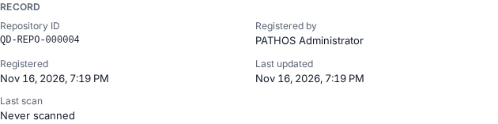
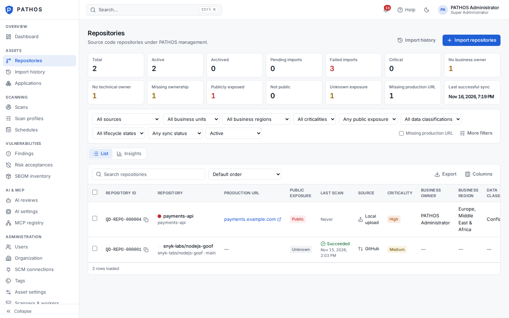
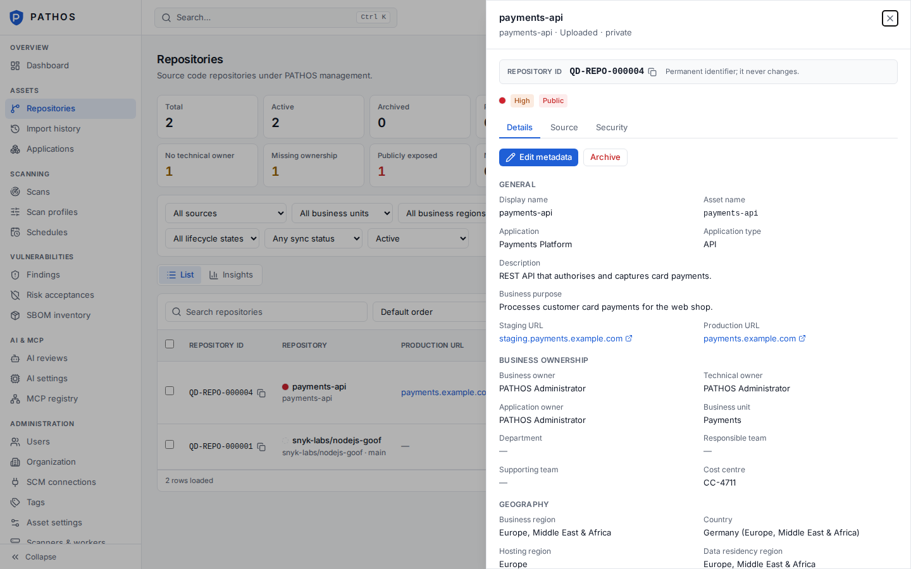
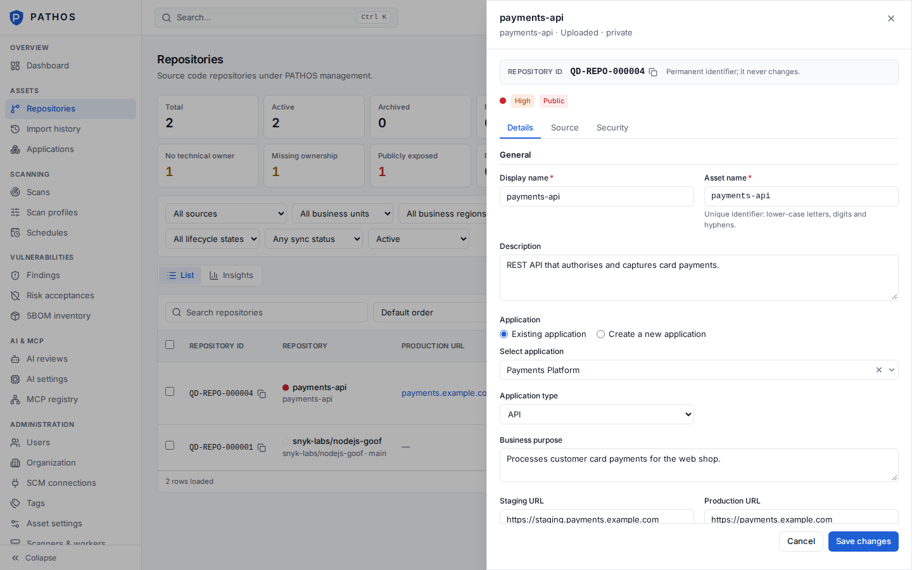
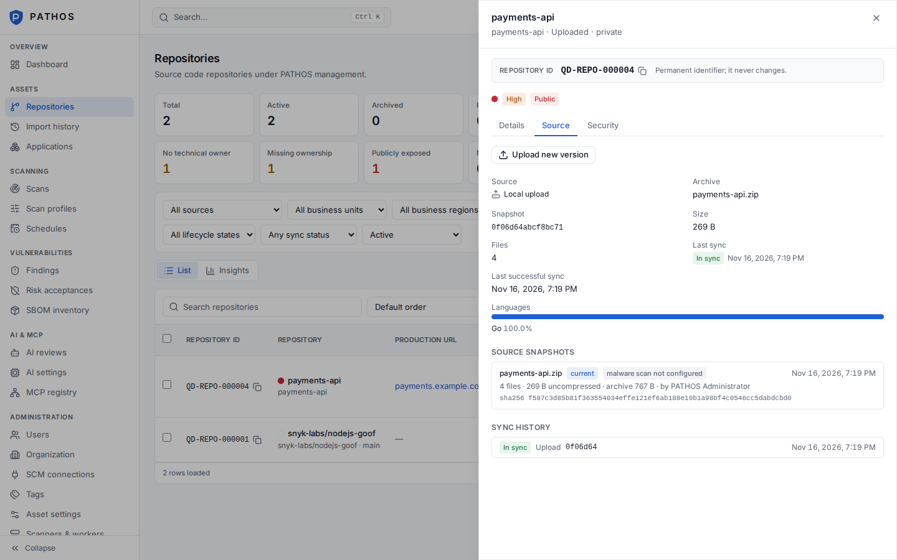

# Repository management

## What a repository is

In PATHOS a **repository** is one code base under management. It comes from one of two sources:

| Source | Where it comes from | What PATHOS stores |
|---|---|---|
| **Git provider** (`scm`) | A repository discovered through an [SCM connection](provider-integrations.md) to GitHub, GitHub Enterprise Server, GitLab, Bitbucket Cloud, Azure DevOps Services or Azure DevOps Server | Provider, organization / project, default and scan branch, latest commit, visibility, languages. Source code is fetched only by scan workers, at scan time |
| **Local upload** (`upload`) | A ZIP, TAR or TAR.GZ archive or a folder uploaded from a local computer | An encrypted, normalized **source snapshot** with its SHA-256, file count, languages and detected manifests. New versions are added as further snapshots |

Each repository is also an **asset**: it carries the business metadata entered in the [registration wizard](asset-registration.md).

## Why register repositories

- Only registered repositories can be scanned, appear in findings and count towards dashboards.
- Registration records **who is accountable** (owners, business unit) and **how much it matters** (criticality, data classification, exposure), which drives prioritisation and scoped access.
- Every registration is audited (`repository.import`), so you can show when an asset entered the inventory and with which metadata.

## The Repository ID

Every repository receives a **Repository ID** when it is registered, for example `QD-REPO-000042`.

| Property | Behaviour |
|---|---|
| Format | `<prefix>-<number>`: the prefix (default `QD-REPO`) followed by a hyphen and a number padded to at least six digits |
| Assigned by | The database, at the moment the repository is created. It cannot be entered or chosen by a user |
| Permanent | It cannot be changed afterwards, not even by an administrator or through the API |
| Never reused | Numbers come from a sequence that never hands out a number twice, even after a repository is deleted. Numbers may therefore have gaps (`000001`, `000004`, …) |
| Prefix setting | **Administration → Asset settings → Repository ID prefix** (permission `assets.configure`). Upper-case letters, digits and single hyphens, starting with a letter, at most 20 characters. A new prefix applies only to repositories registered afterwards; existing IDs never change |
| Where it appears | Repository inventory (column, exact-match filter, sort), repository details, scan jobs, findings, CSV exports, global search and audit log entries (`metadata.repository_key`) |

The internal UUID remains the technical key used in API paths; the Repository ID is the identifier for people, tickets and reports.

## Name and provider

| Field | Meaning |
|---|---|
| **Display name** | Human-friendly name shown in lists (up to 200 characters). Defaults to the repository or archive name |
| **Asset name** | Unique short identifier within your organization: lower-case letters, digits and hyphens (up to 100 characters), for example `payments-api` |
| **Full name** | Provider path such as `acme/payments-api` (for uploads, the asset name) |
| **Source** | The provider (GitHub, GitLab, Bitbucket, Azure DevOps, …) or **Local upload**, plus the connection name |

## Repository URL versus application URLs

These are different things and are stored separately:

- The **repository URL** (clone URL) is where the *source code* lives at the provider. PATHOS derives it from the provider and uses it only for scanning. Uploaded repositories have none.
- The **Staging URL** and **Production URL** are where the *running application* built from this code is reachable, for example `https://staging.payments.example.com` and `https://payments.example.com`. They are optional absolute `http://` or `https://` URLs without user names or passwords, entered in the **General** step of the wizard.

Application URLs are **metadata only**. PATHOS never fetches, resolves or scans them. They exist so that you can find the repository behind a URL (filters *Production URL contains* and *Staging URL contains*) and report on repositories that are missing a production URL.

> Application URLs and public exposure are recorded **per repository**. An application in PATHOS has no URL fields of its own. See [Applications](applications.md).

## Verify declared public endpoints

The public URLs, domain names and IP addresses you declare in the exposure section are metadata until you choose to verify them. **Endpoint verification** on the repository's **Details** tab checks them from a scan worker:

- **DNS**: the name resolves (through the egress proxy when the worker has no resolver);
- **reachability** over HTTPS and HTTP, and whether HTTP redirects to HTTPS;
- **TLS**: certificate validity and expiry (expired, not yet valid, expiring within 30 days), host name match, trust chain, legacy protocols (TLS 1.0 and 1.1) and weak cipher suites (RC4, 3DES, CBC-SHA256, RSA key exchange);
- **headers**: HSTS (missing or shorter than 180 days), Content-Security-Policy, X-Content-Type-Options, X-Frame-Options or `frame-ancestors`, and Referrer-Policy;
- optionally the non-intrusive **Nuclei exposure templates** (exposed files and panels, subdomain takeovers).

It is **opt-in** and limited in scope:

1. Someone with repository management permission selects **Enable**, confirms **I am authorized to test these endpoints** (optionally with a reference such as a change ticket) and sets the request rate (1–10 per second, default 2). Name and time are recorded and audited.
2. The statement covers the endpoints listed at that moment. Endpoints declared later are shown as *not authorized* and skipped until someone confirms the list again; turning on Nuclei also needs a new confirmation.
3. **Verify now** queues the check on a worker (never on the PATHOS server). Only the declared hosts are contacted, through the egress proxy: add them to `deploy/egress/allowlist.txt`, otherwise they are reported as **Blocked by egress proxy**. Redirects to other hosts are not followed. Wildcard domains cannot be checked.

Each endpoint then shows **Verified**, **Unreachable**, **DNS failure**, **Blocked by egress proxy** or **Skipped**, with the TLS protocol, certificate expiry and any legacy protocol. Problems become findings of the repository (type *Web and API (DAST)*, asset *Declared public endpoints*), resolved automatically when a later check no longer sees them. Verification is disabled in offline mode (`PATHOS_OFFLINE=true`). The check also appears in **Scanning → Scan targets** as a *Declared public endpoints* target.

## Branch selection

- **Git repositories** are scanned on the **scan branch**. You choose it per repository in the import step (**Branch**, default: the provider's default branch). If no branch is chosen, the repository's default branch is used and shown as `main (default)` or similar.
- Push and merge webhooks only trigger a scan when they are for the scan branch.
- **Full history** (optional, per repository at import) clones the whole history so that Gitleaks scans past commits for secrets. The default is a shallow clone of the latest commit.
- **Uploaded repositories** have no branch: they are scanned from their **current snapshot**.

## Ownership

| Field | Meaning |
|---|---|
| Business owner | Person accountable for the business use of the asset. **Always required** |
| Technical owner | Person responsible for the code and its fixes. Required by default |
| Application owner | Person responsible for the application the code belongs to |
| Business unit / Department | Organizational placement. Business unit is **always required**; Department is a sub-unit of it |
| Responsible team / Supporting team | Teams known to PATHOS, chosen with a search field. If no teams appear, none have been set up for your organization yet |
| Cost centre | Free text, for example `CC-4711` |

Being the business, technical or application owner of a repository (or a member of its responsible team) lets you edit that repository's descriptive and ownership metadata even without `repos.manage`. Changing the **business unit, department or country** (the placement that drives access control) requires `repos.manage`.

## Lifecycle and status

A repository has several independent status values:

| Status | Values | Set by |
|---|---|---|
| **Lifecycle status** | From the *Lifecycle status* catalog in Asset settings (default entries: Planned, In development, Active, Maintenance only, Deprecated, Retired), plus optional go-live and retirement dates | You, in the wizard or by editing |
| **Archived** | Active or Archived | A user with `repos.manage` (**Archive** / **Unarchive**). Archived repositories are not scanned and are hidden from the default list; findings and history are kept |
| **Sync status** | Never synced, In sync, Sync failed, Missing upstream, No access, Archived upstream | PATHOS, when it checks the provider (nightly, on **Sync now**, on **Re-sync metadata** and on webhooks) |
| **Archived at the provider** | Shown as a warning in the details | The provider |

Sync only reads metadata and the latest commit; it never downloads source code. Uploaded repositories always show **Never synced**; you add a new version with **Upload new version** instead.

## Link to scans and findings

Each repository's **Security** tab shows open findings by severity, the latest scan (status, commit or snapshot, profile, each scanner's version and finding count), the scan profile and recent scans, with **Scan now** and links to **All findings**, **Scan history** and the SBOM downloads. See [Running scans](scanning.md#step-by-step-scan-a-repository-from-its-record-and-view-its-findings) and [Supply chain](supply-chain.md#export-an-sbom).

## Example repository record

The following record is illustrative (it was created for this guide from a small example archive):

| Field | Example value |
|---|---|
| Repository ID | `QD-REPO-000042` |
| Display name / Asset name | payments-api / `payments-api` |
| Source | Local upload, archive `payments-api.zip`, snapshot SHA-256 `01a1e5cc…` |
| Application | Payments Platform |
| Application type | API |
| Description | REST API that authorises and captures card payments. |
| Business purpose | Processes customer card payments for the web shop. |
| Staging URL / Production URL | `https://staging.payments.example.com` / `https://payments.example.com` |
| Business owner / Technical owner / Application owner | Dana Owner / Dana Owner / Dana Owner |
| Business unit / Department / Cost centre | Payments / – / CC-4711 |
| Business region / Country | Europe, Middle East & Africa / Germany |
| Hosting region / Data residency region | Europe / Europe, Middle East & Africa |
| Primary operational location | Frankfurt data centre |
| Public exposure | Yes, URL `https://payments.example.com`, domain `api.payments.example.com`, IP `203.0.113.10` |
| Exposure notes | Behind the corporate WAF and CDN; confirmed by Dana Owner. |
| Criticality / Data classification / Environment | High / Confidential / Production |
| Compliance scope | GDPR, PCI DSS |
| Tags / Asset colour | Data domain: Payments / `#cf222e` |
| Lifecycle status / Go-live date | Active / 2026-03-01 |
| Scan branch / History | Current snapshot / Shallow clone |
| Sync status | Never synced (uploaded repository) |
| Registered by / Registered | Dana Owner / 2026-11-16 19:19 |

 for an uploaded example repository")

## Step-by-step: view and edit a repository

**Purpose.** Look up a repository's metadata and correct or complete it, for example add a missing production URL or change the technical owner.

**Prerequisites.** The repository is registered.

**Required permissions.** `repos.read` in the repository's scope to view. To edit: be an owner of the repository (business, technical or application owner, or a member of its responsible team) or hold `repos.manage` in its scope. Changing business unit, department or country requires `repos.manage`. Archive and delete require `repos.manage`.

**Steps.**

1. Open **Assets → Repositories**.
2. Find the repository: type part of its name in **Search repositories**, or open **More filters** and enter the exact **Repository ID**, for example `QD-REPO-000042`.
   
3. Select the row. The details panel opens with the Repository ID at the top (use the copy button to copy it) and tabs: **Details**, **Source**, **Security**, **Dependencies** (needs `sbom.read`; see [Dependencies of a repository](posture.md#dependencies-of-a-repository)) and **Material changes** (needs `scans.read`; see [Material changes](developer-insights.md#material-changes)).
   
4. On **Details**, select **Edit metadata**. The same sections as in the wizard appear.
5. Change the fields, for example set **Production URL** to `https://payments.example.com`.
   
6. Select **Save changes**.
7. To see the source information, open **Source**: provider and connection (or archive), organization / project, branch, latest commit (or snapshot), size, files, sync status, languages, source snapshots (uploads) and sync history (Git). Use **Sync now** (Git) or **Upload new version** (uploads).
   

**Expected result.** *Changes saved.* appears, the inventory shows the new values, and the audit log contains an entry with the old and new values. The Repository ID is unchanged.

**Troubleshooting.**

- *Read-only: you are not an owner of this repository.* You need to be an owner or have `repos.manage`. Ask the business owner or an administrator.
- *As an owner you can edit descriptive metadata; business unit, department and country need repository management permission.* Ask a user with `repos.manage` to move the repository.
- A required field is highlighted: your organization's [required fields](asset-registration.md#mandatory-optional-and-configurable-fields) apply to edits too.
- **Edit metadata** is missing: the repository is archived. **Unarchive** it first.

**Related APIs.** [Repositories API](../api-reference/repositories.md), [Assets API](../api-reference/assets.md).

## Archive and delete a repository

1. Open the repository and select **Archive**, then confirm. Archived repositories are no longer scanned and are hidden from the default list (filter **Status → Archived** to see them). Findings and history are kept and you can **Unarchive** later.
2. To remove it completely, open the archived repository and select **Delete permanently**. Uploaded repositories' encrypted snapshots are deleted too. The Repository ID is not reused.

Both actions require `repos.manage`. A repository must be archived before it can be deleted.
