# Running scans: executions, schedules, targets and imports

The **Scanning** section runs and follows scans:

| Page | Use it to |
|---|---|
| **Scan Overview** | See scan activity, outcomes and open findings at a glance |
| **Scans** | Start scans, follow running ones, cancel or retry, and open any execution |
| **Scan Schedules** | Run scans automatically: once, daily, weekly, monthly, at intervals or by cron |
| **Scan Comparison** | Compare executions over up to 360 days: what is new, fixed, recurring or unchanged |
| **Scan targets** | Scan container images, running web applications and APIs, SBOMs and build artifacts |
| **Pull request checks** | Check pull requests before they merge, see [Supply chain](supply-chain.md#pull-request-checks) |
| **Import Results** | Bring in findings and SBOMs from other tools |

Which scanners run, scan profiles, custom rules and workers are explained in [Security scanning: scanners and profiles](security-scanning.md). The Scanning pages only *use* existing profiles; they never change them.

Every execution has a permanent **Scan ID** such as `QD-SCAN-000042`. It never changes and is never reused, so you can quote it in tickets and reports.

## Scan Overview

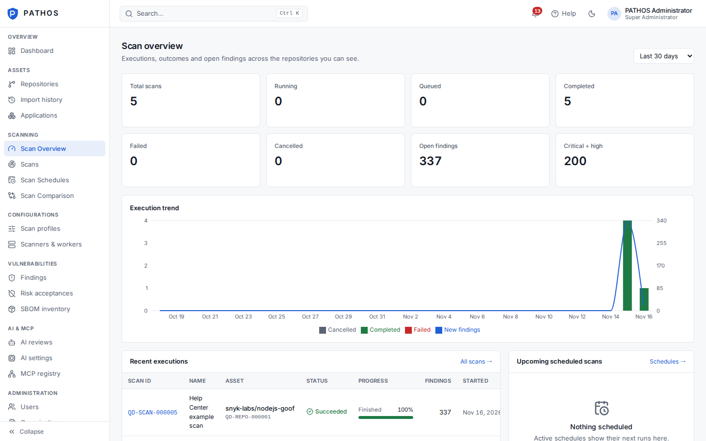

Choose the period (7, 30, 90 or 360 days) at the top right. The cards count executions by status (running and queued are always current), open findings and critical + high findings. The trend shows completed, failed and cancelled executions per day and the new findings they produced. **Recent executions** and **Upcoming scheduled scans** link to the details. The page refreshes while scans are running. All figures come from recorded executions and findings.

## Scans

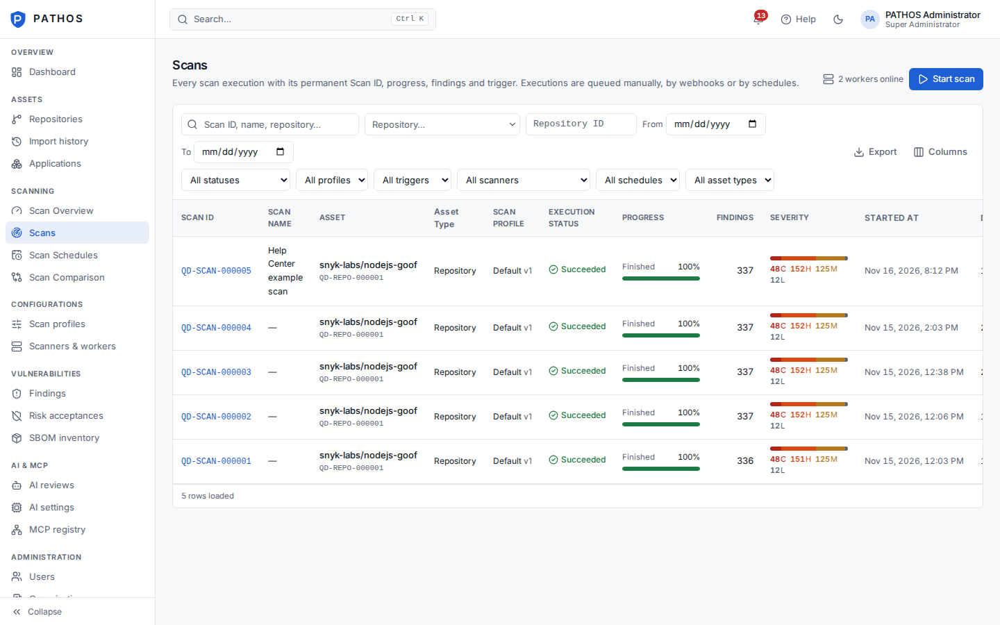

Each row is one execution of one scan profile against one asset (today, assets are repositories). **Progress** moves only when a stage actually completes: the worker picks the scan up (5 %), the source is checked out (15 %), each scanner engine finishes (up to 95 %), and the results are processed (100 %). The **Severity** bar shows the distinct findings this execution observed.

Filter by text (Scan ID, name, repository or Repository ID), repository, Repository ID, date range, status, profile, trigger, scanner engine and schedule. **Export** downloads the list as CSV, including Scan IDs.

### Step-by-step: start a scan

**Purpose.** Scan one or more repositories now with an existing profile.

**Prerequisites.** The repositories are registered, not archived, and at least one scan worker is online (the page header shows *n workers online*).

**Required permissions.** `scans.run` on the repositories.

1. Open **Scanning → Scans** and select **Start scan**.
2. Search and select one or more repositories (each shows its Repository ID).
3. Choose a **Scan profile**: *Repository's own profile* (the default), or any existing profile. All current profiles are compatible with repositories.
4. Optionally enter a **Name** (for example *Release check 2.4*).
5. Select **Start**. Each repository shows *Queued*, *Already queued* (an execution with the same profile was already waiting and was reused) or the reason it could not be queued, with links to the new executions.

**Expected result.** The executions appear in the list with status *Queued*, then *Running* with live progress, then *Succeeded*, *Partial* (some engines failed), or *Failed*.

**Troubleshooting.** See [Why a scan does not start or fails](#why-a-scan-does-not-start-or-fails).

**Related APIs.** [Scans: start scans](../api-reference/scans.md).

### Cancel and retry

- **Cancel** stops a queued or running execution (`scans.run`). Its stages show *cancelled*.
- **Retry** is available for *Failed*, *Partial* and *Cancelled* executions. It creates a **new** execution (new Scan ID) of the same repository and profile, linked to the original (**Retry of**). The original stays in the history unchanged.

## Step-by-step: scan a repository from its record and view its findings

**Purpose.** Scan one registered repository and review the results without leaving the repository.

**Required permissions.** `scans.run` to start a scan; `scans.read` and `findings.read` to view results.

**Example values.** Repository `payments-api` (`QD-REPO-000042`), default profile.

1. Open **Assets → Repositories**, select the repository and open the **Security** tab.
2. Select **Scan now**. The button shows *Scan queued* (or *Already queued*).
3. Follow the scan in **Scanning → Scans**; select the Scan ID to see the stages and execution log.
4. Back on the **Security** tab, check **Open findings** by severity and the **Latest scan**: status, trigger, profile, commit or snapshot, and the table of scanners with versions, status and findings.
   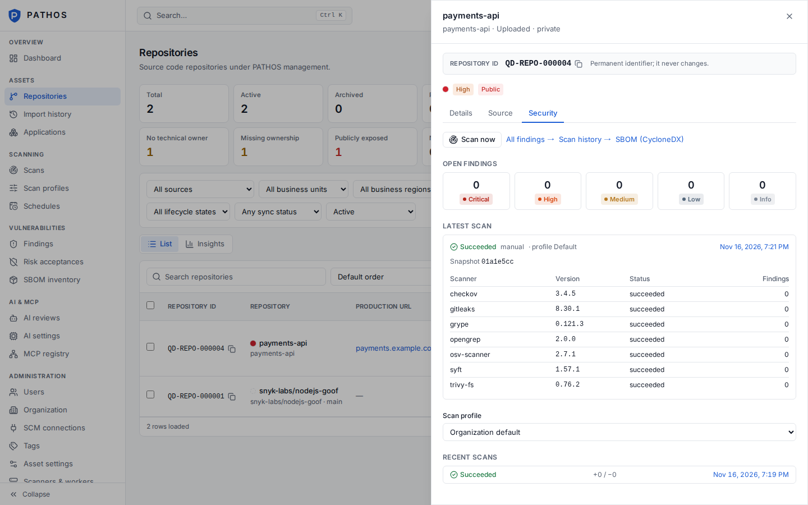
5. Select **All findings** to open the findings list filtered to this repository, or **Scan history** for its scans. Continue in [Working with findings](findings.md).

**Expected result.** A succeeded (or partial) execution, findings linked to the repository and its Repository ID, and an updated **Last scan** column in the inventory.

**Related APIs.** [Repositories API](../api-reference/repositories.md) (repository security summary), [Scans](../api-reference/scans.md).

## Scan details

Select a Scan ID to open the execution. It has six tabs:

| Tab | Shows |
|---|---|
| **Overview** | Status and progress, Scan ID, asset (with Repository ID), profile and version, trigger, schedule, retry link, branch and commit (Git) or snapshot (upload), worker, timing, a findings summary and the scanner engines with versions, statuses, findings and raw report downloads |
| **Findings** | The findings this execution observed: severity, title, affected component, engine, evidence (file and line, or package and version), remediation (fixed version) and whether it was new in this execution |
| **Execution Logs** | Time-stamped worker and scanner output, filterable by engine and minimum level, live while the scan runs, downloadable as text. Secrets are redacted before they are stored |
| **Stages** | Queue, source checkout, one row per scanner engine job and results processing, with status, times, duration, scanner version, findings and errors, plus the raw event list |
| **Configuration** | A read-only snapshot of the profile version used by this execution: scanners and their settings, exclusions, severity threshold, timeout, SBOM, security gate and retention. Later profile edits never change it |
| **History** | Earlier executions of the same repository (last 360 days), with **Compare selected** and **Compare with this scan** |

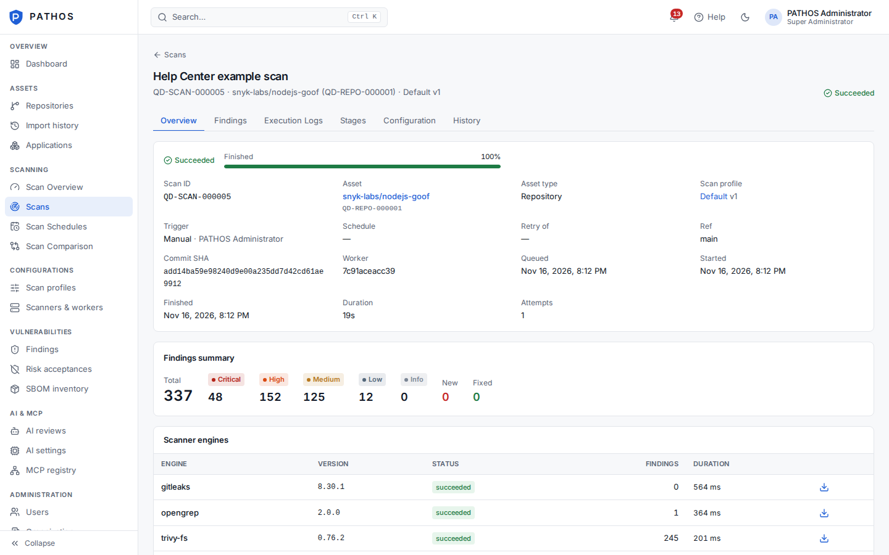

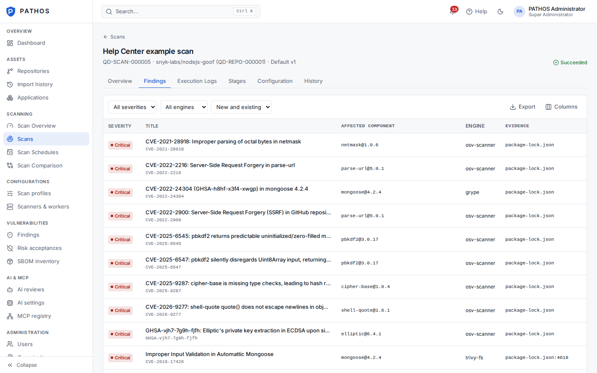

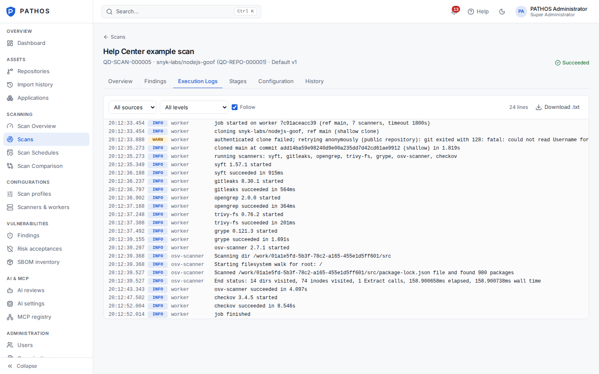

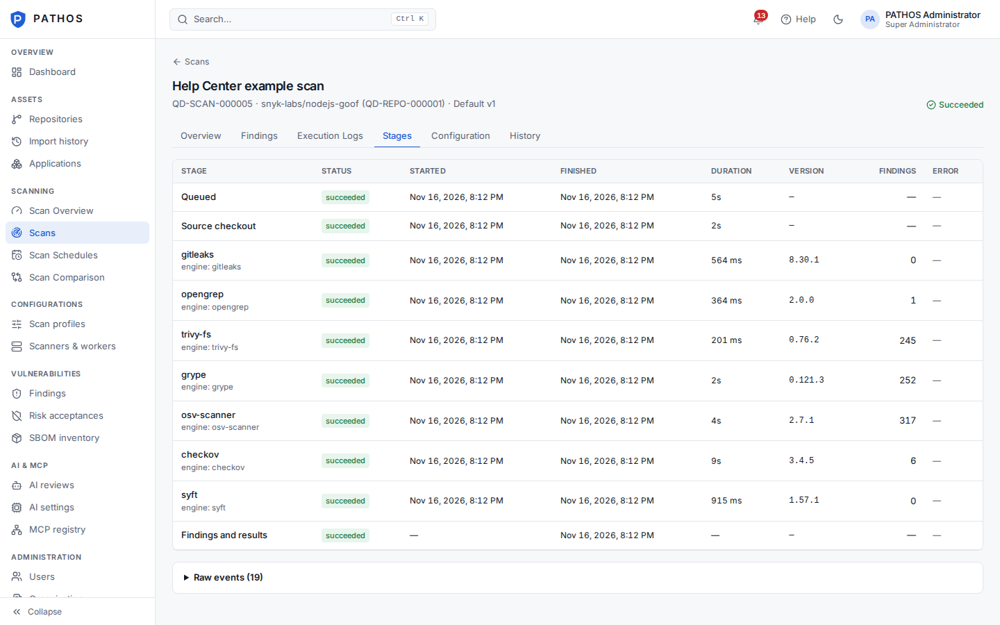

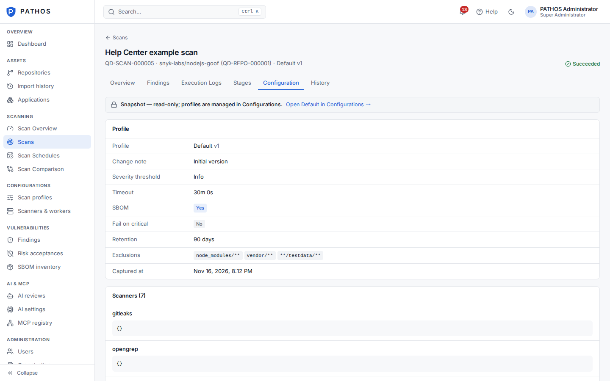

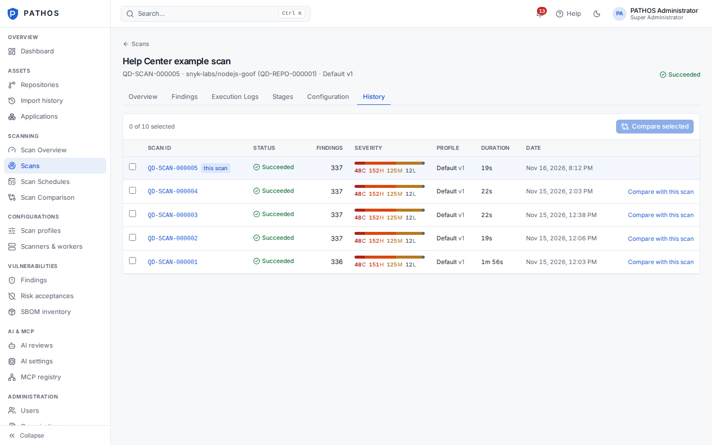

## Scan Schedules

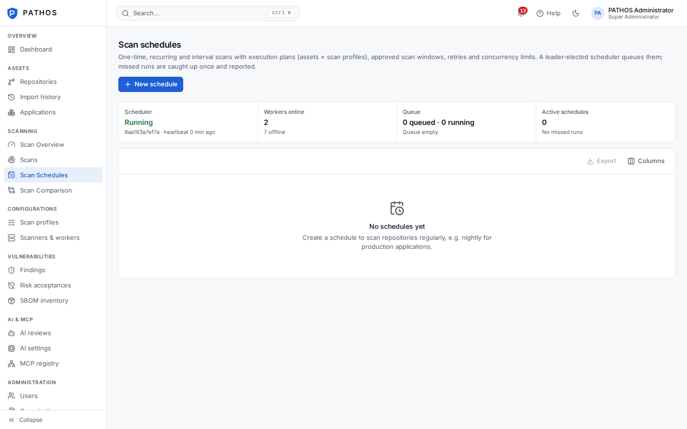

A schedule runs an **execution plan**: rows that pair assets (all repositories, a region, a business unit or one repository) with a scan profile (*Repository's own profile* or a specific one). Each activation creates one execution per repository and profile, each with its own Scan ID and a link to the schedule.

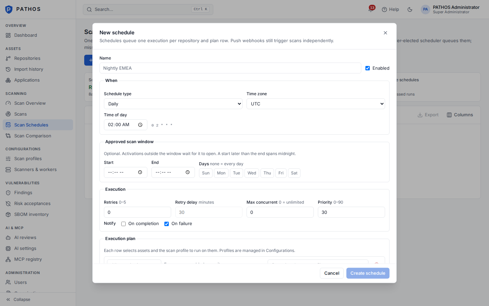

| Setting | Meaning |
|---|---|
| **Schedule type** | One-time (date and time), Daily, Weekly, Monthly, Custom cron, or Custom interval (at least one hour) |
| **Time zone** | Times are interpreted in this zone, including daylight saving changes |
| **Approved scan window** | Optional hours (and weekdays) when scans may start. A start later than the end spans midnight. Activations outside the window wait for it |
| **Retries** / **Retry delay** | Failed executions are retried up to this many times, as new executions, after the delay |
| **Max concurrent** | At most this many executions of the schedule queued or running; the rest wait their turn (0 = unlimited) |
| **Notify** | E-mail and in-app notification when an activation completes and/or fails (after retries) |
| **Priority** | Queue priority (0–90) |
| **Execution plan** | One or more rows of assets × profile |

The preview shows the next five runs and how many executions each activation creates. **Pause** stops a schedule without deleting it; **Resume** continues from the next due time (missed activations are not replayed). **Run now** starts an activation immediately (it ignores the scan window). **History** lists each activation with its status (*Running*, *Waiting*, *Completed*, *Partial*, *Failed*) and execution counts.

If the scheduler was unavailable when a schedule was due, the missed activation runs once when it recovers (*catch up*) and the *Schedule missed runs* notification is sent. An activation never runs twice, even if the scheduler retries.

### Step-by-step: schedule a weekly scan with two profiles

**Required permissions.** `schedules.manage` for every asset scope in the plan.

1. Open **Scanning → Scan Schedules** and select **New schedule**.
2. Name it *Weekly full scan*, choose **Weekly**, Saturday at 03:00, time zone *Europe/Berlin*.
3. Set an **Approved scan window** of 01:00–07:00 so scans never start during business hours.
4. Set **Retries** 1 and **Max concurrent** 5; tick **On failure**.
5. In **Execution plan**, add *All repositories* × *Default*, and a second row *payments-api* × *PCI profile*.
6. Check the preview (next runs, executions per activation) and select **Create schedule**.

**Related APIs.** [Scan schedules](../api-reference/schedules.md).

## Scan Comparison

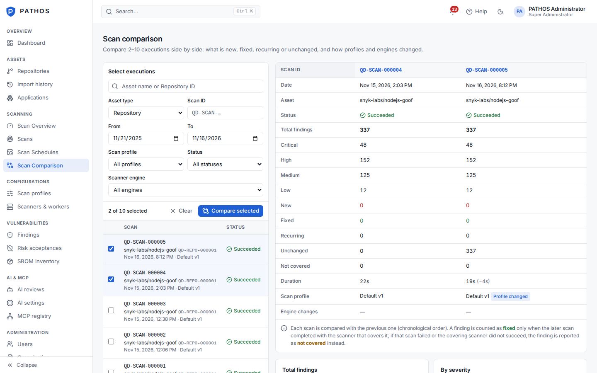

Pick 2–10 executions on the left (filter by asset name or Repository ID, asset type, Scan ID, dates within the last 360 days, profile, status and scanner engine) and select **Compare selected**. You can also start from a scan's **History** tab.

Executions are ordered by time and each is compared with the previous one:

| Result | Meaning |
|---|---|
| **New** | Found now and never before |
| **Recurring** | Found now, missing in the previous execution, found earlier |
| **Unchanged** | Found in both |
| **Fixed** | Found before and gone now, and this execution completed with a scanner that reports it |
| **Not covered** | Gone now, but this execution failed or was cancelled, or its covering scanner did not succeed. PATHOS never counts these as fixed |

The comparison also shows severity counts, duration and its change, whether the profile or its version changed, and scanner engine changes (added, removed, new versions), with trend charts and a finding-by-execution matrix.

**Related APIs.** [Scans: comparison](../api-reference/scans.md).

## Scan targets

**Scanning → Scan targets** scans what is deployed, not only the source code:

| Kind | Scanner | Use it for |
|---|---|---|
| **Container image** | Trivy | Vulnerable OS and language packages in an image in a registry |
| **Web application (DAST)** | Nuclei | Misconfigurations, exposed files and panels, known vulnerabilities of a running application |
| **API (OpenAPI)** | Nuclei DAST templates | Injection and similar flaws in each operation of your OpenAPI document |
| **SBOM** | Grype | Vulnerabilities in software you receive but cannot scan as source (vendor products, appliances). CycloneDX JSON or SPDX 2.x JSON |
| **Build artifact** | Trivy | Vulnerable components inside a release file (up to 200 MiB): a zip, tar or tar.gz archive, a Java archive (`.jar`, `.war`, `.ear`) or a binary. Archives are checked and unpacked safely on a worker; nothing in them is run |

Each target belongs to a repository, so its findings reach that repository's application, owners and teams. Adding, changing and deleting targets needs `repos.manage` on the repository; scanning one needs `scans.run`.

### Step-by-step: scan a staging application

1. Ask your PATHOS administrator to allow the application's host in the egress proxy (see the installation guide). Without that, the scan fails and says which host to add.
2. Select **Add target**, choose **Web application (DAST)**, the repository, a name and the base URL.
3. If the application needs a login, choose **Request header** and enter, for example, `Authorization` with a test account's token. The value is encrypted and never shown again.
4. Tick **I am authorized to security-test this application** and add a reference (change ticket, owner's approval). Your name and the time are recorded.
5. Select **Scan**. Follow the execution from the link, or open the target's findings from **Open findings**.

Scans send real requests, at most the configured rate (default 20 per second). They never run intrusive, brute-force or denial-of-service checks, and web application scans do not fuzz. API scans test the operations in your OpenAPI document, which must point at the same host.

### Notes

- **Container images:** for private registries choose **Registry username and token**. `ghcr.io` is allowed out of the box; Docker Hub and other registries need their hosts in the egress allowlist.
- **Findings** of a target are kept apart from the repository's own findings. Filter them with **Asset** on the Findings page. Only a successful scan of the same target marks them fixed.
- **Changing the address** of a web or API target needs a new authorization statement.
- **Targets with findings** cannot be deleted (their evidence is kept). Disable them instead.

## Importing results from other tools

**Scanning → Import Results** brings in findings from tools PATHOS does not run: other SAST or SCA products, DAST and IAST tools, fuzzers, or your CI pipeline. Importing needs `scans.run` on the repository.

1. Choose **Scanner results** and the repository. Leave **Format** on *Detect from the file* or pick the tool's format; tool-specific formats fill in the tool name and category, generic ones (SARIF, PATHOS findings JSON, CSV) need the **Tool** name. Optionally enter the **Branch** and **Commit SHA** the report belongs to.
2. Upload the report. PATHOS reads SARIF 2.1 and the native output of Semgrep, Snyk, SonarQube, OWASP ZAP, Burp Suite, Trivy, Gitleaks, TruffleHog, Checkov, Bandit, Gosec, ESLint, npm audit, pip-audit, OSV-Scanner, Grype, Nessus, OpenVAS, Nuclei, Dependency-Check and Checkmarx, plus a generic CSV and the PATHOS findings JSON ([supported formats](../api-reference/result-imports.md#supported-formats)). Secret values in Gitleaks, TruffleHog and Trivy reports are removed before the report is stored.
3. If the file is the tool's complete result, tick **This file is the tool's complete result**. Findings the tool no longer reports are then marked fixed. Partial results never close anything.

Each import appears as a scan execution. Its findings are de-duplicated, risk-scored and reviewable like any other, and they keep the tool's name.

To import from a build pipeline, use the [`pathos` CLI and the CI templates](ci-cd-integration.md).

The same page imports a **Software bill of materials** (CycloneDX or SPDX JSON). An imported SBOM replaces the repository's component inventory, and license policies apply immediately. **Import history** on the page lists earlier imports with their execution.

## Why a scan does not start or fails

| Problem | Cause and fix |
|---|---|
| **Scan now** or **Start scan** missing | No `scans.run` permission |
| *cannot scan yet: no scan profile available* | Create a default profile in **Configurations → Scan profiles** |
| Importing did not start a scan | Expected unless **Scan on import** is on and *Start onboarding scan* was ticked. Use **Scan now** |
| *repository has no source snapshot yet* | The upload import has not completed |
| *repository is archived or scanning is disabled* | Unarchive the repository or enable scanning on its **Security** tab |
| Execution stays **Queued** | No worker online (the Scans page header shows *n workers online*; **Configurations → Scanners & workers** lists them), or another execution of the same repository is running |
| *Already queued* | An execution with the same profile was already waiting and was reused |
| Webhook push did not scan | Only pushes and merges to the **scan branch** trigger a scan, the webhook secret must match, and the repository must be registered through that connection |
| Scheduled scan skipped the repository | The repository is *Excluded* from scheduled scans |
| Status **Partial** | One or more scanners failed or timed out; the scan details show which |
| Git scan fails to clone | The connection's credential expired or lost access; **Test** the connection ([Provider integrations](provider-integrations.md#connection-statuses-and-messages)) |
| Opengrep reports *no rule sets available* | Ask an administrator to install rule sets |
| No SBOM | **Generate an SBOM** is off in the profile |
| *offline mode: vulnerability database missing* | Import an offline bundle ([offline operation](security-scanning.md#offline-air-gapped-operation)) |
| Target scan fails naming a host | Ask your administrator to allow the host in the egress proxy |

**Related APIs.** [Scans](../api-reference/scans.md), [Scan targets](../api-reference/scan-targets.md), [Result imports](../api-reference/result-imports.md).

