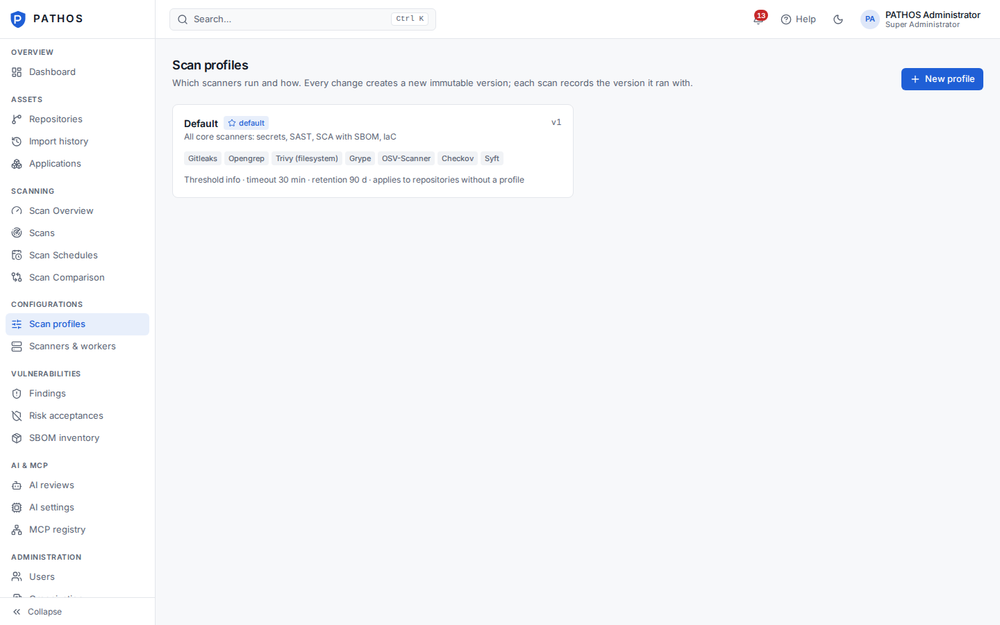

# Security scanning: scanners and profiles

Registering a repository makes it **eligible** for scanning. Scans run in isolated **worker** containers that fetch the code, run the scanners of a **scan profile**, and send normalized results back to PATHOS. Workers never receive platform secrets or a Docker socket.

This page explains *what* a scan does. How to start, schedule, follow and compare scans, scan deployed targets and import results from other tools is in [Running scans](scanning.md). What happens to the results is in [Working with findings](findings.md).

## How repositories enter the scanning pipeline

| Trigger (shown in **Scans → Trigger**) | When | Notes |
|---|---|---|
| `onboarding` | Right after registration, if **Administration → Asset settings → Scan on import** is on **and** *Start onboarding scan* was ticked in the wizard | **Off by default**: without it, importing does not start a scan |
| `manual` | **Start scan** on **Scanning → Scans**, **Scan now** on the repository's **Security** tab, or select repositories in the inventory and choose **Scan** (up to 1,000 at once) | Requires `scans.run`; also runs for repositories excluded from scheduled scans |
| `schedule` | A schedule under **Scanning → Scan Schedules** ([schedules](scanning.md#scan-schedules)) | Requires `schedules.manage`. Repositories marked *Excluded* from scheduled scans are skipped |
| `push`, `merge` | A provider [webhook](provider-integrations.md#webhooks) for a push or merge to the repository's **scan branch** | Pull requests are scanned only when [pull request checks](supply-chain.md#pull-request-checks) are on, and those scans never change the repository's findings |
| `emergency` | A bulk scan requested through the API with `trigger: emergency` (no button in the UI) | Highest queue priority; runs even for repositories excluded from scheduled scans |

Rules:

- **One queued scan per repository.** New triggers join the queued scan (*Already queued*) instead of piling up, and only one execution per repository runs at a time.
- **Archived repositories are never scanned**, nor repositories with scanning disabled on their **Security** tab.
- **Uploaded repositories** are scanned from their **current snapshot**; they cannot be scanned before the first snapshot exists. Push webhooks do not apply to them; upload a new version and scan it.
- **Git repositories** are cloned at scan time from the scan branch (shallow by default, full history if **Full history** was chosen at import).

## Scanners

**Configurations → Scanners & workers** lists the scanner catalog with license, **Availability** (*Available* or *Planned*) and policy (*mandatory*, *optional*, *license-restricted*, *requires build*). Filter with **Available now** to see what runs today; the other catalog entries (for example TruffleHog, Semgrep CE, CodeQL, KICS, ZAP) are planned and **do not run**.

Repository scanners of the `worker-core` image:

| Scanner (key) | Category | What it does in PATHOS |
|---|---|---|
| **Gitleaks** (`gitleaks`) | Secrets | Finds committed secrets such as API keys and passwords. **Mandatory** in every profile. Secret values are **redacted** in reports. Scans the working tree; with **Full history** it scans every commit |
| **Opengrep** (`opengrep`) | SAST | Static analysis with Semgrep-compatible rules: the PATHOS baseline rules, rule sets added by administrators and your [custom rules](#custom-rules). If no rule set is available it reports *no rule sets available* and produces no findings |
| **Trivy (filesystem)** (`trivy-fs`) | SCA | Known vulnerabilities in dependencies declared in lock files and manifests |
| **Syft** (`syft`) | SBOM | Generates a CycloneDX software bill of materials. A utility, not a finding source |
| **Grype** (`grype`) | SCA | Matches the Syft SBOM against vulnerability databases. Needs **Generate an SBOM** in the profile |
| **OSV-Scanner** (`osv-scanner`) | SCA | Checks dependencies against the OSV vulnerability database |
| **Checkov** (`checkov`) | IaC | Misconfiguration checks for Terraform, CloudFormation, Kubernetes, Helm, Dockerfile, ARM, Bicep, Serverless, GitHub Actions, GitLab CI and Azure Pipelines files |
| **actionlint** (`actionlint`) | IaC | GitHub Actions workflow checks (script injection, syntax, types); runs only when the repository has workflows |
| **zizmor** (`zizmor`) | IaC | GitHub Actions workflow security, see [CI/CD workflow security](#cicd-workflow-security) |

Scanners for [scan targets](scanning.md#scan-targets) run only for targets, never for repositories: **Trivy (image)** for container images, **Nuclei** for web applications and APIs, Grype for SBOMs and Trivy for build artifacts.

Application URLs, domains and IP addresses recorded on a repository are metadata only: PATHOS never scans them. Dynamic testing (DAST) runs only against web application and API **scan targets** that someone registered and authorized.

### Scanner plugins

Operators can add a scanner that produces SARIF 2.1.0 without changing PATHOS: they place a definition file in `deploy/scanners.d/` on the worker host and make the tool available in the worker container. When the worker registers, the plugin appears in **Scanners & workers** as *`<name>` (plugin)* and can be added to scan profiles. Its results are normalized, de-duplicated, risk-scored and triaged like any other scanner's. Plugins scan repository source only (not scan targets). Definitions are files on the worker host, never API input, so a PATHOS administrator cannot make workers run arbitrary programs. The file format is described in `docs/SCANNER_CATALOG.md` in the PATHOS repository.

## Scan profiles

**Configurations → Scan profiles** defines what a scan does. The Scanning pages only *use* profiles; they never change them.

- The **default** profile (**Make default**) applies to repositories without a profile of their own; set a different profile per repository on its **Security** tab (**Scan profile**).
- Settings: **Scanners** (Gitleaks always on; plugins of online workers can be added), **Record severities from**, **Generate an SBOM (Syft, CycloneDX). Required by Grype.**, **Mark the scan's security gate as failed when new critical findings appear**, **Timeout (min)**, **Raw report retention (days)**, **Exclusions** (globs such as `vendor/**`).
- Every change creates a new immutable version with a **Change note** (**Version history**). Each scan records the version it ran with; later edits never change it.
- New scanners are not added to existing profiles automatically.
- **Archive** retires a profile.

Managing profiles requires `profiles.manage`.

## Custom rules

**Configurations → Custom rules** holds your own Opengrep (Semgrep-syntax) rules: internal APIs, frameworks and coding standards. Managing them requires `profiles.manage` organization-wide.

- **New rule file**, with **Rules (YAML)** and a **Change note**.
- **Validate** checks a file without running it.
- Every save is a new version (**Versions**).
- Enabled files run in every new scan, and each scan records which versions it used.

## CI/CD workflow security

The **zizmor** scanner audits GitHub Actions workflows and actions in the repository: template injection, dangerous triggers such as `pull_request_target`, unpinned actions, excessive permissions and credential persistence. It works offline and runs only when the repository has workflows. **actionlint** adds syntax, type and script-injection checks. Add them to a scan profile to use them.

## SBOM and SCA

- **SBOM**: when the profile has SBOM enabled, Syft produces a CycloneDX SBOM per scan. **Vulnerabilities → SBOM inventory** lists components from the latest SBOM of each repository with licenses, license-policy result and open vulnerabilities. Export and package health are described in [Supply chain](supply-chain.md).
- **SCA** (software composition analysis): Trivy, Grype and OSV-Scanner report vulnerable dependencies. Findings show the package, installed version, CVE or advisory ID and, if known, the **Fixed version**. The same vulnerability reported by several scanners is merged into one finding (**Detected by** lists the scanners).

## Commit-based tracking

Every scan is tied to an identified source version:

- **Git**: the scan records the commit the worker actually checked out (shown as **Commit** in the latest scan and in the scan details).
- **Upload**: the scan records the **snapshot** (shown as *Snapshot 01a1e5cc…*; ref `snapshot` in the scans list). The repository's **Source → Source snapshots** shows each snapshot's archive SHA-256.

Findings keep a **first seen** date and the commit of the first scan that found them (**First detected at commit**). When a scanner that ran successfully no longer reports a finding, it is set to **Fixed** automatically; if it reappears later it is reopened.

## Offline (air-gapped) operation

PATHOS can run without internet access. With `PATHOS_OFFLINE=true`, workers use only local vulnerability databases (Trivy and Grype never update, OSV-Scanner uses its offline databases) and the intelligence feeds are imported from files on **Administration → Risk & intelligence**. Administrators bring the databases in as an offline bundle (`scripts/offline-bundle.sh`); the procedure is in `docs/AIRGAP.md` in the PATHOS repository. A scanner whose database is missing fails with *offline mode: vulnerability database missing; import an offline bundle*.

**Related APIs.** [Scan configuration](../api-reference/scan-configuration.md) (profiles, scanners, custom rules), [Scans](../api-reference/scans.md), [Worker protocol](../api-reference/worker-protocol.md).
